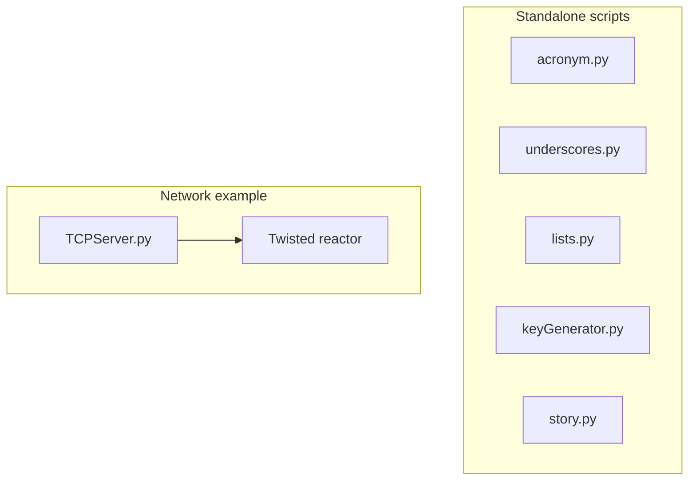

# PyCademy

Standalone Python learning scripts and small exercises — string helpers, list comprehensions, format-string parsing, and a Twisted TCP chat server.

## 🚀 Quick Start

Most scripts run with the system Python or the shared PySuite virtual environment. No extra packages are required except for `TCPServer.py`.

```bash
cd PySuite
just setup-venv          # optional
source venv/bin/activate

cd PyCademy
python acronym.py
python lists.py
python keyGenerator.py
```

For the TCP server example, install Twisted first — see **📋 Prerequisites & Dependencies** below.

### Usage

Run any script directly:

```bash
python acronym.py          # interactive: build an acronym from a phrase
python underscores.py      # interactive: replace spaces with underscores
python lists.py            # list multiplication demo
python keyGenerator.py     # extract {placeholders} from format strings
python story.py            # interactive mad-libs style story builder
python main.py             # minimal PyCharm starter template
```

### Output

Scripts print results to **stdout**. Interactive ones prompt on stdin:

```
Enter a phrase: portable document format
PDF
```

## ✨ Features

- **acronym.py** — Build an uppercase acronym from the first letter of each word
- **underscores.py** — Replace spaces with underscores in a phrase
- **lists.py** — Compare list comprehensions vs. imperative loops for scaling numbers
- **keyGenerator.py** — Parse `{named}` placeholders from Python format strings
- **story.py** — Collect user input and fill a story template from cue keys
- **TCPServer.py** — Multi-client TCP chat server using Twisted (legacy Python 2 syntax)
- **main.py** — Empty starter script for IDE debugging

## 📋 Prerequisites & Dependencies

- Python `3.12+` (most scripts)
- **Twisted** — only for `TCPServer.py` (`pip install twisted`)

| Source | Purpose |
| ------ | ------- |
| [PySuite README](../README.md) | Optional shared `venv/` via root Justfile |
| Script docstrings | Per-file behavior and examples |

No `requirements.txt` lives in this directory; dependencies are minimal and script-specific.

## ⚙️ Build & Configuration

### Build

```bash
cd ..
just setup-venv              # optional shared environment
source venv/bin/activate
cd PyCademy
```

Install Twisted only if you need the TCP server:

```bash
pip install twisted
```

No environment variables or config files are required.

## 📁 Project Layout

```
PyCademy/
├── acronym.py          # Acronym builder (interactive)
├── underscores.py      # Space-to-underscore helper
├── lists.py            # List comprehension vs loop
├── keyGenerator.py     # Format-string key extraction
├── story.py            # Template story with user picks
├── TCPServer.py        # Twisted TCP chat server
├── main.py             # IDE starter template
└── README.md           ← you are here
```

| Script | Run | Notes |
| ------ | --- | ----- |
| `acronym.py` | `python acronym.py` | stdin prompt |
| `lists.py` | `python lists.py` | prints two equivalent results |
| `keyGenerator.py` | `python keyGenerator.py` | includes doctest examples |
| `TCPServer.py` | `python TCPServer.py` | requires Twisted; Python 2-era syntax |

## 🏗️ Architecture



Each file is self-contained with a `if __name__ == "__main__"` block. There is no shared package layer — copy and adapt patterns into your own projects.

### TCPServer protocol

Clients connect via telnet and send colon-delimited commands:

- `iam:<name>` — announce join
- `msg:<text>` — broadcast a message

```bash
telnet localhost 1601
```

## 🧪 Testing

```bash
python keyGenerator.py     # runs embedded doctests when executed
python lists.py              # verify printed output matches
```

Manual checks for interactive scripts: run and enter sample input at the prompt.

## 🛠️ Troubleshooting

**`TCPServer.py` syntax errors on Python 3**

- **Cause:** File uses Python 2 `print` statements
- **Fix:** Run under Python 2, or modernize syntax before executing on Python 3

**Twisted import error**

- **Cause:** Twisted not installed
- **Fix:** `pip install twisted`

| Issue | Fix |
| ----- | --- |
| Script waits with no output | Interactive scripts expect stdin — type input and press Enter |

## 📚 References

### In this repository

| README / Link | Description |
| ------------- | ----------- |
| [PySuite (root)](../README.md) | Monorepo index |
| [PyCore](../PyCore/README.md) | Production utilities (converter, time) |
| [PyPatterns](../PyPatterns/README.md) | Design pattern reference code |

### External Documentation

| Link | Description |
| ---- | ----------- |
| [Twisted](https://twisted.org/) | Event-driven networking engine used by `TCPServer.py` |
| [Python format strings](https://docs.python.org/3/library/string.html#format-string-syntax) | Placeholder syntax used in `keyGenerator.py` / `story.py` |

## 📄 License

[Add your license here]

## 👤 Author

- **Rohtash Lakra** — [@rslakra](https://github.com/rslakra)
