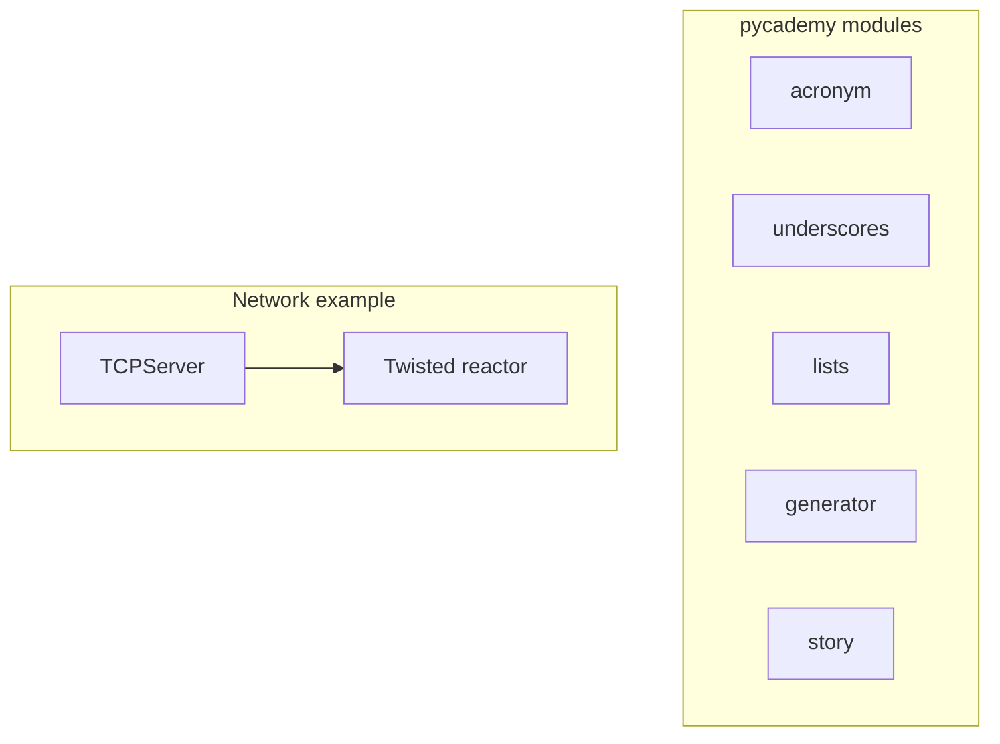

# PyCademy

Standalone Python learning scripts and small exercises — string helpers, list comprehensions, format-string parsing, Jupyter notebooks, and a Twisted TCP chat server.

## 🚀 Quick Start

Install the package once, then run modules with `-m`:

```bash
cd PyCademy
just install-packages
source venv/bin/activate

python -m pycademy.acronym
python -m pycademy.lists
python -m pycademy.generator
```

For the TCP server, Twisted is included via `requirements.txt` — see **📋 Prerequisites & Dependencies** below.

### Usage

```bash
just acronym                         # or: python -m pycademy.acronym
python -m pycademy.underscores       # interactive: replace spaces with underscores
python -m pycademy.lists             # list multiplication demo
python -m pycademy.generator         # extract {placeholders} from format strings
python -m pycademy.story             # interactive mad-libs style story builder
python -m pycademy.main              # minimal PyCharm starter template
jupyter notebook notebooks/Jupyter01Core.ipynb
```

From the repo root: `just pycademy acronym`

### Output

Scripts print results to **stdout**. Interactive ones prompt on stdin:

```
Enter a phrase: portable document format
PDF
```

## ✨ Features

- **pycademy.acronym** — Build an uppercase acronym from the first letter of each word
- **pycademy.underscores** — Replace spaces with underscores in a phrase
- **pycademy.lists** — Compare list comprehensions vs. imperative loops for scaling numbers
- **pycademy.generator** — Parse `{named}` placeholders from Python format strings
- **pycademy.story** — Collect user input and fill a story template from cue keys
- **pycademy.TCPServer** — Multi-client TCP chat server using Twisted (legacy Python 2 syntax)
- **pycademy.main** — Empty starter script for IDE debugging
- **notebooks/** — Notebook exercises (`Jupyter01Core.ipynb`)

## 📋 Prerequisites & Dependencies

- Python `3.12+` (most scripts)
- **Twisted** — only for `TCPServer.py`

| Source | Purpose |
| ------ | ------- |
| [`requirements.txt`](requirements.txt) | Editable install (`-e .`) plus Twisted for `TCPServer` |
| [PySuite README](../README.md) | Optional shared `venv/` via root Justfile |

### Install

```bash
just install-packages    # pip install -e ".[network]"
```

## ⚙️ Build & Configuration

### Build

```bash
cd PyCademy
just install-packages
source venv/bin/activate
python -m pycademy.acronym
```

Scripts live under **`src/pycademy/`**. After editable install, run with `python -m pycademy.<module>`.

No environment variables or config files are required.

## 📁 Project Layout

```
PyCademy/
├── src/
│   └── pycademy/
│       ├── acronym.py
│       ├── underscores.py
│       ├── lists.py
│       ├── generator.py
│       ├── story.py
│       ├── TCPServer.py
│       └── main.py
├── notebooks/
│   ├── Jupyter01Core.ipynb
│   └── README.md
├── pyproject.toml
├── requirements.txt      # -e . + twisted
├── Justfile
└── README.md             ← you are here
```

| Module | Run | Notes |
| ------ | --- | ----- |
| `pycademy.acronym` | `python -m pycademy.acronym` | stdin prompt |
| `pycademy.lists` | `python -m pycademy.lists` | prints two equivalent results |
| `pycademy.generator` | `python -m pycademy.generator` | includes doctest examples |
| `pycademy.TCPServer` | `python -m pycademy.TCPServer` | requires Twisted; Python 2-era syntax |

## 🏗️ Architecture



Each module is self-contained with an `if __name__ == "__main__"` block (except `TCPServer`, which runs at import time).

### TCPServer protocol

Clients connect via telnet and send colon-delimited commands:

- `iam:<name>` — announce join
- `msg:<text>` — broadcast a message

```bash
telnet localhost 1601
```

## 🧪 Testing

```bash
python -m pycademy.generator     # runs embedded doctests when executed
python -m pycademy.lists       # verify printed output matches
```

Manual checks for interactive scripts: run and enter sample input at the prompt.

## 🛠️ Troubleshooting

**`TCPServer.py` syntax errors on Python 3**

- **Cause:** File uses Python 2 `print` statements
- **Fix:** Run under Python 2, or modernize syntax before executing on Python 3

**Twisted import error**

- **Cause:** Twisted not installed
- **Fix:** `just install-packages` or `pip install -e ".[network]"`

| Issue | Fix |
| ----- | --- |
| Script waits with no output | Interactive scripts expect stdin — type input and press Enter |

## 📚 References

### In this repository

| README / Link | Description |
| ------------- | ----------- |
| [PySuite (root)](../README.md) | Monorepo index |
| [PyCore](../PyCore/README.md) | Production utilities |
| [PyPatterns](../PyPatterns/README.md) | Design pattern reference code |
| [notebooks/README.md](notebooks/README.md) | Notebook exercises |

### External Documentation

| Link | Description |
| ---- | ----------- |
| [Twisted](https://twisted.org/) | Event-driven networking engine |
| [Python format strings](https://docs.python.org/3/library/string.html#format-string-syntax) | Placeholder syntax in `generator.py` / `story.py` |

## 📄 License

[Add your license here]

## 👤 Author

- **Rohtash Lakra** — [@rslakra](https://github.com/rslakra)
