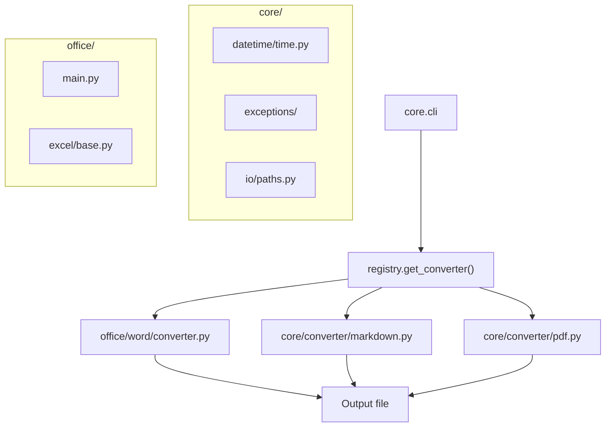

# PyCore

Self-contained Python core library and CLI: document conversion (markdown, Word, PDF), UTC/TAI time utilities, HTTP-style exceptions, path/I/O helpers, and office/Excel tooling.

## 🚀 Quick Start

```bash
cd PyCore
just setup-venv
source venv/bin/activate
just install-packages

just list
just convert -i README.md
```

For prerequisites and dependency details, see **📋 Prerequisites & Dependencies** and **⚙️ Build & Configuration** below.

### Usage

Document converter (`core.cli`):

```bash
python -m core.cli -h
python -m core.cli --list
python -m core.cli -i report.pdf --out report.docx
python -m core.cli -i notes.docx pdf
python cli.py -i notes.docx pdf          # root shim
just convert -i README.md
just convert -i /path/to/notes.docx md
just convert-to /path/to/notes.docx md
```

Office tooling (`office.main`):

```bash
just office --help
just office export path/to/workbook.xlsx -o output_dir/
just office roster list
python -m office.main --help
```

Time utilities demo:

```bash
just time-demo
# or: python -m core.datetime.time
```

HTTP exceptions:

```python
from core.exceptions import NotFoundException, exception_for_status

raise NotFoundException("User 42 not found")
exc = exception_for_status(404)
```

### Output

Converted documents are written to `--out` when given, or **next to the input** using a trailing format (`pdf`, `md`, …), `-f` / `--format`, or the default format for that input type:

| Input | Default output |
| ----- | -------------- |
| `.md` / `.markdown` | `.docx` |
| `.pdf` | `.docx` |
| `.docx` | `.md` |

Example: `just convert -i README.md` creates `README.docx` beside `README.md`.

Office `export` writes one NDJSON (or pretty JSON) file per Excel sheet to the output directory (stdout lists each path).

## ✨ Features

- **Document converter** — Markdown, Word (`.docx`), and PDF via `core.cli` and a registry-based converter pipeline
- **Time utilities** — UTC/TAI conversion and leap-second handling via `TimeUtils`
- **HTTP exceptions** — Typed 4xx/5xx exception classes (`ClientException`, `ServerException`, and children)
- **Context stack** — Thread-local `ContextStack` / `Context` for scoped variables (`core/context.py`)
- **Path & I/O helpers** — `PathUtils`, `FileUtils`, and related utilities under `core/io/`
- **Office tooling** — Excel export and roster CLI under `office/`
- **Excel helpers** — Filename sanitization and type-hint enums in `office/excel/base.py`

## 📋 Prerequisites & Dependencies

- Python `3.12+`
- [Just](https://github.com/casey/just) (optional — task runner for venv, convert, office, etc.)
- **Microsoft Word** (macOS or Windows only) — required for `docx → pdf` via `docx2pdf`

| Source | Purpose |
| ------ | ------- |
| [`pyproject.toml`](pyproject.toml) | Package metadata and runtime deps — `pip install -e .` |
| [`requirements.txt`](requirements.txt) | Shorthand for editable install (`-e .`) |

Packages: `leapseconddata`, `python-docx`, `markdown`, `pdf2docx`, `docx2pdf`, `pandas`, `openpyxl`.

### Installing Just

```bash
# macOS
brew install just

# Linux
curl --proto '=https' --tlsv1.2 -sSf https://just.systems/install.sh | bash -s -- --to ~/bin
```

## ⚙️ Build & Configuration

### Build

```bash
just setup-venv
source venv/bin/activate
just install-packages    # pip install -e . (src layout)
```

Library code lives under **`src/`** (`core`, `office`, `models`). After editable install, import with `from core...` / `from office...`.

No `.env` file is required. Configuration is via CLI flags.

### Supported conversions

| From | To |
| ---- | -- |
| `.md` / `.markdown` | `.docx` |
| `.docx` | `.md` / `.markdown` / `.pdf` |
| `.pdf` | `.docx` |

### CLI flags (converter)

| Flag / form | Purpose |
| ----------- | ------- |
| `-i` / `--input PATH` | Input file |
| `FORMAT` (trailing) | Target format — e.g. `just convert -i file.docx pdf` |
| `-f` / `--format FORMAT` | Explicit format |
| `--out PATH` | Explicit output file path |
| `--list` | Supported conversion pairs |

### Just commands

Run from **PyCore/** (or `just pycore <command>` from the repo root):

| Command | Description |
| ------- | ----------- |
| `just setup-venv` | Create local `venv/` |
| `just install-packages` | Install from `requirements.txt` |
| `just list` | Show supported document conversions |
| `just convert -i FILE pdf` | Convert to a format (trailing argument) |
| `just convert -i FILE -f pdf` | Same, with explicit `--format` |
| `just convert -i FILE --out OUT` | Convert with explicit output path |
| `just convert-to FILE md` | Shorthand: input + target format |
| `just cli-help` | Show `core.cli` help |
| `just test` | Run `pytest tests/` |
| `just office ARGS...` | Run `office/main.py` (export, roster, …) |
| `just time-demo` | Run UTC/TAI time utilities demo |
| `just clean` | Remove virtual environment |
| `just help` | Show PyCore commands |

## 📁 Project Layout

```
PyCore/
├── pyproject.toml              # pip install -e .
├── cli.py                      # Shim → core.cli
├── requirements.txt
├── Justfile
├── src/
│   ├── core/                   # import core.*
│   │   ├── cli.py              # Document converter CLI
│   │   ├── context.py
│   │   ├── converter/
│   │   ├── datetime/
│   │   ├── exceptions/
│   │   └── io/
│   ├── office/                 # import office.*
│   │   ├── main.py
│   │   └── word/converter.py
│   └── models/
├── tests/
│   └── test_context.py
└── README.md                   ← you are here
```

| Module | Purpose |
| ------ | ------- |
| `core/converter/registry.py` | Maps source/dest extensions to converter classes |
| `office/word/converter.py` | Markdown → Word, PDF → Word |
| `core/converter/markdown.py` | Word → markdown |
| `core/converter/pdf.py` | Word → PDF |
| `core/datetime/time.py` | Leap-second-aware UTC/TAI conversions |
| `core/context.py` | Thread-local context stack with inheritance |
| `core/exceptions/` | `ClientException`, `ServerException`, HTTP status subclasses |
| `office/main.py` | Excel export and agent roster CLI |

## 🏗️ Architecture



Each converter implements `AbstractConverter` with `source_extensions`, `dest_extensions`, and `convert(source, destination)`.

### Time utilities

```python
from core.datetime.time import TimeUtils

utc_time = TimeUtils.now()
leap_seconds = TimeUtils.get_leap_seconds(utc_time)
tai_time = TimeUtils.to_tai(utc_time)
utc_time = TimeUtils.from_tai(tai_time)
```

Uses `leapseconddata` for IERS-aligned leap-second offsets.

### HTTP exceptions

```python
from core.exceptions import NotFoundException, exception_for_status, HTTP_EXCEPTIONS

raise NotFoundException()
raise NotFoundException("Resource missing")

exc = exception_for_status(503)  # → ServiceUnavailableException
```

Hierarchy: `BaseException` → `HTTPException` → `ClientException` / `ServerException` → specific `*Exception` per status code.

## 🧪 Testing

```bash
source venv/bin/activate
just list
python cli.py -i README.md --out /tmp/test.docx
just time-demo
just office --help

python -c "from core.exceptions import HTTP_EXCEPTIONS; assert len(HTTP_EXCEPTIONS) == 13"

pip install -e ../PyTests && just test
```

Shared monorepo tests live in [PyTests/](../PyTests/) — see [PyTests/README.md](../PyTests/README.md).

## 🛠️ Troubleshooting

**`docx → pdf` fails or Word opens**

- **Cause:** `docx2pdf` automates Microsoft Word on macOS/Windows
- **Fix:** Install Word, or convert via markdown instead

**`Unsupported conversion` error**

- **Cause:** Source and destination extensions are not paired in the registry
- **Fix:** Run `just list` and use a supported pair

**`ModuleNotFoundError: core`**

- **Cause:** Commands run outside `PyCore/` without `PYTHONPATH`
- **Fix:** Run from `PyCore/`, or `source venv/bin/activate` first

| Issue | Fix |
| ----- | --- |
| Missing libraries | `just install-packages` |
| `office/main.py` import errors | Run via `just office` (bootstraps `sys.path`) |

## 📚 References

### In this repository

| README / Link | Description |
| ------------- | ----------- |
| [PySuite (root)](../README.md) | Monorepo index |
| [office/README.md](office/README.md) | Office/Excel export and roster tooling |
| [PyTests](../PyTests/README.md) | Shared test package |

### External Documentation

| Link | Description |
| ---- | ----------- |
| [Just](https://github.com/casey/just) | Task runner |
| [python-docx](https://python-docx.readthedocs.io/) | Word read/write |
| [leapseconddata](https://pypi.org/project/leapseconddata/) | Leap second data |

## 📄 License

[Add your license here]

## 👤 Author

- **Rohtash Lakra** — [@rslakra](https://github.com/rslakra)
