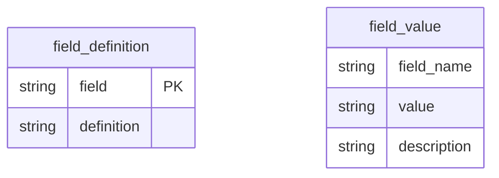

# PoCSuite — Vestwell sample data and tooling

This repository holds shared utilities (`common/`), the Vestwell tenant (`tenants/vestwell/`) with sample inputs and scripts, and a root **`main.py`** CLI. The sections below describe layout, how the pieces relate, and how to run what is here.

## Project layout

Paths are relative to the **PoCSuite** repository root (this directory).

```
PoCSuite/
├── README.md                 ← this file
├── main.py                   # unified CLI (export + roster subcommands)
├── requirements.txt
├── common/
│   └── utils/
│       ├── excel.py
│       └── ioutils.py
└── tenants/
    └── vestwell/
        ├── agent_roster_handler.py   # AgentRoster + CLI (dim_agent-style sheets / merges)
        ├── platform_data_handler.py  # CLI + API: workbook → NDJSON per sheet
        ├── models/                   # small data types (DimAgentRecord, field guide rows)
        │   ├── __init__.py
        │   ├── agent_roster.py
        │   └── platform_data.py
        └── data/
            ├── Platform Data/
            │   └── Sample Data For Invisible.xlsx
            ├── Agent Roster/
            │   └── dim_agents - VW Agent Roster_ Source of Truth.xlsx
            └── json/                 # NDJSON exports (Spark-friendly)
                ├── Sponsor Record Test.json
                ├── Participant Record Test.json
                ├── Loan Record Test.json
                ├── Rollover Record Test.json
                ├── Withdrawal Record Test.json
                ├── Field Definitions.json
                ├── Field Values Guide.json
                └── Field Values Guide enums/*.json
```

Dependencies for the Python scripts are declared at **`requirements.txt`** (`pandas`, `openpyxl`).

## Create virtual env and install dependencies

From the **PoCSuite** repo root:

```shell
python3 -m venv venv
source venv/bin/activate
pip install --upgrade pip
pip install -r requirements.txt
```

## Python tools

Paths below assume the **PoCSuite** repo root; adjust if you run from another working directory.

### `main.py` — unified CLI

Repo-root **`main.py`** fronts **`tenants.vestwell.platform_data_handler`** (Excel → JSON) and **`tenants/vestwell/agent_roster_handler.py`** (roster sheets). It prepends the **repo root** to `sys.path`, so you do not need **`PYTHONPATH`** for these invocations.

**Command shape**

| Invocation | What it does |
|------------|----------------|
| `python main.py export …` | One NDJSON (or pretty JSON) file per workbook sheet |
| `python main.py roster list …` | Print sheet names |
| `python main.py roster merge …` | Concatenate sheets, dedupe by key → CSV or JSON file |
| `python main.py roster merge-join …` | Successive merges on a key → CSV or JSON file |
| `python main.py roster peek …` | Preview rows from one sheet as CSV |

**Default roster workbook** (any `roster` subcommand when `-w` / `--workbook` is omitted):  
`tenants/vestwell/data/Agent Roster/dim_agents - VW Agent Roster_ Source of Truth.xlsx`.

**Discover every flag** (argparse help):

```shell
python main.py --help
python main.py export --help
python main.py roster --help
python main.py roster list --help
python main.py roster merge --help
python main.py roster merge-join --help
python main.py roster peek --help
```

#### `main.py export`

| Argument | Required | Description |
|----------|----------|-------------|
| `xlsx` | yes | Path to the `.xlsx` workbook |
| `-o`, `--output-dir` | no | Output directory (default: `<xlsx_stem>_json` next to the workbook) |
| `--pretty` | flag | Pretty JSON arrays per file instead of NDJSON (one object per line) |

**Behavior:** Prints each output file path to stdout. Refuses Excel lock files whose name starts with `~$` (exit code 2). **Field Values Guide** sheets are handled like `platform_data_handler.py` (including split files under `Field Values Guide enums/`).

```shell
python main.py export \
  "tenants/vestwell/data/Platform Data/Sample Data For Invisible.xlsx" \
  -o tenants/vestwell/data/json
```

#### `main.py roster list`

| Argument | Required | Description |
|----------|----------|-------------|
| `-w`, `--workbook` | no | Roster `.xlsx` (default: bundled Source of Truth) |

```shell
python main.py roster list
python main.py roster list -w "/path/to/roster.xlsx"
```

#### `main.py roster merge`

Stack sheets then **`drop_duplicates`** on **`--dedupe-key`** (same as `AgentRoster.merge_records`).

| Argument | Required | Description |
|----------|----------|-------------|
| `sheets` | no | Zero or more sheet names (positional). If omitted, only **`dim_agent`** |
| `-w`, `--workbook` | no | Roster `.xlsx` (default: bundled Source of Truth) |
| `-o`, `--output` | no | **`--format csv`:** path (default: **stdout**). **`--format json`:** path (default: **`<workbook_stem>_merged.json`** beside the workbook) |
| `--format` | no | **`csv`** (default) or **`json`** (NDJSON unless `--pretty`) |
| `--pretty` | flag | With **`--format json`**, one pretty JSON array instead of NDJSON |
| `--dedupe-key` | no | Column for deduplication (default: **`zendesk_agent_id`**) |
| `--keep` | no | **`first`** or **`last`** when keys repeat (default: **`last`**) |

**JSON mode:** Writes the file, then prints the resolved output path to stdout.

```shell
python main.py roster merge dim_agent "2-26 update dim_agent" -o /tmp/roster_merged.csv
python main.py roster merge --format json dim_agent "2-26 update dim_agent" -o /tmp/roster_merged.json
python main.py roster merge --format json dim_agent
```

#### `main.py roster merge-join`

Successive **`pandas.merge`** on **`--on`** (same as `AgentRoster.merge_join`).

| Argument | Required | Description |
|----------|----------|-------------|
| `sheets` | no | Sheet names (positional). If omitted, only **`dim_agent`** |
| `-w`, `--workbook` | no | Roster `.xlsx` (default: bundled Source of Truth) |
| `-o`, `--output` | no | **`csv`:** default **stdout**. **`json`:** default **`<workbook_stem>_merge_join.json`** beside the workbook |
| `--format` | no | **`csv`** (default) or **`json`** |
| `--pretty` | flag | With **`--format json`**, pretty JSON array |
| `--on` | no | Merge key column (default: **`zendesk_agent_id`**) |
| `--how` | no | **`left`**, **`right`**, **`outer`**, **`inner`**, or **`cross`** (default: **`outer`**) |

```shell
python main.py roster merge-join dim_agent "2-26 update dim_agent" -o /tmp/roster_joined.csv
python main.py roster merge-join --format json dim_agent -o /tmp/roster_joined.json
```

#### `main.py roster peek`

Load one sheet (auto header row for dim_agent-style layout unless **`--header-row`** is set), show the first **`--rows`** rows as CSV.

| Argument | Required | Description |
|----------|----------|-------------|
| `sheet` | yes | Sheet name, e.g. **`dim_agent`** |
| `-w`, `--workbook` | no | Roster `.xlsx` (default: bundled Source of Truth) |
| `-o`, `--output` | no | CSV path (default: **stdout**) |
| `--rows` | no | Number of data rows (default: **`10`**) |
| `--header-row` | no | 0-based Excel header row; omit for auto-detect |

```shell
python main.py roster peek dim_agent --rows 5
```

### Direct scripts (optional)

Same behavior as above, without going through **`main.py`**.

#### `tenants/vestwell/platform_data_handler.py`

| Argument | Required | Description |
|----------|----------|-------------|
| `xlsx` | yes | Workbook path |
| `-o`, `--output-dir` | no | Output directory (default: `<xlsx_stem>_json` next to workbook) |
| `--pretty` | flag | Pretty JSON arrays instead of NDJSON |

```shell
python tenants/vestwell/platform_data_handler.py --help
python tenants/vestwell/platform_data_handler.py \
  "tenants/vestwell/data/Platform Data/Sample Data For Invisible.xlsx" \
  -o tenants/vestwell/data/json
```

#### `tenants/vestwell/agent_roster_handler.py`

Full **`AgentRoster`** implementation and CLI (merge, merge-join, list, peek). Run as a file or import from code (see below).

| Argument | Required | Description |
|----------|----------|-------------|
| `sheets` | no | Zero or more sheet names (positional). If omitted, only **`dim_agent`** |
| `-w`, `--workbook` | no | Roster `.xlsx` (default: bundled Source of Truth under `data/Agent Roster/`) |
| `-o`, `--output` | no | Output **`.json`** (default: **`<workbook_stem>_merged.json`** beside workbook) |
| `--pretty` | flag | One pretty JSON array instead of NDJSON |
| `--dedupe-key` | no | Column after concat (default: **`zendesk_agent_id`**) |
| `--keep` | no | **`first`** or **`last`** (default: **`last`**) |

Writes the file, prints the resolved path to stdout.

```shell
python tenants/vestwell/agent_roster_handler.py --help
python tenants/vestwell/agent_roster_handler.py -o /tmp/merged.json dim_agent "2-26 update dim_agent"
python tenants/vestwell/agent_roster_handler.py --pretty dim_agent
```

**API (merge-join JSON):** `AgentRoster.write_merged_join_json`. **Convenience:** `write_merged_roster_json` wraps **`write_merged_records_json`**.

```python
from importlib.util import spec_from_file_location, module_from_spec
from pathlib import Path

p = Path("tenants/vestwell/agent_roster_handler.py")
spec = spec_from_file_location("agent_roster_handler", p)
mod = module_from_spec(spec)
spec.loader.exec_module(mod)

with mod.AgentRoster() as roster:
    roster.write_merged_records_json(
        "dim_agent", "2-26 update dim_agent", output_path="/tmp/out.json"
    )
```

### Packages — `common/` and `tenants/vestwell/`

- **`common/`** (repo root) — shared code: e.g. `common.utils.excel`, `common.utils.ioutils`. Put the **PoCSuite repo root** on `PYTHONPATH` (or run from it) for `import common`.
- **`tenants/vestwell/`** — tenant scripts and **`tenants.vestwell.models`** (`DimAgentRecord`, field guide row types). Same repo root on `PYTHONPATH` enables `from tenants.vestwell.platform_data_handler import export_workbook` and similar.

## Optional: Jupyter

```shell
pip install notebook
jupyter notebook
```

## How the JSON maps to columns

Exports produced by **`platform_data_handler.py`** from **`Sample Data For Invisible.xlsx`** (e.g. under **`tenants/vestwell/data/Platform Data/json/`**) use **one NDJSON object per data row**, with JSON keys equal to the **logical column names** from the workbook (the row under the Excel type-hint row: `SPONSOR_PLAN_ID`, `PARTICIPANT_ID`, …). Type hints (`INTEGER`, `STRING`, …) stay in Excel only; they are not written into the JSON.

Other shapes in the same export:

- **`Field Definitions.json`** — each line is `field`, `definition` (header row `Field` / `Definition` is applied in the exporter, not repeated as a data row).
- **`Field Values Guide.json`** — `field_name`, `value`, `description` on every line.
- **`Field Values Guide enums/*.json`** — same columns as the guide, **one file per** `field_name`.

Older copies of NDJSON built before this layout may still show the **type-key / header-row** pattern (first object holds column names, keys are `INTEGER`, `STRING`, …); re-run **`main.py export`** or **`platform_data_handler.py`** to refresh.

## Core ER diagram (plans, participants, sub-ledgers)

Color-coded flowchart: each entity is a **two-column table** (field name · logical type / PK / FK). This uses Mermaid `htmlLabels`; GitHub, Mermaid Live, and recent VS Code/Cursor previews render it. If you see raw HTML, turn on HTML labels in your Mermaid version or open the diagram in [Mermaid Live Editor](https://mermaid.live).

```mermaid
%%{init: {
  "flowchart": {
    "htmlLabels": true,
    "curve": "basis",
    "nodeSpacing": 52,
    "rankSpacing": 60,
    "padding": 24
  },
  "themeVariables": {
    "fontSize": "18px",
    "fontFamily": "system-ui, -apple-system, 'Segoe UI', sans-serif"
  }
}}%%
flowchart TB
  SP["<table style='border-collapse:collapse;font-size:15px;text-align:left'><tr><th colspan='2' style='background:#1565C0;color:#fff;padding:8px 12px'>sponsor_plan</th></tr><tr style='background:#E3F2FD'><th style='border:1px solid #1565C0;padding:5px 10px'>Field</th><th style='border:1px solid #1565C0;padding:5px 10px'>Type / key</th></tr><tr><td style='border:1px solid #90CAF9;padding:5px 10px'>SPONSOR_PLAN_ID</td><td style='border:1px solid #90CAF9;padding:5px 10px'>PK · int</td></tr><tr><td style='border:1px solid #90CAF9;padding:5px 10px'>COMPANY_NAME</td><td style='border:1px solid #90CAF9;padding:5px 10px'>string</td></tr><tr><td style='border:1px solid #90CAF9;padding:5px 10px'>PLAN_STATUS</td><td style='border:1px solid #90CAF9;padding:5px 10px'>string</td></tr><tr><td style='border:1px solid #90CAF9;padding:5px 10px'>ONBOARDING_TYPE</td><td style='border:1px solid #90CAF9;padding:5px 10px'>string</td></tr><tr><td style='border:1px solid #90CAF9;padding:5px 10px'>PAYROLL_INFO</td><td style='border:1px solid #90CAF9;padding:5px 10px'>json</td></tr><tr><td style='border:1px solid #90CAF9;padding:5px 10px'>CURRENT_PLAN_BALANCE</td><td style='border:1px solid #90CAF9;padding:5px 10px'>float</td></tr><tr><td style='border:1px solid #90CAF9;padding:5px 10px'>NEXT_EXPECTED_PAY_DATE</td><td style='border:1px solid #90CAF9;padding:5px 10px'>date</td></tr><tr><td style='border:1px solid #90CAF9;padding:5px 10px'>…</td><td style='border:1px solid #90CAF9;padding:5px 10px'>other sponsor columns</td></tr></table>"]
  PT["<table style='border-collapse:collapse;font-size:15px;text-align:left'><tr><th colspan='2' style='background:#2E7D32;color:#fff;padding:8px 12px'>participant</th></tr><tr style='background:#E8F5E9'><th style='border:1px solid #2E7D32;padding:5px 10px'>Field</th><th style='border:1px solid #2E7D32;padding:5px 10px'>Type / key</th></tr><tr><td style='border:1px solid #A5D6A7;padding:5px 10px'>PARTICIPANT_ID</td><td style='border:1px solid #A5D6A7;padding:5px 10px'>PK · int</td></tr><tr><td style='border:1px solid #A5D6A7;padding:5px 10px'>SPONSOR_PLAN_ID</td><td style='border:1px solid #A5D6A7;padding:5px 10px'>FK · int</td></tr><tr><td style='border:1px solid #A5D6A7;padding:5px 10px'>PERSONAL_EMAIL</td><td style='border:1px solid #A5D6A7;padding:5px 10px'>string</td></tr><tr><td style='border:1px solid #A5D6A7;padding:5px 10px'>WORK_EMAIL</td><td style='border:1px solid #A5D6A7;padding:5px 10px'>string</td></tr><tr><td style='border:1px solid #A5D6A7;padding:5px 10px'>USER_EMAIL</td><td style='border:1px solid #A5D6A7;padding:5px 10px'>string</td></tr><tr><td style='border:1px solid #A5D6A7;padding:5px 10px'>PHONE</td><td style='border:1px solid #A5D6A7;padding:5px 10px'>string</td></tr><tr><td style='border:1px solid #A5D6A7;padding:5px 10px'>ELIGIBILITY_STATUS</td><td style='border:1px solid #A5D6A7;padding:5px 10px'>string</td></tr><tr><td style='border:1px solid #A5D6A7;padding:5px 10px'>CURRENT_BALANCE</td><td style='border:1px solid #A5D6A7;padding:5px 10px'>float</td></tr><tr><td style='border:1px solid #A5D6A7;padding:5px 10px'>BIRTH_DATE</td><td style='border:1px solid #A5D6A7;padding:5px 10px'>date</td></tr><tr><td style='border:1px solid #A5D6A7;padding:5px 10px'>STATE</td><td style='border:1px solid #A5D6A7;padding:5px 10px'>string</td></tr><tr><td style='border:1px solid #A5D6A7;padding:5px 10px'>PRETAX_CONTRIBUTION_AMOUNT</td><td style='border:1px solid #A5D6A7;padding:5px 10px'>float</td></tr><tr><td style='border:1px solid #A5D6A7;padding:5px 10px'>PRETAX_CONTRIBUTION_RATE</td><td style='border:1px solid #A5D6A7;padding:5px 10px'>float</td></tr><tr><td style='border:1px solid #A5D6A7;padding:5px 10px'>ROTH_CONTRIBUTION_AMOUNT</td><td style='border:1px solid #A5D6A7;padding:5px 10px'>float</td></tr><tr><td style='border:1px solid #A5D6A7;padding:5px 10px'>ROTH_CONTRIBUTION_RATE</td><td style='border:1px solid #A5D6A7;padding:5px 10px'>float</td></tr><tr><td style='border:1px solid #A5D6A7;padding:5px 10px'>PARTICIPANT_INVESTMENT_ELECTION_TYPE</td><td style='border:1px solid #A5D6A7;padding:5px 10px'>string</td></tr><tr><td style='border:1px solid #A5D6A7;padding:5px 10px'>DEFERRAL_ELECTION_TYPE</td><td style='border:1px solid #A5D6A7;padding:5px 10px'>string</td></tr></table>"]
  LN["<table style='border-collapse:collapse;font-size:15px;text-align:left'><tr><th colspan='2' style='background:#E65100;color:#fff;padding:8px 12px'>loan</th></tr><tr style='background:#FFF3E0'><th style='border:1px solid #E65100;padding:5px 10px'>Field</th><th style='border:1px solid #E65100;padding:5px 10px'>Type / key</th></tr><tr><td style='border:1px solid #FFCC80;padding:5px 10px'>PARTICIPANT_ID</td><td style='border:1px solid #FFCC80;padding:5px 10px'>FK · int</td></tr><tr><td style='border:1px solid #FFCC80;padding:5px 10px'>SPONSOR_PLAN_ID</td><td style='border:1px solid #FFCC80;padding:5px 10px'>FK · int</td></tr><tr><td style='border:1px solid #FFCC80;padding:5px 10px'>LOAN_ID</td><td style='border:1px solid #FFCC80;padding:5px 10px'>PK · int</td></tr><tr><td style='border:1px solid #FFCC80;padding:5px 10px'>ORIGINATION_DATE</td><td style='border:1px solid #FFCC80;padding:5px 10px'>date</td></tr><tr><td style='border:1px solid #FFCC80;padding:5px 10px'>LAST_EXPECTED_PAYMENT_DATE</td><td style='border:1px solid #FFCC80;padding:5px 10px'>date</td></tr><tr><td style='border:1px solid #FFCC80;padding:5px 10px'>LOAN_AMOUNT</td><td style='border:1px solid #FFCC80;padding:5px 10px'>float</td></tr><tr><td style='border:1px solid #FFCC80;padding:5px 10px'>STATUS</td><td style='border:1px solid #FFCC80;padding:5px 10px'>string</td></tr></table>"]
  RO["<table style='border-collapse:collapse;font-size:15px;text-align:left'><tr><th colspan='2' style='background:#006064;color:#fff;padding:8px 12px'>rollover</th></tr><tr style='background:#E0F7FA'><th style='border:1px solid #006064;padding:5px 10px'>Field</th><th style='border:1px solid #006064;padding:5px 10px'>Type / key</th></tr><tr><td style='border:1px solid #80DEEA;padding:5px 10px'>PARTICIPANT_ID</td><td style='border:1px solid #80DEEA;padding:5px 10px'>FK · int</td></tr><tr><td style='border:1px solid #80DEEA;padding:5px 10px'>SPONSOR_PLAN_ID</td><td style='border:1px solid #80DEEA;padding:5px 10px'>FK · int</td></tr><tr><td style='border:1px solid #80DEEA;padding:5px 10px'>ROLLOVER_ID</td><td style='border:1px solid #80DEEA;padding:5px 10px'>PK · int</td></tr><tr><td style='border:1px solid #80DEEA;padding:5px 10px'>PRE_TAX_AMOUNT</td><td style='border:1px solid #80DEEA;padding:5px 10px'>float</td></tr><tr><td style='border:1px solid #80DEEA;padding:5px 10px'>ROTH_AMOUNT</td><td style='border:1px solid #80DEEA;padding:5px 10px'>float</td></tr><tr><td style='border:1px solid #80DEEA;padding:5px 10px'>STATUS</td><td style='border:1px solid #80DEEA;padding:5px 10px'>string</td></tr><tr><td style='border:1px solid #80DEEA;padding:5px 10px'>CREATED_AT</td><td style='border:1px solid #80DEEA;padding:5px 10px'>timestamp</td></tr></table>"]
  WD["<table style='border-collapse:collapse;font-size:15px;text-align:left'><tr><th colspan='2' style='background:#AD1457;color:#fff;padding:8px 12px'>withdrawal</th></tr><tr style='background:#FCE4EC'><th style='border:1px solid #AD1457;padding:5px 10px'>Field</th><th style='border:1px solid #AD1457;padding:5px 10px'>Type / key</th></tr><tr><td style='border:1px solid #F48FB1;padding:5px 10px'>PARTICIPANT_ID</td><td style='border:1px solid #F48FB1;padding:5px 10px'>FK · int</td></tr><tr><td style='border:1px solid #F48FB1;padding:5px 10px'>SPONSOR_PLAN_ID</td><td style='border:1px solid #F48FB1;padding:5px 10px'>FK · int</td></tr><tr><td style='border:1px solid #F48FB1;padding:5px 10px'>WITHDRAWAL_ID</td><td style='border:1px solid #F48FB1;padding:5px 10px'>PK · int</td></tr><tr><td style='border:1px solid #F48FB1;padding:5px 10px'>WITHDRAWAL_REASON</td><td style='border:1px solid #F48FB1;padding:5px 10px'>string</td></tr><tr><td style='border:1px solid #F48FB1;padding:5px 10px'>CREATED_AT</td><td style='border:1px solid #F48FB1;padding:5px 10px'>timestamp</td></tr><tr><td style='border:1px solid #F48FB1;padding:5px 10px'>STATUS</td><td style='border:1px solid #F48FB1;padding:5px 10px'>string</td></tr><tr><td style='border:1px solid #F48FB1;padding:5px 10px'>WITHDRAWAL_AMOUNT</td><td style='border:1px solid #F48FB1;padding:5px 10px'>float</td></tr></table>"]

  SP ==>|SPONSOR_PLAN_ID| PT
  SP ==>|SPONSOR_PLAN_ID| LN
  PT ==>|PARTICIPANT_ID| LN
  SP ==>|SPONSOR_PLAN_ID| RO
  PT ==>|PARTICIPANT_ID| RO
  SP ==>|SPONSOR_PLAN_ID| WD
  PT ==>|PARTICIPANT_ID| WD

  classDef sponsor fill:#90CAF9,stroke:#0D47A1,stroke-width:4px,color:#01579B
  classDef people fill:#A5D6A7,stroke:#1B5E20,stroke-width:4px,color:#1B5E20
  classDef loan fill:#FFCC80,stroke:#E65100,stroke-width:4px,color:#E65100
  classDef rollover fill:#80DEEA,stroke:#006064,stroke-width:4px,color:#004D40
  classDef withdrawal fill:#F48FB1,stroke:#AD1457,stroke-width:4px,color:#880E4F

  class SP sponsor
  class PT people
  class LN loan
  class RO rollover
  class WD withdrawal

  linkStyle default stroke:#37474F,stroke-width:3px
```



**Join summary**

| From | To | Join |
|------|-----|------|
| `participant` | `sponsor_plan` | `participant.SPONSOR_PLAN_ID = sponsor_plan.SPONSOR_PLAN_ID` |
| `loan` | `participant` | `loan.PARTICIPANT_ID = participant.PARTICIPANT_ID` **and** `loan.SPONSOR_PLAN_ID = participant.SPONSOR_PLAN_ID` |
| `loan` | `sponsor_plan` | `loan.SPONSOR_PLAN_ID = sponsor_plan.SPONSOR_PLAN_ID` |
| `rollover` | `participant` | same composite as loan |
| `withdrawal` | `participant` | same composite as loan |

Natural composite keys for child facts: **`(PARTICIPANT_ID, SPONSOR_PLAN_ID, LOAN_ID)`**, **`(..., ROLLOVER_ID)`**, **`(..., WITHDRAWAL_ID)`** — together these uniquely identify rows within the sample.

## Reference data (metadata, not transactional FKs)



- **`Field Definitions.json`** → **`field_definition`**: human-readable meaning of **field/column names** (e.g. `SPONSOR_PLAN_ID`, `WITHDRAWAL_AMOUNT`).
- **`Field Values Guide.json`** (or **`Field Values Guide enums/*`**) → **`field_value`**: allowed **values** for named **domains** (`field_name` such as `WITHDRAWAL_STATUS`), with descriptions.

`field_definition` and `field_value` are **separate** reference tables. Some domain names in `field_value.field_name` also appear as column names on facts (e.g. `PLAN_STATUS`); others describe a **category** of codes (`WITHDRAWAL_REASON`) rather than a single physical column name. There is **no FK column** in the export; analysts link by **name and value** as in the table below.

## Enum / value-domain links (logical, not physical FKs)

Use these to validate or explain codes in analysis and in Delta:

| Source file (entity) | Column (logical name from header row) | Join to enum data (`field_name`) |
|----------------------|----------------------------------------|-----------------------------------|
| Sponsor Record Test | `PLAN_STATUS` | `PLAN_STATUS` |
| Sponsor Record Test | `ONBOARDING_TYPE` | `ONBOARDING_TYPE` |
| Participant Record Test | `ELIGIBILITY_STATUS` | `ELIGIBILITY_STATUS` |
| Loan Record Test | `STATUS` | `LOAN_STATUS` |
| Rollover Record Test | `STATUS` | `ROLLOVER_STATUS` |
| Withdrawal Record Test | `WITHDRAWAL_REASON` | `WITHDRAWAL_REASON` |
| Withdrawal Record Test | `STATUS` | `WITHDRAWAL_STATUS` |

**Note:** `PAYROLL_STATUS` exists in the guide for payroll-submission states; it does not clearly match the sponsor sample column `STATUS` (values like `completed` / `started`), so it is **not** wired above unless your production model maps them explicitly.

## File → table quick map

| JSON path | Logical role |
|-----------|----------------|
| `Sponsor Record Test.json` | `sponsor_plan` (keys = Excel column names from `platform_data_handler`) |
| `Participant Record Test.json` | `participant` |
| `Loan Record Test.json` | `loan` |
| `Rollover Record Test.json` | `rollover` |
| `Withdrawal Record Test.json` | `withdrawal` |
| `Field Definitions.json` | `field_definition` |
| `Field Values Guide.json` | `field_value` (long, all domains) |
| `Field Values Guide enums/<DOMAIN>.json` | `field_value` filtered to one `field_name` / one Delta table per domain |

## Databricks ingestion tips

- For NDJSON facts: `spark.read.json(path)` per file. **Current** `platform_data_handler` exports already use keys like `SPONSOR_PLAN_ID`, `PARTICIPANT_ID`. **Legacy** files that used type keys (`INTEGER`, …) need a first-row rename or re-export.
- For enums: either load **`Field Values Guide.json`** once as `field_value`, or load **`Field Values Guide enums/*.json`** with a `input_file_name()` or path-based `field_name` column if you omit `field_name` from some files later.
- Join enums with `join` on `column_value = field_value.value AND 'DOMAIN' = field_value.field_name` (or use broadcast small enum tables for validation).

This diagram reflects the **sample** export only; production Vestwell APIs or warehouses may name or normalize entities differently.
