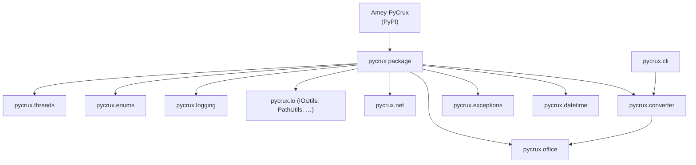
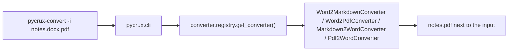

# PyCrux

Shared Python utilities — enums, logging, I/O helpers, thread-local contexts, HTTP exceptions, document conversion, UTC/TAI time and office/Excel tooling — published as **`Amey-PyCrux`** on PyPI and imported as `pycrux`.

## 🚀 Quick Start

Clone, install and run the tests in one go:

```bash
git clone https://github.com/rslakra/PyCrux
cd PyCrux

make setup     # .venv + editable install with dev extras (no .env file needed)
make test
```

For full prerequisites and environment variables, see **📋 Prerequisites & Dependencies** and **⚙️ Build & Configuration** below.

### Usage

Use the library after `make setup`:

```python
from pycrux import __version__
from pycrux.threads import ContextStack
from pycrux.enums import DeviceType, EnvType, OS, SizeUnit
from pycrux.logging import MDC, LogManager
from pycrux.io import IOUtils
from pycrux.net import HttpUtils

print(__version__)
LogManager.configure({"outputs": [{"format": "json", "target": "file", "path": "logs/app"}]})
with MDC.request_scope(userId="42"):
    LogManager.get_logger(__name__).info("hello")   # -> logs/app.json with requestId + userId
env = EnvType.from_string("staging")
size = SizeUnit.format_bytes(2048)
path = IOUtils.resolve("config/app.yaml")
```

Install it in another project (after publish) and import `pycrux`:

```bash
python3 -m pip install Amey-PyCrux
```

Optional extras:

```bash
python3 -m pip install "Amey-PyCrux[dotenv]"    # IOUtils.load_env()
python3 -m pip install "Amey-PyCrux[convert]"   # pycrux.converter / pycrux.cli
python3 -m pip install "Amey-PyCrux[time]"      # pycrux.datetime (leap seconds)
python3 -m pip install "Amey-PyCrux[all]"       # everything above
```

Document converter (`pycrux.cli`, also installed as the `pycrux-convert` command):

```bash
python -m pycrux.cli -h
python -m pycrux.cli --list
python -m pycrux.cli -i report.pdf --out report.docx
python -m pycrux.cli -i notes.docx pdf
just convert -i README.md                      # via the Justfile
just convert-to /path/to/notes.docx md
```

Time demo:

```bash
just time-demo                                 # or: python -m pycrux.datetime.time
```

HTTP exceptions:

```python
from pycrux.exceptions import NotFoundException, exception_for_status

raise NotFoundException("User 42 not found")
exc = exception_for_status(404)
```

### Output

Converted documents are written to `--out` when given, or **next to the input** using a trailing format (`pdf`, `md`, …), `-f` / `--format`, or the default format for that input type:

| Input | Default output |
| ----- | -------------- |
| `.md` / `.markdown` | `.docx` |
| `.pdf` | `.docx` |
| `.docx` | `.md` |

Example: `just convert -i README.md` creates `README.docx` beside `README.md`.

## ✨ Features

- **Thread contexts** — scoped, thread-local `ContextStack` ([`pycrux.threads`](src/pycrux/threads/README.md))
- **Enums** — `EnvType`, `SizeUnit`, `DeviceType`, `OS`, `RunState` and shared helpers ([`pycrux.enums`](src/pycrux/enums/README.md))
- **Logging** — text/JSON/XML output with MDC and full exception capture ([`pycrux.logging`](src/pycrux/logging/README.md))
- **I/O helpers** — `IOUtils`, `PathUtils`, plus `FileUtils`, `TextUtils` and language-server buffers in `pycrux.io`
- **Document conversion** — Markdown, Word (`.docx`) and PDF through a registry of converters and the `pycrux-convert` CLI
- **Time utilities** — UTC/TAI conversion and leap-second handling ([`pycrux.datetime`](src/pycrux/datetime/))
- **HTTP exceptions** — typed 4xx/5xx classes (`ClientException`, `ServerException`, one per status code)
- **Office tooling** — Excel helpers and Markdown/PDF → Word converters ([`pycrux.office`](src/pycrux/office/README.md))
- **Optional extras** — heavy dependencies are opt-in, so a plain install stays light
- **Offline tests** — pytest runs from source (`pythonpath = ["src"]`), no network or PyPI install needed

## 📋 Prerequisites & Dependencies

- Python `3.10+`
- `make` and `python3 -m venv`
- [Just](https://github.com/casey/just) (optional) — shortcuts for the converter and demos
- **Microsoft Word** (macOS or Windows only) — required for `docx → pdf` via `docx2pdf`
- PyPI / TestPyPI accounts — only for the deploy targets

| Source | Purpose |
| ------ | ------- |
| `pyproject.toml` | Package metadata, the `[dotenv]`, `[convert]`, `[time]`, `[all]` and `[dev]` extras and the `pycrux-convert` script; `[tool.setuptools.packages.find]` discovers packages under `src/` (`where = ["src"]`, `include = ["pycrux*"]`) |
| `pyproject.toml` `[tool.pytest.ini_options]` | `testpaths`, `pythonpath`, `test_*.py` pattern |
| `Justfile` | Shortcuts: `just convert`, `just time-demo` (setup and test delegate to `make`) |
| `src/pycrux/` | Importable library — see [Project Layout](#-project-layout) |
| `tests/` | Tests, grouped like the packages — see [Testing](#-testing) |

### Packages

| Package | Public API | Notes |
| ------- | ---------- | ----- |
| [`threads/`](src/pycrux/threads/README.md) | `Context`, `ContextStack`, `StackUnderflow` | Fully documented |
| [`enums/`](src/pycrux/enums/README.md) | `DeviceType`, `EnvType`, `OS`, `RunState`, `SizeUnit`, `BaseEnum`, `CaseInsensitiveEnum` | Fully documented |
| [`logging/`](src/pycrux/logging/README.md) | `LogManager`, `MDC`, `LogConfig`, `LogConfigParser`, `LogFormat` | Fully documented; stdlib only |
| [`io/`](src/pycrux/io/) | `PathUtils` (`paths.py`); `IOUtils` (`utils.py`, stdlib only); `TextUtils`, `FileUtils`, `PlatformUtils`, `SymbolUtils` (`base.py`); `LSPFileBuffer`, `LanguageServerHandle` (`buffers.py`); `SolidLanguageServer` and symbol types (`symbols.py`) | `base.py`, `buffers.py` and `symbols.py` need `solidlsp`, `serena`, `sensai`, `pathspec`, `requests` and `charset_normalizer`; not yet a stable public API |
| [`converter/`](src/pycrux/converter/) | `AbstractConverter`; `get_converter`, `list_conversions`, `normalize_extension` in `converter.registry` | Needs the `[convert]` extra |
| [`datetime/`](src/pycrux/datetime/) | `TimeUtils`, `DateUtils`, `DateTimeUtils` | Needs the `[time]` extra |
| [`exceptions/`](src/pycrux/exceptions/) | `HTTPException`, `ClientException`, `ServerException`, `*Exception` per status, `exception_for_status` | HTTP-style exceptions |
| [`office/`](src/pycrux/office/README.md) | `ExcelUtils`, `ExcelDataType` (`excel/`); `Markdown2WordConverter`, `Pdf2WordConverter` (`word/`) | `excel/` is stdlib only; `word/` needs the `[convert]` extra |
| [`net/`](src/pycrux/net/) | `HttpUtils` | HTTP helpers (stub) |
| Others | — | Placeholders: `jwt/`, `models/`, `parser/`, `security/`, `sql/`, `ui/`, `utils/` |

## ⚙️ Build & Configuration

### Build

```bash
make setup          # .venv + editable install with dev extras
make build          # dist/amey_pycrux-*.tar.gz and *.whl
make rebuild        # clean + build
make version        # print the version the next build will get
```

`pycrux.__version__` reads the installed distribution version (falls back to `0.0.0+unknown` when not installed).

### Environment variables

No environment variable is required. The logging package reads these when you pass `env=os.environ` to `LogManager.configure(...)`; they override the configuration passed in code.

| Variable | Required | Description | Default / example |
| -------- | -------- | ----------- | ----------------- |
| `PYCRUX_LOG_LEVEL` | No | Root log level | `debug`, `info` (default), `warn`, `error` |
| `PYCRUX_LOG_FORMAT` | No | `text`, `json` or `xml` for every output | `text` |
| `PYCRUX_LOG_FILE` | No | Adds a file output (format inferred from the extension) | `logs/app.json` |
| `PYCRUX_LOG_MDC_KEYS` | No | Comma-separated MDC keys to include | all keys |
| `PYCRUX_LOG_STACK_TRACE` | No | Include full stack traces | `true` |
| `PYCRUX_LOG_CAPTURE_UNCAUGHT` | No | Log uncaught exceptions at `CRITICAL` | `false` |

`python-dotenv` (extra `[dotenv]`) is only needed for `IOUtils.load_env()`.

### Versioning

The version is **generated automatically** — nothing to edit by hand. [`version.sh`](version.sh) turns this repo's git commit count into a `MAJOR.MINOR.PATCH` string, and `make` runs it before every `setup`, `build`, `check` and `deploy`:

```
git rev-list --count HEAD  ──►  version.sh  ──►  VERSION file  ──►  pyproject.toml (dynamic version)  ──►  dist/
```

| Commits | Version | Rule |
| ------- | ------- | ---- |
| `N < 10` | `0.0.N` | `7` → `0.0.7` |
| `N < 100` | `0.1.(N-10)` | `10` → `0.1.0`, `42` → `0.1.32` |
| `N ≥ 100` | `D.X.Y` | `D = digits(N) − 2`, `X = (N − 10^(digits−1)) / 100`, `Y = N mod 100` |

Examples: `100` → `1.0.0`, `199` → `1.0.99`, `200` → `1.1.0`, `1000` → `2.0.0`, `1234` → `2.2.34`. A bigger commit count always gives a bigger version and no two counts give the same one, which is what PyPI needs (it refuses a re-upload of an existing version).

```bash
./version.sh 42                  # 0.1.32 — try any number
make version                     # version for the current commit count
make build VERSION=1.2.3         # override the generated version
```

- `VERSION` is generated into a git-ignored `VERSION` file that `pyproject.toml` reads (`dynamic = ["version"]`); the sdist ships it, so building from the sdist works.
- Commit before deploying: the version is the commit count, so `make deploy` / `make deploy-testpypi` refuse to run with uncommitted changes (`ALLOW_DIRTY=1` overrides).
- Use a full clone: a shallow clone (`--depth`) gives a wrong count, and `make` stops with a message — run `git fetch --unshallow`. In CI use `fetch-depth: 0`.
- A plain `pip install -e .` needs the `VERSION` file; run `make version-file` (or `make setup`) first.

### Virtual environment (manual)

`make setup` creates and populates `.venv` for you. To activate it by hand:

```bash
source .venv/bin/activate     # macOS / Linux
.venv\Scripts\activate        # Windows
deactivate
```

### Pytest configuration

In `pyproject.toml`:

```toml
testpaths = ["tests"]
pythonpath = ["src"]
python_files = ["test_*.py"]
```

### Security

- **Never commit** PyPI API tokens — paste them at the deploy prompt only
- Register tokens at [pypi.org](https://pypi.org) and [test.pypi.org](https://test.pypi.org)
- `.env` files and `*.pem` / `*.key` files are git-ignored

### Deploy

**TestPyPI first**, then production PyPI:

```bash
make check              # build, then validate dist/ with Twine
make deploy-testpypi    # paste TestPyPI token when prompted
make deploy             # production PyPI
```

Commit your changes first. Each deploy builds with the version generated by [`version.sh`](version.sh) from the commit count (see [Versioning](#versioning)), so every new commit publishes a new, higher version — PyPI never allows re-uploading the same version. Deploying the same commit twice is rejected by PyPI.

Yank a bad release (pip skips it unless pinned) — pass the version to yank, it is not generated here:

```bash
make yank VERSION=0.1.32 COMMENT="broken release"
make yank-testpypi VERSION=0.1.32
```

### Make commands

| Target | Action |
| ------ | ------ |
| `make setup` | Create `.venv` and install with dev extras |
| `make version` | Print the version the next build gets (from `version.sh`) |
| `make version-file` | Write the `VERSION` file (run automatically by `setup` / `build`) |
| `make build` | Build sdist and wheel into `dist/` with the generated version |
| `make test` | Run pytest against the source tree |
| `make check` | Build, then validate `dist/` with Twine |
| `make deploy-testpypi` | Upload to TestPyPI (needs a clean git tree) |
| `make deploy` | Upload to PyPI (needs a clean git tree) |
| `make yank` / `make yank-testpypi` | Yank a version |
| `make install-wheel` | Install the local wheel into `.venv` |
| `make rebuild` | Clean artifacts, then build |
| `make clean` | Remove build, dist, egg-info and caches |
| `make clean-all` | `clean` + remove `.venv` |
| `make help` | List all targets |

### Just commands

Run from `PyCrux/`. Setup, test and clean delegate to `make`; the rest run through `.venv`.

| Command | Description |
| ------- | ----------- |
| `just setup` | `make setup` |
| `just test` | `make test` |
| `just clean` / `just clean-all` | `make clean` / `make clean-all` |
| `just list` | Show the supported document conversions |
| `just convert -i FILE pdf` | Convert to a format (trailing argument) |
| `just convert -i FILE -f pdf` | Same, with an explicit `--format` |
| `just convert -i FILE --out OUT` | Convert with an explicit output path |
| `just convert-to FILE md` | Shorthand: input + target format |
| `just cli-help` | Show `pycrux.cli` help |
| `just time-demo` | Run the UTC/TAI leap-second demo |
| `just help` | Show the PyCrux commands |

## 📁 Project Layout

```
PyCrux/
├── LICENSE
├── Makefile
├── Justfile               # converter / demo shortcuts
├── README.md              ← you are here
├── cli.py                 # shim → pycrux.cli (needs `make setup` / an editable install)
├── pyproject.toml
├── requirements.txt       # `-e .` (dependencies live in pyproject.toml)
├── version.sh             # commit count -> MAJOR.MINOR.PATCH
├── VERSION                # generated by make (git-ignored)
├── tests/                 # mirrors src/pycrux — see Testing
└── src/                   # source root (packages discovered here; pytest pythonpath)
    └── pycrux/            # importable package
        ├── __init__.py
        ├── cli.py         # document converter CLI (pycrux-convert)
        ├── converter/     # registry-based Markdown / Word / PDF converters
        ├── datetime/      # UTC/TAI time utilities
        ├── enums/         # EnvType, SizeUnit, DeviceType, OS, RunState
        │   └── README.md
        ├── exceptions/    # HTTP-style 4xx/5xx exceptions
        ├── io/            # paths, utils (IOUtils), base (File/Text utils), buffers (LSPFileBuffer), symbols (LSP)
        ├── jwt/           # placeholder
        ├── logging/       # text/JSON/XML logging, MDC
        │   └── README.md
        ├── models/        # placeholder
        ├── net/           # HttpUtils (stub)
        ├── office/        # Excel helpers, Word converters
        │   ├── excel/
        │   ├── word/
        │   └── README.md
        ├── parser/        # placeholder
        ├── security/      # placeholder
        ├── sql/           # placeholder
        ├── threads/       # thread-local context stack
        │   └── README.md
        ├── ui/            # placeholder
        └── utils/         # placeholder
```

| README | Scope |
| ------ | ----- |
| [src/pycrux/threads/README.md](src/pycrux/threads/README.md) | Context stack |
| [src/pycrux/enums/README.md](src/pycrux/enums/README.md) | Enum types and helpers |
| [src/pycrux/logging/README.md](src/pycrux/logging/README.md) | Logging, MDC, config reference |
| [src/pycrux/office/README.md](src/pycrux/office/README.md) | Office: Excel helpers and Word converters |

## 🏗️ Architecture



Consuming projects depend on `Amey-PyCrux` in `pyproject.toml` and import `pycrux.*`. Tests import **public** names from `pycrux.*`, not relative source paths — same as consumer code.

### Data flow

Document conversion, from the command line to the output file:



Each converter implements `AbstractConverter` with `source_extensions`, `dest_extensions` and `convert(source, destination)`; the registry maps a source/destination extension pair to the right one.

| Conversion | Converter |
| ---------- | --------- |
| Markdown / PDF → Word | `pycrux/office/word/converter.py` |
| Word → Markdown | `pycrux/converter/markdown.py` |
| Word → PDF | `pycrux/converter/pdf.py` |

Time utilities and HTTP exceptions:

```python
from pycrux.datetime.time import TimeUtils
from pycrux.exceptions import NotFoundException, exception_for_status

tai_time = TimeUtils.to_tai(TimeUtils.now())   # leapseconddata-backed IERS offsets
exc = exception_for_status(503)                 # -> ServiceUnavailableException
```

Hierarchy: `BaseException` → `HTTPException` → `ClientException` / `ServerException` → one `*Exception` per status code.

### Adding a module

1. Add code under `src/pycrux/<package>/` with `__init__.py` in every package dir.
2. Re-export public names from the package `__init__.py`.
3. Add a `README.md` next to the package and link it from [Project Layout](#-project-layout).
4. Add tests under [tests/](tests/) in a folder named like the package — see [Adding tests](#adding-tests).
5. Commit, then deploy — the version is generated automatically (see [Versioning](#versioning)).

### Import conventions

- **All imports sit at the top of the file** — no imports inside functions or methods, and none below executable code.
- **Optional libraries** (the `[convert]`, `[dotenv]`, … extras) are imported in a guarded `try / except ImportError` block at the top that falls back to `None`; the function that needs the library raises a clear `ImportError` ("Install with: pip install …") when it runs. Importing the package therefore works without the extras.
- **Circular dependencies** are removed by restructuring, not by a deferred import — for example `io/buffers.py` depends on the small `LanguageServerHandle` protocol instead of importing `SolidLanguageServer` from `io/symbols.py`, and `office/word/__init__.py` re-exports nothing because `office/word/converter.py` and `converter/registry.py` import each other's package.

## 🧪 Testing

```bash
make test                                                   # whole suite
.venv/bin/python -m pytest tests/enums                      # one package
.venv/bin/python -m pytest --cov=pycrux --cov-report=term-missing   # with coverage
make check                                                  # build + twine validate (before upload)
```

The suite has about 1,000 tests and runs offline. `tests/` mirrors `src/pycrux/`: one folder per package (with an `__init__.py`, so folders such as `logging` or `io` never shadow the standard library) and one `test_<module>.py` per source module.

| Folder / file | Covers |
| ------------- | ------ |
| `tests/test_package.py` | `__version__`, public imports, `IOUtils.resolve`, `HttpUtils` |
| `tests/test_cli.py` | `pycrux.cli` and the root `cli.py` shim |
| `tests/converter/` | `AbstractConverter`, the registry, Markdown, PDF and Word converters |
| `tests/datetime/` | `TimeUtils` (fake and real leap-second data), `Temporal`, `Formatter` |
| `tests/enums/` | `BaseEnum`, `CaseInsensitiveEnum`, `EnvType`, `DeviceType`, `OS`, `RunState`, `SizeUnit` |
| `tests/exceptions/` | exception base class, every HTTP status exception, the lookup helpers |
| `tests/io/` | `paths`, `utils`, `base`, `buffers` and `symbols` (models, server lifecycle and caches, LSP requests) |
| `tests/logging/` | one file per module (types, config, parser, MDC, events, formatters, logger) plus `test_logging.py` end-to-end |
| `tests/net/` | `HttpUtils` placeholder |
| `tests/office/` | `excel/base`, `word/converter` |
| `tests/threads/` | `ContextStack`, `Context` and per-thread isolation |
| `tests/conftest.py` | shared fixtures, e.g. `reload_without` (re-imports a module while an optional library is "missing") |

Notes:

- `src/pycrux/io/base.py`, `buffers.py` and `symbols.py` import `solidlsp`, `serena`, `sensai` and `pathspec`, which are not declared dependencies. `tests/io/_stubs.py` installs small stand-ins for the packages that are missing and `tests/io/_fakes.py` provides a fake language-server process; the tests that rely on them are skipped when the real packages are installed.
- The converter and office tests use the real `python-docx` and `markdown`; `docx2pdf` (needs Microsoft Word) and `pdf2docx` are replaced with recorders. The real leap-second tests are skipped when the IERS list cannot be loaded.

### Adding tests

- Put tests in the folder named like the package, in `test_<module>.py` for the module under test (`tests/io/test_paths.py` for `io/paths.py`); every test folder needs an `__init__.py`.
- Use a dedicated file for a large type (`tests/enums/test_env_type.py`) and `parametrize` over tables of inputs.
- Keep imports at the top of the test file and import public names from `pycrux.*`.
- Re-export new public types from the package `__init__.py` — see [Adding a module](#adding-a-module).

## 🛠️ Troubleshooting

**`make test` fails with "Run 'make setup' first"**

- **Cause:** the `.venv` does not exist yet
- **Fix:** run `make setup`, then `make test`

**`ModuleNotFoundError: pycrux` (or `pycrux.cli`) outside the tests**

- **Cause:** the package is not installed in the active environment, or you are running the root `cli.py` shim without an editable install
- **Fix:** `make setup` and activate `.venv`, or `pip install -e ".[dev]"` from the PyCrux root

**PyPI upload rejected — version already exists**

- **Cause:** the version is the commit count and it has not changed
- **Fix:** make a new commit, then run `make deploy` again

| Issue | Fix |
| ----- | --- |
| Tests pass locally but fail in CI | Ensure `pythonpath = ["src"]` is set in the pytest config |
| `make deploy` says "Uncommitted changes" | Commit first (the version is the commit count), or use `ALLOW_DIRTY=1` |
| `make` says "Shallow git clone" | `git fetch --unshallow` (CI: `fetch-depth: 0`) |
| `pip install -e .` fails: no such file `VERSION` | Run `make version-file` (or `make setup`) first |
| `ImportError: Missing required library` from the converter | Install the extra: `pip install "Amey-PyCrux[convert]"` |
| `pycrux.datetime` fails to import | Install `leapseconddata`: `pip install "Amey-PyCrux[time]"` |
| `docx → pdf` fails or Word opens | `docx2pdf` drives Microsoft Word (macOS/Windows only) — install Word, or convert via Markdown |
| `import pycrux.io.base` fails: no module `solidlsp` | Those modules need the language-server packages (not a declared dependency); `pycrux.io.paths` / `pycrux.io.utils` work without them |
| New type not importable | Re-export it from the package `__init__.py` |
| Twine check fails | Run `make build` and then `make check` |

## 📚 References

### In this repository

| README / Link | Description |
| ------------- | ----------- |
| [src/pycrux/threads/README.md](src/pycrux/threads/README.md) | Context stack reference |
| [src/pycrux/enums/README.md](src/pycrux/enums/README.md) | Enum reference |
| [src/pycrux/logging/README.md](src/pycrux/logging/README.md) | Logging reference |
| [src/pycrux/office/README.md](src/pycrux/office/README.md) | Office: Excel helpers and Word converters |

### External Documentation

| Link | Description |
| ---- | ----------- |
| [Packaging Python Projects](https://packaging.python.org/en/latest/tutorials/packaging-projects) | Build and publish guide |
| [Amey-PyCrux on PyPI](https://pypi.org/project/Amey-PyCrux/) | Published package (when available) |
| [PyPI](https://pypi.org) / [TestPyPI](https://test.pypi.org) | Production and staging package indexes |
| [pytest](https://docs.pytest.org/) | Test runner |
| [Just](https://github.com/casey/just) | Task runner |

## 📄 License

Distributed under the [MIT License](LICENSE).

## 👤 Author

- **Rohtash Lakra** — [@rslakra](https://github.com/rslakra)
