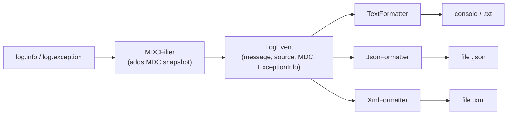

# pycrux.logging

Consistent, configurable logging for any application — a stdlib-only layer over Python's `logging` that adds **text / JSON / XML output**, a **Mapped Diagnostic Context (MDC)**, and **complete exception capture** (full stack + cause chain). Import from `pycrux.logging` after installing [Amey-PyCrux](../../../README.md).

## 🚀 Quick Start

```python
from pycrux.logging import MDC, LogManager

LogManager.configure({
    "level": "INFO",
    "outputs": [
        {"format": "text", "target": "console"},
        {"format": "json", "target": "file", "path": "logs/app"},   # -> logs/app.json
    ],
    "mdc_defaults": {"app": "orders"},
    "capture_uncaught": True,
})

log = LogManager.get_logger(__name__)

with MDC.request_scope(userId="42") as request_id:       # binds requestId + userId
    log.info("Processing order", extra={"orderId": 5})
    try:
        place_order()
    except Exception:
        log.exception("Order failed")                 # full stack + root cause + MDC
```

Console line:

```
2025-01-01T12:00:00.123Z INFO     [MainThread] orders - Processing order [app=orders, requestId=9f3c…, userId=42] [orderId=5]
```

Use the standard `logging` API everywhere (`log.info`, `log.exception`, `extra=`, `stack_info=True`); `LogManager.get_logger(name)` simply returns the stdlib logger.

The package is class-based: `LogManager` (setup), `MDC` (context), `LogConfigParser` (config), `FormatterFactory` / `HandlerFactory` (outputs) and `UncaughtExceptionHandler` — there are no module-level functions.

## ✨ Features

- **Multiple outputs at once** — each with its own format, target, level and rotation
- **Formats** — `text` (`.txt`), `json` (`.json`, one object per line), `xml` (`.xml`, one `<event>` per record)
- **MDC** — `MDC.put/get/remove/clear`, bound per thread and per asyncio task, included in every record
- **Request flow** — `MDC.request_scope()` stamps a `requestId` on every log line in a block
- **Full error context** — complete traceback including chained exceptions, structured frames, and the cause chain down to the root cause
- **Uncaught exceptions** — optional `capture_uncaught` logs crashes (main and worker threads) at `CRITICAL` with the full stack
- **Configurable context** — choose which MDC keys are logged (`mdc_keys`) and add constant fields (`mdc_defaults`)
- **Config from anywhere** — dict, `.json` file, or `PYCRUX_LOG_*` environment variables
- **Idempotent** — call `LogManager.configure()` again to replace the setup; `LogManager.shutdown()` removes it

## 📋 Prerequisites & Dependencies

- **Amey-PyCrux** / editable `pycrux` install
- **stdlib only** (`logging`, `contextvars`, `json`, `xml.etree`)

| File | Contents |
| ---- | -------- |
| [`types.py`](types.py) | `LogLevel`, `LogFormat`, `LogTarget` |
| [`mdc.py`](mdc.py) | `MDC`, `MDCScope`, `RequestScope` (returned by `MDC.scope` / `MDC.request_scope`) |
| [`events.py`](events.py) | `LogEvent`, `ExceptionInfo`, `CauseInfo`, `StackFrame` |
| [`formatters.py`](formatters.py) | `EventFormatter`, `TextFormatter`, `JsonFormatter`, `XmlFormatter`, `FormatterFactory` |
| [`config.py`](config.py) | `LogConfig`, `OutputConfig` |
| [`parser.py`](parser.py) | `LogConfigParser` (`parse`, `parse_level`) |
| [`logger.py`](logger.py) | `LogManager`, `HandlerFactory`, `MDCFilter`, `UncaughtExceptionHandler` |

## ⚙️ Build & Configuration

### Configuration reference

```json
{
  "level": "INFO",
  "levels": {"urllib3": "WARN"},
  "outputs": [
    {"format": "text", "target": "console", "stream": "stderr"},
    {"format": "json", "target": "file", "path": "logs/app", "max_bytes": 10485760, "backup_count": 5},
    {"format": "xml",  "target": "file", "path": "logs/errors.xml", "level": "ERROR"}
  ],
  "mdc_keys": ["requestId", "userId", "app"],
  "mdc_defaults": {"app": "orders"},
  "include_stack_trace": true,
  "capture_uncaught": true
}
```

| Key | Default | Description |
| --- | ------- | ----------- |
| `level` | `INFO` | Level of the configured logger — a `LogLevel` name: `CRITICAL`, `ERROR`, `WARN`, `INFO`, `DEBUG`, `NOTSET` (case-insensitive; plain numbers also work) |
| `levels` | `{}` | Per-logger overrides (`{"urllib3": "WARN"}`) |
| `outputs` | one `text` console output | List of destinations (at least one) |
| `mdc_keys` | all keys | Allow-list of MDC keys to log (also fixes their order) |
| `mdc_defaults` | `{}` | Constant context added to every event; MDC values override them |
| `include_stack_trace` | `true` | Include tracebacks and frames for exceptions |
| `capture_uncaught` | `false` | Log uncaught exceptions at `CRITICAL` |

Output keys:

| Key | Default | Description |
| --- | ------- | ----------- |
| `format` | `text`; inferred from `path` extension | `text`, `json`, `xml` (`txt`, `jsonl` accepted) |
| `target` | `file` when `path` is set, else `console` | `console` or `file` |
| `path` | — | File path; no extension → the format's extension is added |
| `level` | logger level | Minimum level for this destination |
| `stream` | `stderr` | `stdout` or `stderr` (console) |
| `pattern` | see below | `str.format` pattern for `text` |
| `max_bytes` / `backup_count` | 10 MiB / 5 | Size-based rotation (`max_bytes: 0` disables) |
| `encoding` | `utf-8` | File encoding |

Unknown keys raise `ValueError`, so typos are caught at startup.

### Loading configuration

```python
LogManager.configure({...})                          # dict
LogManager.configure("config/logging.json")          # JSON file
LogManager.configure(LogConfig(outputs=[OutputConfig(format="json", target="file", path="logs/app")]))
LogManager.configure(env=os.environ)                 # defaults + PYCRUX_LOG_* overrides
LogManager.configure({...}, name="myapp")            # attach only to the "myapp" logger tree

LogConfigParser.parse("config/logging.json")         # parse without installing anything
```

### Environment variables

Applied only when `env=` is passed (`LogManager.configure(..., env=os.environ)`); they override the config.

| Variable | Effect |
| -------- | ------ |
| `PYCRUX_LOG_LEVEL` | Root level |
| `PYCRUX_LOG_FORMAT` | `text` / `json` / `xml` for every output |
| `PYCRUX_LOG_FILE` | Adds a file output (format inferred from extension) |
| `PYCRUX_LOG_MDC_KEYS` | Comma-separated MDC keys to include |
| `PYCRUX_LOG_STACK_TRACE` | `true` / `false` |
| `PYCRUX_LOG_CAPTURE_UNCAUGHT` | `true` / `false` |

## 📁 Project Layout

```
logging/
├── __init__.py         # public exports
├── types.py
├── mdc.py
├── events.py
├── formatters.py
├── config.py
├── parser.py
├── logger.py
└── README.md           ← you are here
```

## 🏗️ Architecture



### MDC

Same lifecycle as SLF4J / Logback's MDC:

| Method | Role |
| ------ | ---- |
| `MDC.put(key, value)` | Insert a pair into the current context |
| `MDC.get(key, default=None)` | Read a value |
| `MDC.remove(key)` | Delete a key (no error if missing) |
| `MDC.clear()` | Remove everything |
| `MDC.get_all()` / `MDC.set_all(map)` | Copy / replace the whole map |
| `MDC.scope(**kv)` | Add entries for a `with` block, then restore |
| `MDC.request_scope(request_id=None, **kv)` | `scope` that also sets `requestId` (generated when omitted) |

```python
MDC.put("userId", "42")
log.info("hello")        # carries userId=42 without passing it around
MDC.clear()
```

- The context lives in a `ContextVar`: each **thread** has its own map (new threads start empty) and each **asyncio task** gets a copy of its parent's.
- To carry it into a thread pool: `executor.submit(contextvars.copy_context().run, work)`.
- Always `clear()` (or use `scope`) at the end of a request in long-lived worker threads.
- Don't put secrets in the MDC — use `mdc_keys` as an allow-list.

### Exceptions

`log.exception(...)` (or `exc_info=True`) records an `ExceptionInfo`:

- `stack_trace` — the complete traceback, including every chained exception
- `frames` — structured `file` / `line` / `function` / `code` of the failing stack
- `causes` — chain from the immediate cause to the **root cause**, each marked `cause` (`raise … from …`) or `context` (raised while handling another)

JSON excerpt:

```json
{"timestamp":"2025-01-01T12:00:00.123Z","level":"ERROR","logger":"orders","message":"Order failed",
 "source":{"module":"service","function":"place","line":42,"path":"/app/service.py"},
 "thread":{"name":"MainThread","id":1},"process":1234,
 "mdc":{"requestId":"9f3c…","userId":"42"},
 "exception":{"type":"RuntimeError","message":"request failed",
   "stack_trace":"Traceback (most recent call last): …",
   "frames":[{"file":"service.py","line":40,"function":"place","code":"load(order)"}],
   "causes":[{"type":"ValueError","message":"cannot load order","relation":"cause"},
             {"type":"KeyError","message":"'db row missing'","relation":"cause"}]}}
```

Text output prints the traceback followed by `Root cause: KeyError: 'db row missing'`.

Filter a request's complete flow by its id:

```bash
grep 9f3c logs/app.json            # or: jq 'select(.mdc.requestId=="9f3c…")' logs/app.json
```

### Output formats

- **text** — default pattern `{timestamp} {level:<8} [{thread}] {logger} - {message} {mdc} {extra}`. Fields: `timestamp`, `level`, `logger`, `message`, `module`, `function`, `line`, `path`, `thread`, `thread_id`, `process`, `mdc`, `extra`. `{mdc[requestId]}` selects one key. Example: `"pattern": "{level}|{mdc[requestId]}|{message}"`.
- **json** — one compact object per line (JSON Lines), friendly to `jq` and log shippers.
- **xml** — one `<event>` element per record (a fragment stream like Log4j's `XMLLayout`). Wrap the file in a root element to parse it as one document: `ET.fromstring("<log>" + text + "</log>")`. Characters illegal in XML are replaced.

Timestamps are UTC (ISO 8601, millisecond precision).

### Using it inside a library

Libraries should only call `LogManager.get_logger(__name__)`; the **application** calls `LogManager.configure()` once at startup.

## 🧪 Testing

```bash
cd ../../.. && make test
```

| Test file | Covers |
| --------- | ------ |
| [`test_logging.py`](../../../tests/test_logging.py) | MDC, config parsing, text/JSON/XML output, exception chains, context keys, `LogManager.configure` lifecycle |

See [PyCrux › Testing](../../../README.md#-testing).

## 🛠️ Troubleshooting

| Issue | Fix |
| ----- | --- |
| No output | Logger level too high — set `level`; check the output's own `level` |
| Duplicate lines | Another handler (e.g. `basicConfig`) is also attached to the root logger |
| MDC empty in a worker thread | Threads start with an empty MDC — run work via `contextvars.copy_context().run` |
| `ValueError: Unknown logging config keys` | Typo in the config; see the reference above |
| `ValueError: Invalid text log pattern` | Unknown field in `pattern` — use only the fields listed above |
| File not created | Files are created on the first log record (`delay=True`) |

## 📚 References

### In this repository

| README | Description |
| ------ | ----------- |
| [PyCrux](../../../README.md) | Package root, library map, build and tests |
| [threads](../threads/README.md) | Thread-local `ContextStack` |

### External Documentation

| Link | Description |
| ---- | ----------- |
| [Python logging](https://docs.python.org/3/library/logging.html) | stdlib logging |
| [contextvars](https://docs.python.org/3/library/contextvars.html) | Context variables |
| [SLF4J MDC](https://logback.qos.ch/manual/mdc.html) | The MDC concept this mirrors |

## 📄 License

MIT — see [LICENSE](../../../LICENSE).

## 👤 Author

- **Rohtash Lakra** — [@rslakra](https://github.com/rslakra)
