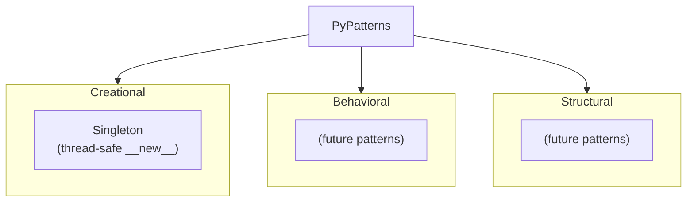

# PyPatterns

Reference implementations of common object-oriented design patterns in Python, organized by category (creational, behavioral, structural).

## 🚀 Quick Start

Patterns are plain Python modules — standard library only, no install step required.

```bash
cd PyPatterns
just singleton
```

Or run directly:

```bash
python3 creational/singleton.py
```

For optional shared tooling from the monorepo root, see **📋 Prerequisites & Dependencies** below.

### Usage

```bash
just list
just singleton
just run creational/singleton.py
```

Import into your own code (run from `PyPatterns/` or add it to `PYTHONPATH`):

```python
from creational.singleton import Singleton

a = Singleton()
b = Singleton()
assert a is b  # same instance
```

### Output

Running `singleton.py` prints instance identity and class information to stdout, demonstrating that repeated construction returns the same object.

## ✨ Features

- **Creational** — Object creation patterns (e.g. Singleton with thread-safe double-checked locking)
- **Behavioral** — Communication patterns between objects (placeholder package for future examples)
- **Structural** — Composition and adapter-style patterns (placeholder package for future examples)
- **Runnable demos** — Each pattern module includes a `__main__` block where applicable
- **Just tasks** — `just singleton`, `just list`, and `just run <module>` from this directory

## 📋 Prerequisites & Dependencies

- Python `3.12+`
- [Just](https://github.com/casey/just) (optional — task runner for demos)
- Standard library only (current patterns use `threading`)

| Source | Purpose |
| ------ | ------- |
| Pattern subpackages | Self-contained example modules |
| [PySuite README](../README.md) | Optional shared virtual environment |

No `requirements.txt` — nothing to install for the current patterns.

## ⚙️ Build & Configuration

### Build

No build step. Run demos with system `python3` or the optional monorepo venv:

```bash
cd PyPatterns
just singleton
```

Optional shared venv from repo root:

```bash
cd ..
just setup-venv
source venv/bin/activate
cd PyPatterns
```

No environment variables or configuration files are required.

### Just commands

Run from **PyPatterns/** (or `just pypatterns <command>` from the repo root):

| Command | Description |
| ------- | ----------- |
| `just list` | List implemented and placeholder patterns |
| `just singleton` | Run the Singleton demo |
| `just run creational/singleton.py` | Run any pattern module |
| `just help` | Show PyPatterns commands |

## 📁 Project Layout

```
PyPatterns/
├── creational/
│   └── singleton.py    # Thread-safe Singleton
├── behavioral/
│   └── __init__.py     # Future behavioral patterns
├── structural/
│   └── __init__.py     # Future structural patterns
├── Justfile
└── README.md           ← you are here
```

| Path | Pattern | Status |
| ---- | ------- | ------ |
| `creational/singleton.py` | Singleton | Implemented |
| `behavioral/` | Observer, Strategy, etc. | Placeholder |
| `structural/` | Adapter, Facade, etc. | Placeholder |

## 🏗️ Architecture



Patterns are grouped by intent (GoF categories). Each file is independent — study or copy one pattern at a time without pulling in the rest of the package.

### Singleton implementation

`creational/singleton.py` uses:

1. A class-level `_instance` holder
2. A `threading.Lock` for concurrent safety
3. Double-checked locking in `__new__` to avoid unnecessary synchronization

## 🧪 Testing

```bash
just singleton
# or: python3 creational/singleton.py
```

Verify that two `Singleton()` calls refer to the same object (printed addresses and `counter` state should match).

When pytest tests are added under the repo root `tests/` package, run:

```bash
source ../venv/bin/activate
python -m pytest tests/
```

## 🛠️ Troubleshooting

**Import errors when importing from another directory**

- **Cause:** Python cannot resolve the `creational` package from outside `PyPatterns/`
- **Fix:** Run from `PyPatterns/`, use `just singleton`, or add `PyPatterns/` to `PYTHONPATH`

| Issue | Fix |
| ----- | --- |
| Empty behavioral/structural folders | Only Singleton is implemented so far — add new patterns under the matching category |
| `just: command not found` | Install Just or run `python3 creational/singleton.py` directly |

## 📚 References

### In this repository

| README / Link | Description |
| ------------- | ----------- |
| [PySuite (root)](../README.md) | Monorepo index |
| [PyCademy](../PyCademy/README.md) | Learning scripts and exercises |
| [PyCore](../PyCore/README.md) | Production utilities |

### External Documentation

| Link | Description |
| ---- | ----------- |
| [Design Patterns (GoF)](https://en.wikipedia.org/wiki/Design_Patterns) | Classic pattern catalog |
| [Python threading](https://docs.python.org/3/library/threading.html) | Lock used in Singleton |

## 📄 License

[Add your license here]

## 👤 Author

- **Rohtash Lakra** — [@rslakra](https://github.com/rslakra)
