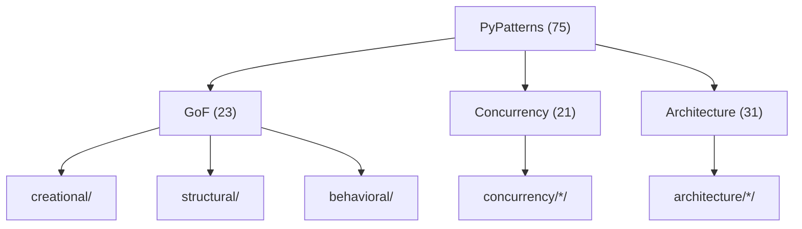

# PyPatterns

Reference implementations of **design patterns**, **concurrency patterns**, and **software architecture patterns** in Python. Each entry has a runnable `demo.py` and a `README.md` with Mermaid diagrams, pros/cons, and distributed-systems guidance.

| Category | Count | Source |
| -------- | ----- | ------ |
| [Creational](creational/README.md) | 5 | [GoF / Design Patterns](https://en.wikipedia.org/wiki/Design_Patterns) |
| [Structural](structural/README.md) | 7 | GoF |
| [Behavioral](behavioral/README.md) | 11 | GoF (incl. Interpreter) |
| [Concurrency](concurrency/README.md) | 21 | [Concurrency pattern](https://en.wikipedia.org/wiki/Concurrency_pattern) |
| [Architecture](architecture/README.md) | 31 | [Software architecture — Patterns](https://en.wikipedia.org/wiki/Software_architecture#Patterns) |

**Total: 75 patterns** — Python 3.12+ stdlib only, no install step.

## 🚀 Quick Start

```bash
cd PyPatterns
just list
just singleton                    # GoF
just run concurrency/barrier    # concurrency
just run architecture/saga      # architecture
just run-all                    # all 75 demos
```

From repo root: `just pypatterns list`

## 📁 Project Layout

```
PyPatterns/
├── creational/       # 5 GoF patterns
├── structural/       # 7 GoF patterns
├── behavioral/       # 11 GoF patterns
├── concurrency/      # 21 concurrency patterns
├── architecture/     # 31 architecture styles & patterns
├── Justfile
└── README.md
```

Each pattern folder:

```
concurrency/barrier/
├── demo.py
└── README.md
```

## 📖 Pattern Catalog

Browse by category — each category README links to every pattern without duplicating per-pattern docs.

| Category | Index |
| -------- | ----- |
| Creational (GoF) | [creational/README.md](creational/README.md) |
| Structural (GoF) | [structural/README.md](structural/README.md) |
| Behavioral (GoF) | [behavioral/README.md](behavioral/README.md) |
| Concurrency | [concurrency/README.md](concurrency/README.md) |
| Architecture | [architecture/README.md](architecture/README.md) |

## ⚙️ Commands

| Command | Description |
| ------- | ----------- |
| `just list` | List all categories |
| `just run <category>/<pattern>` | Run one demo |
| `just run-all` | Run all 75 demos |
| `just run-all-gof` | GoF only (23) |
| `just run-all-concurrency` | Concurrency only (21) |
| `just run-all-architecture` | Architecture only (31) |
| `just help` | Full command list |

## 🏗️ Architecture



**GoF** patterns are object-level. **Concurrency** patterns address threads and synchronization. **Architecture** patterns/styles address system structure and cross-service concerns.

## 🧪 Testing

```bash
just run-all
just run architecture/circuit_breaker
just run concurrency/thread_pool
```

## 🛠️ Troubleshooting

| Issue | Fix |
| ----- | --- |
| Import errors outside `PyPatterns/` | Run from this directory or `just run <pattern>` |
| Old path `creational/singleton.py` | Now `creational/singleton/demo.py` |

## 📚 References

| Link | Description |
| ---- | ----------- |
| [Design Patterns (GoF)](https://en.wikipedia.org/wiki/Design_Patterns) | 23 object-oriented patterns |
| [Concurrency pattern](https://en.wikipedia.org/wiki/Concurrency_pattern) | Threading patterns |
| [Software architecture](https://en.wikipedia.org/wiki/Software_architecture#Patterns) | System-level patterns & styles |
| [Refactoring.Guru](https://refactoring.guru/design-patterns) | Visual GoF explanations |

### In this repository

| README | Description |
| ------ | ----------- |
| [PySuite (root)](../README.md) | Monorepo index |
| [PyCademy](../PyCademy/README.md) | Learning scripts |
| [PyCore](../PyCore/README.md) | Production utilities |

## 📄 License

[Add your license here]

## 👤 Author

- **Rohtash Lakra** — [@rslakra](https://github.com/rslakra)
