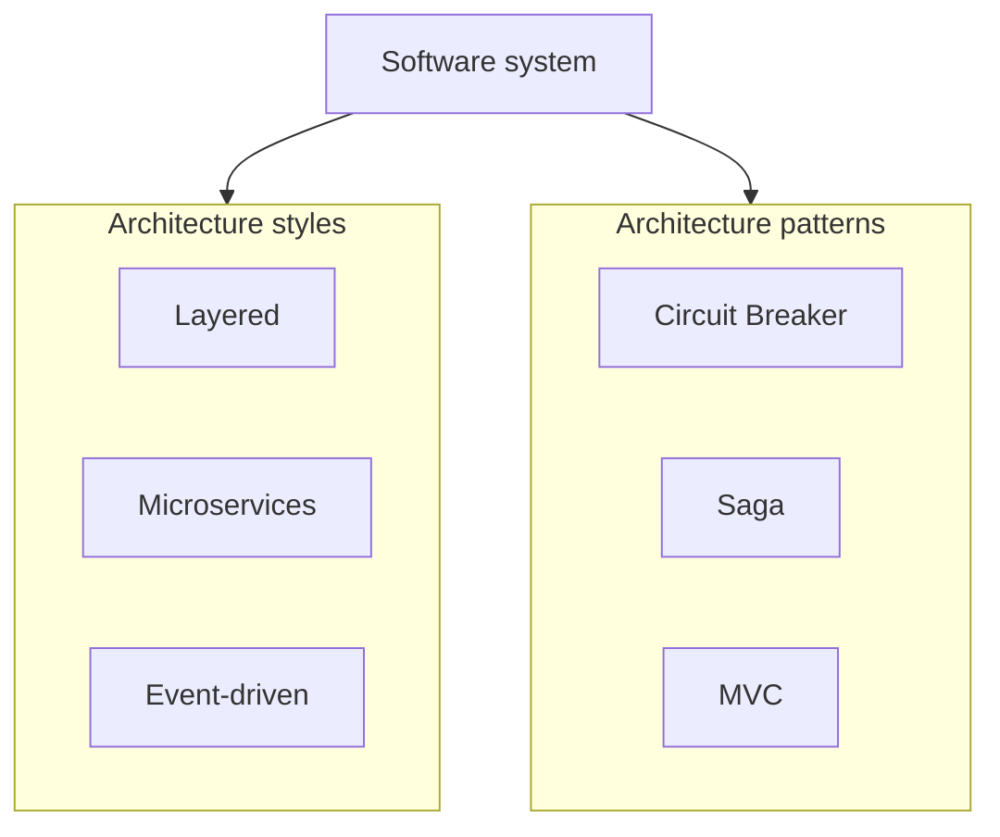

# Architecture Patterns & Styles

System-level patterns and styles from [Software architecture — Patterns](https://en.wikipedia.org/wiki/Software_architecture#Patterns) and the [List of software architecture styles and patterns](https://en.wikipedia.org/wiki/List_of_software_architecture_styles_and_patterns). Part of [PyPatterns](../README.md) — **31 entries** (10 styles + 21 patterns), each with `demo.py` + `README.md`.

## Intent

Architecture patterns operate at a **higher abstraction** than GoF design patterns — they address overall system structure, component interaction, and quality attributes (scalability, availability, maintainability).



## Architecture styles (10)

High-level structural organization — how components are grouped and connected.

| Style | Folder | Demo focus |
| ----- | ------ | ---------- |
| Event-driven architecture | [event_driven/](event_driven/README.md) | Event bus + subscribers |
| Hexagonal (Ports & Adapters) | [hexagonal/](hexagonal/README.md) | Domain core + adapters |
| Layered architecture | [layered/](layered/README.md) | Presentation → business → data |
| Microkernel | [microkernel/](microkernel/README.md) | Core + plugins |
| Pipes and Filters | [pipes_and_filters/](pipes_and_filters/README.md) | Sequential filter pipeline |
| Microservices | [microservices/](microservices/README.md) | Independent services via messages |
| Monolithic | [monolithic/](monolithic/README.md) | Single deployable unit |
| Service-oriented (SOA) | [service_oriented/](service_oriented/README.md) | Registry + services |
| Service-based | [service_based/](service_based/README.md) | Coarse-grained services |
| Space-based | [space_based/](space_based/README.md) | Tuple space + processing units |

## Architecture patterns (21)

Reusable solutions to recurring **system-level** problems.

| Pattern | Folder |
| ------- | ------ |
| Inbox and outbox | [inbox_outbox/](inbox_outbox/README.md) |
| Queue-based load leveling | [queue_load_leveling/](queue_load_leveling/README.md) |
| Backends for frontends (BFF) | [backends_for_frontends/](backends_for_frontends/README.md) |
| Published interfaces | [published_interfaces/](published_interfaces/README.md) |
| Asynchronous messaging | [async_messaging/](async_messaging/README.md) |
| Batch request | [batch_request/](batch_request/README.md) |
| Blackboard | [blackboard/](blackboard/README.md) |
| Circuit breaker | [circuit_breaker/](circuit_breaker/README.md) |
| Client–server | [client_server/](client_server/README.md) |
| Competing consumers | [competing_consumers/](competing_consumers/README.md) |
| Model–view–controller | [mvc/](mvc/README.md) |
| Claim-check | [claim_check/](claim_check/README.md) |
| Peer-to-peer | [peer_to_peer/](peer_to_peer/README.md) |
| Publish–subscribe | [publish_subscribe/](publish_subscribe/README.md) |
| Rate limiting | [rate_limiting/](rate_limiting/README.md) |
| Request–response | [request_response/](request_response/README.md) |
| Retry | [retry/](retry/README.md) |
| Rule-based | [rule_based/](rule_based/README.md) |
| Saga | [saga/](saga/README.md) |
| Strangler fig | [strangler_fig/](strangler_fig/README.md) |
| Throttling | [throttling/](throttling/README.md) |

## Run

```bash
just run architecture/layered
just run architecture/circuit_breaker
just run architecture/saga
just run-all-architecture    # all 31 demos
```

## Distributed environments

These patterns **are** distributed-systems concerns. Demos simulate them in-process; production mappings include:

| Pattern | Real-world technology |
| ------- | --------------------- |
| Microservices | K8s services, independent deploy units |
| Event-driven | Kafka, SNS/SQS, EventBridge |
| Circuit breaker | Resilience4j, Istio outlier detection |
| Saga | Temporal, Camunda, choreographed events |
| BFF | Per-client GraphQL/REST aggregation layers |
| Strangler fig | Proxy routing % traffic to new system |

Each pattern README includes a dedicated **Distributed Environments** section.

## See also

- [Concurrency patterns](../concurrency/README.md) — threading and synchronization
- [GoF design patterns](../README.md) — object-level patterns (creational / structural / behavioral)

## References

- [Software architecture — Patterns and styles](https://en.wikipedia.org/wiki/Software_architecture#Patterns)
- [List of software architecture styles and patterns](https://en.wikipedia.org/wiki/List_of_software_architecture_styles_and_patterns)
- [Circuit breaker design pattern](https://en.wikipedia.org/wiki/Circuit_breaker_design_pattern)
- [Model–view–controller](https://en.wikipedia.org/wiki/Model%E2%80%93view%E2%80%93controller)
