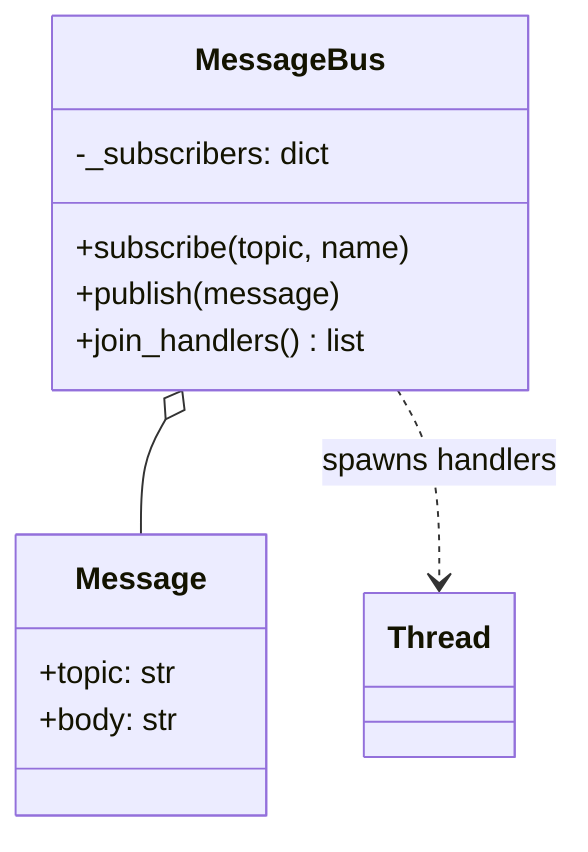
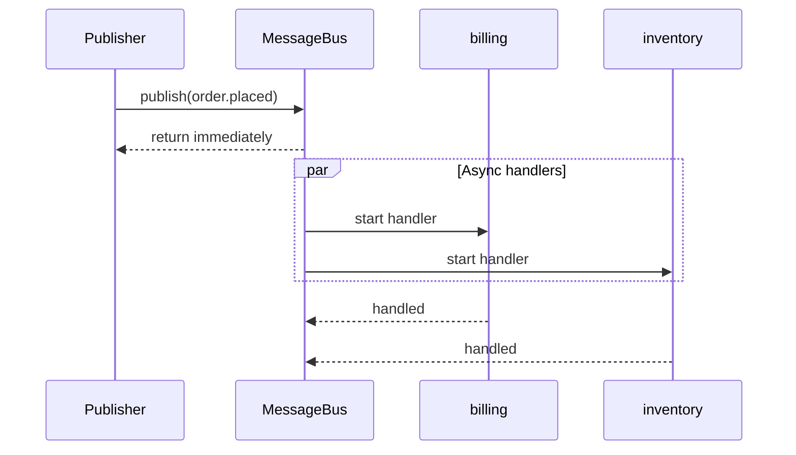
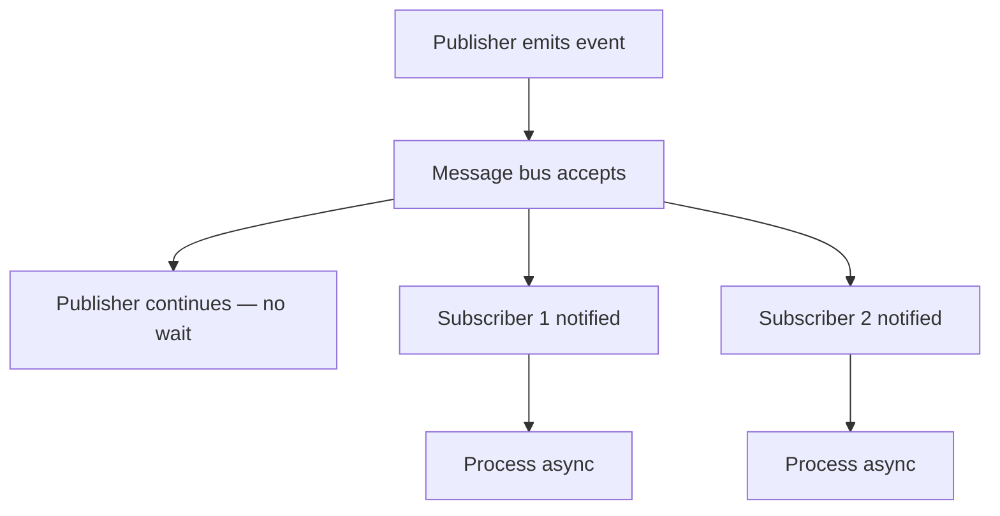

# Asynchronous Messaging Pattern

## Intent

Decouple components with **fire-and-forget messaging**: publishers emit events without waiting for subscribers to finish. Producers and consumers operate independently in time, enabling scalable, resilient systems.

This demo publishes an `order.placed` event; billing and inventory handlers run concurrently while the publisher returns immediately.

## Class Diagram



## Sequence Diagram



## Flowchart



## Run Instructions

```bash
cd PyPatterns
python3 architecture/async_messaging/demo.py
```

Expected output shows the publisher returning before billing and inventory handlers complete.

## Pros / Cons

| Pros | Cons |
| ---- | ---- |
| Loose coupling between services | Eventual consistency — no immediate read-your-writes |
| Natural load spreading | Harder to trace than synchronous calls |
| Failures isolated per subscriber | Ordering guarantees vary by broker |

## Distributed Environments

Async messaging underpins **event-driven architecture**:

- **Kafka / RabbitMQ / SNS**: durable topics with consumer groups and replay.
- **CloudEvents**: standardized envelope for cross-vendor interoperability.
- **Choreography vs orchestration**: services react to events without a central coordinator.

Design idempotent handlers, use correlation IDs for tracing, and prefer at-least-once delivery with compensating actions.

## References

- [Enterprise Integration Patterns — Messaging](https://www.enterpriseintegrationpatterns.com/patterns/messaging/)
- [List of software architecture styles and patterns — Wikipedia](https://en.wikipedia.org/wiki/List_of_software_architecture_styles_and_patterns)
