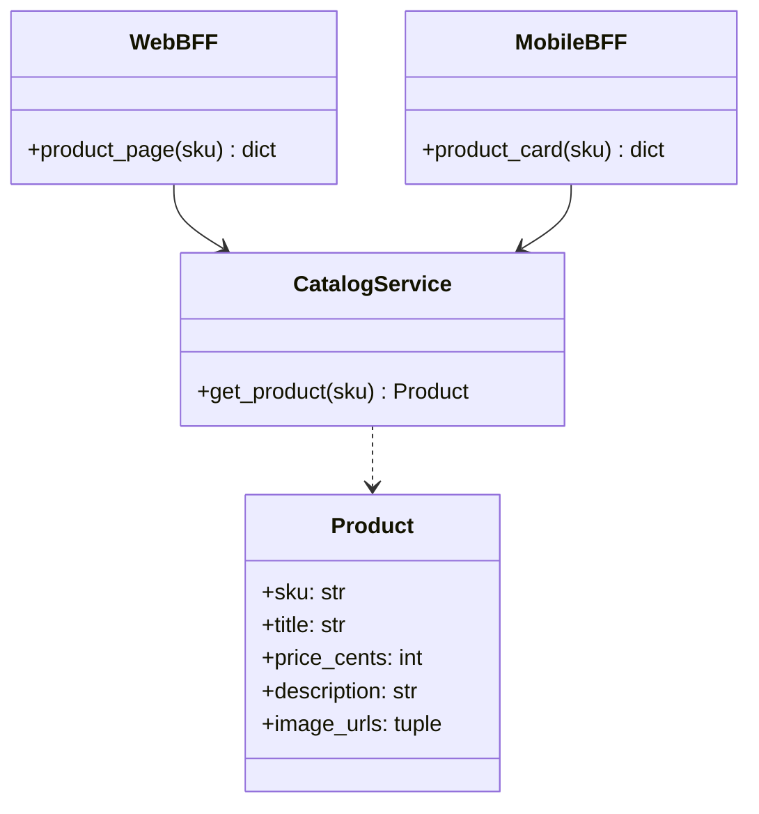
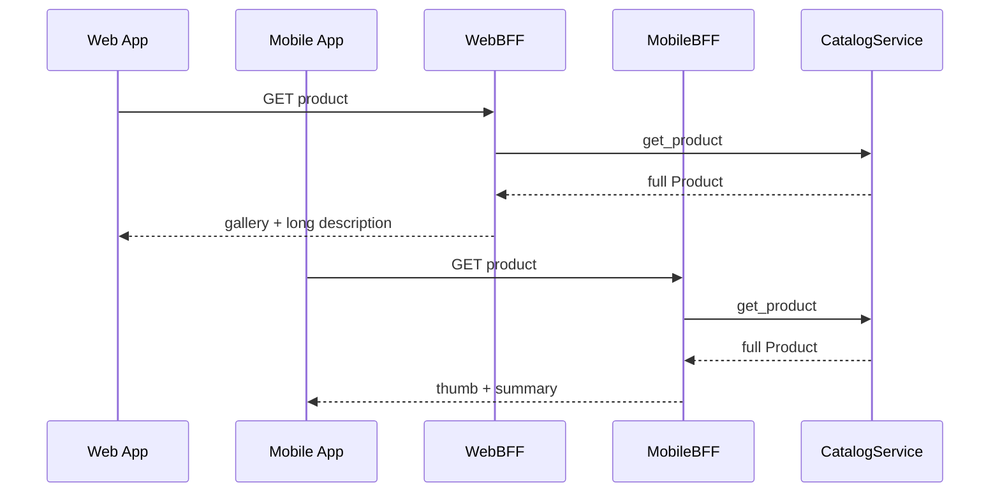
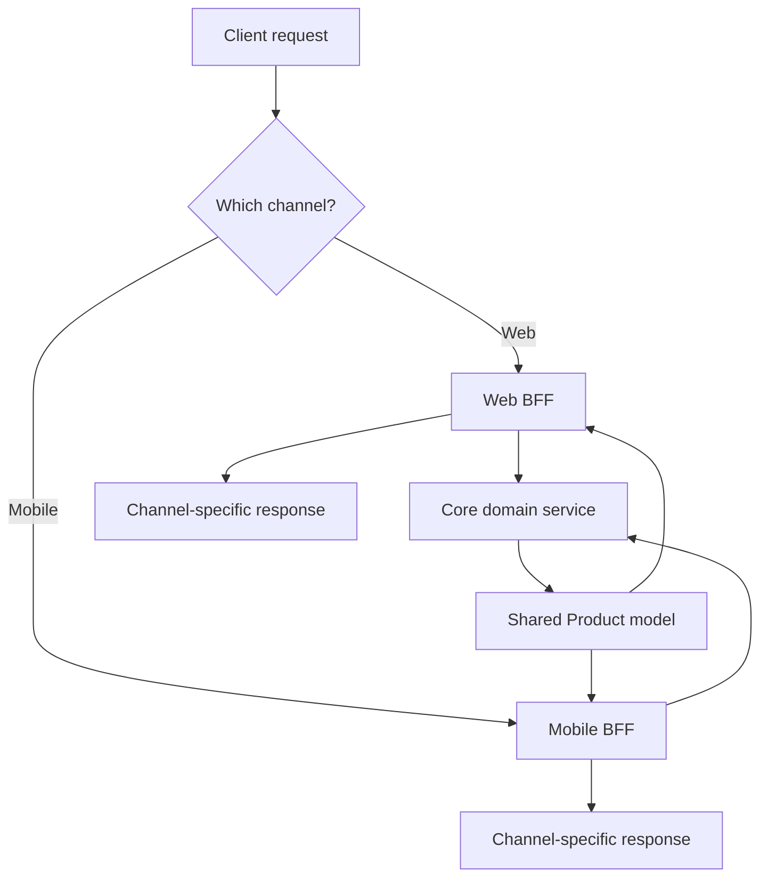

# Backends for Frontends (BFF) Pattern

## Intent

Create **separate backend APIs tailored to each client type** (web, mobile, IoT) instead of forcing every frontend through one generic API. Each BFF aggregates and shapes data for its channel while a shared core service owns domain logic.

This demo exposes the same product through a rich **WebBFF** and a compact **MobileBFF**.

## Class Diagram



## Sequence Diagram



## Flowchart



## Run Instructions

```bash
cd PyPatterns
python3 architecture/backends_for_frontends/demo.py
```

Expected output shows the same SKU rendered as a desktop grid with gallery vs a mobile card with thumbnail and truncated summary.

## Pros / Cons

| Pros | Cons |
| ---- | ---- |
| Optimized payloads per client | Multiple BFFs to build and maintain |
| Core service stays channel-agnostic | Risk of duplicating aggregation logic |
| Teams can iterate per frontend independently | BFF sprawl without governance |

## Distributed Environments

BFFs sit at the **edge of microservice graphs**:

- **GraphQL gateways** per client with different field selections and depth limits.
- **Mobile BFF** batches five REST calls into one response to save radio round trips.
- **Team topology**: frontend squad owns its BFF; domain squad owns core services (Conway's Law).

Avoid turning the BFF into a second monolith — keep business rules in core services; BFFs only orchestrate and present.

## References

- [Backends for Frontends — Sam Newman](https://samnewman.io/patterns/architectural/bff/)
- [List of software architecture styles and patterns — Wikipedia](https://en.wikipedia.org/wiki/List_of_software_architecture_styles_and_patterns)
