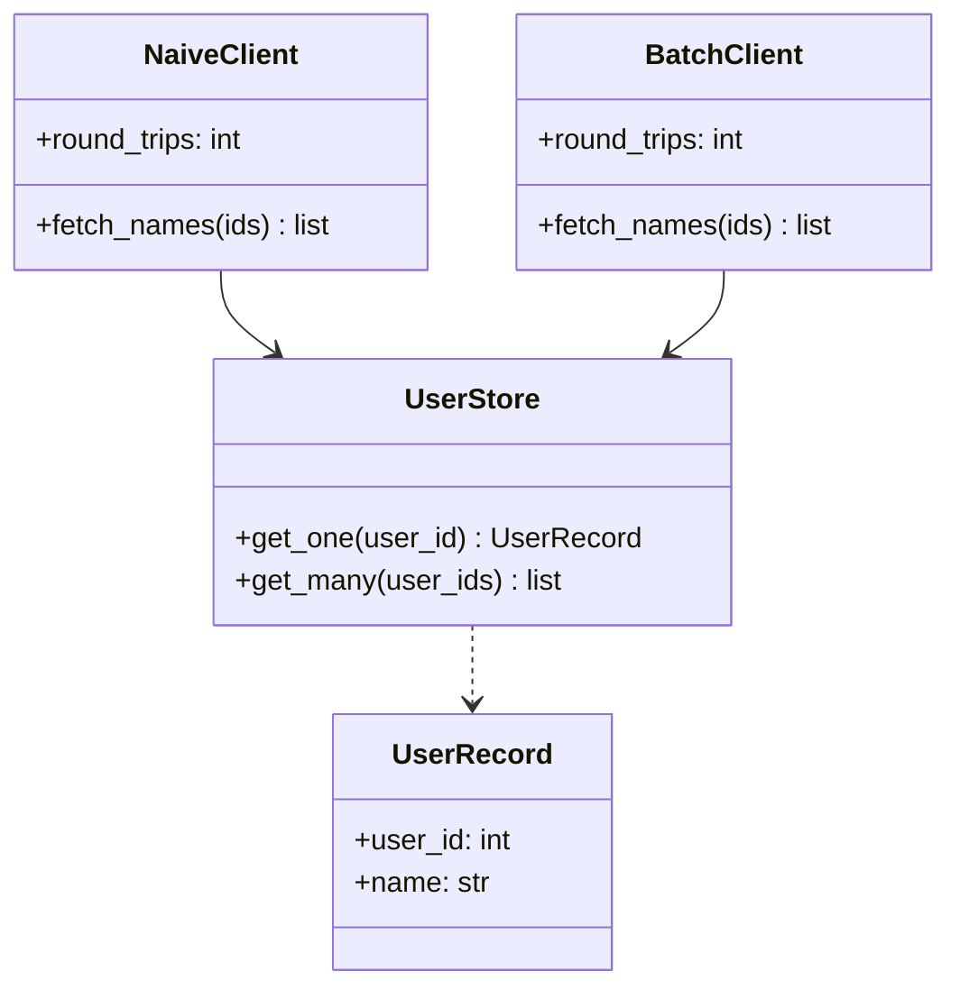
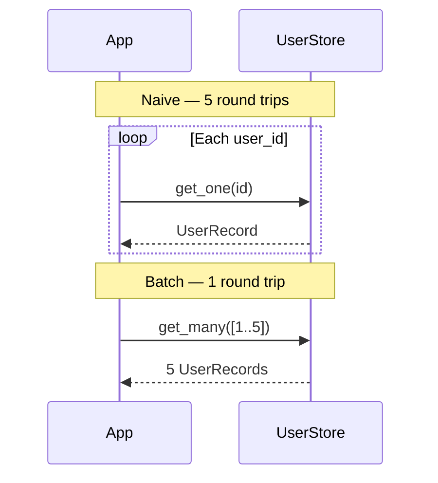
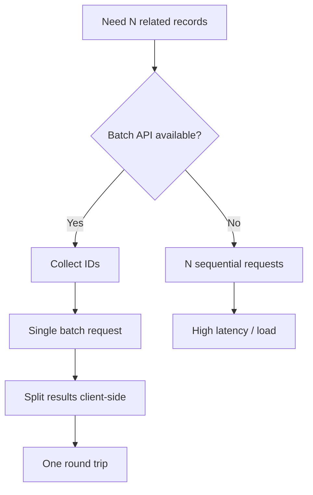

# Batch Request Pattern

## Intent

**Combine multiple operations into a single request** to reduce network round trips and database queries. Especially valuable when a page needs N related records — batching avoids the N+1 problem.

This demo fetches five user names: naive mode uses five round trips; batch mode uses one.

## Class Diagram



## Sequence Diagram



## Flowchart



## Run Instructions

```bash
cd PyPatterns
python3 architecture/batch_request/demo.py
```

Expected output compares 5 round trips (naive) vs 1 round trip (batch) with identical name lists.

## Pros / Cons

| Pros | Cons |
| ---- | ---- |
| Dramatically fewer network hops | Batch endpoints more complex to design |
| Lower DB connection pressure | Large batches can timeout or hit payload limits |
| Better cache efficiency | Partial failures need explicit handling |

## Distributed Environments

Batching is essential at **service and data layers**:

- **GraphQL DataLoader**: coalesces per-key fetches into one query per tick.
- **gRPC batch RPCs** and **Facebook Graph API** `?ids=1,2,3` style endpoints.
- **SQL `WHERE id IN (...)`** instead of N point lookups.

Cap batch size, paginate mega-batches, and return per-item errors so one bad ID does not fail the entire request.

## References

- [Batch Request — Azure Architecture Center](https://learn.microsoft.com/en-us/azure/architecture/patterns/batch-request)
- [List of software architecture styles and patterns — Wikipedia](https://en.wikipedia.org/wiki/List_of_software_architecture_styles_and_patterns)
