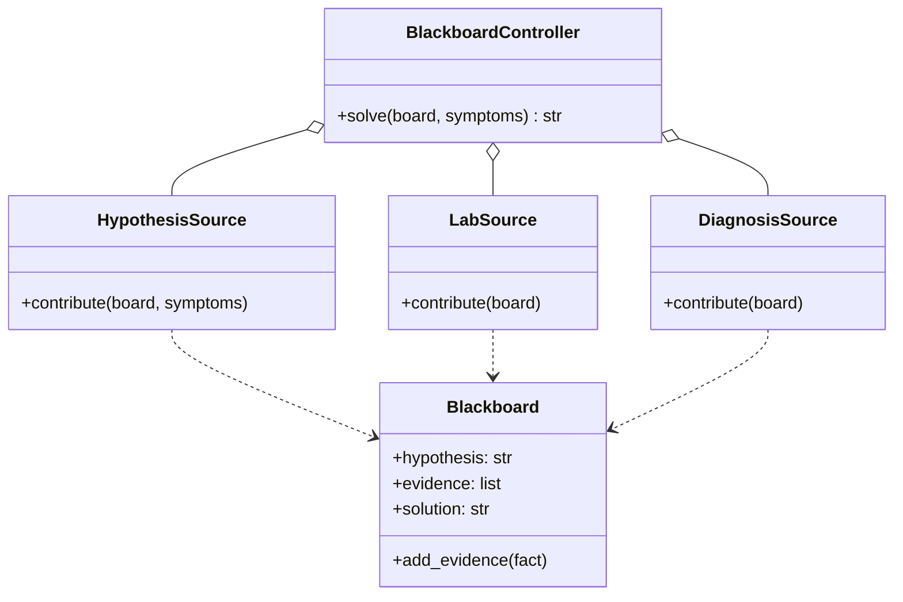
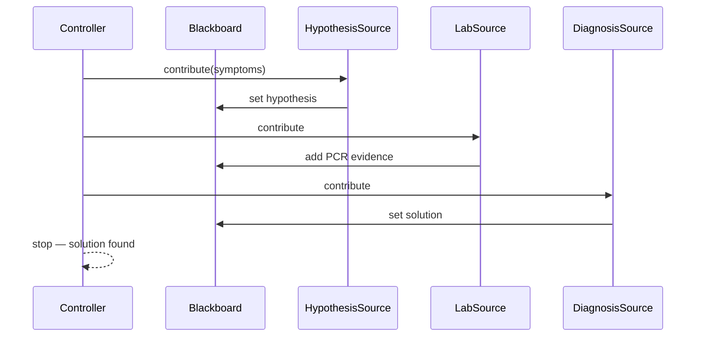
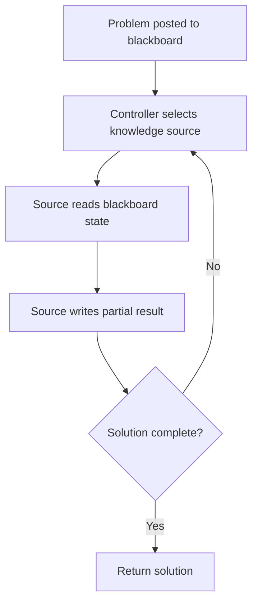

# Blackboard Pattern

## Intent

Solve complex problems by letting **independent knowledge sources** read and write a **shared blackboard** (workspace). No source talks directly to another — the controller triggers sources until a solution emerges on the board.

This demo diagnoses flu-like symptoms: a hypothesis source, lab source, and diagnosis source collaborate via shared state.

## Class Diagram



## Sequence Diagram



## Flowchart



## Run Instructions

```bash
cd PyPatterns
python3 architecture/blackboard/demo.py
```

Expected output shows hypothesis, lab evidence, and a final treatment recommendation written incrementally to the blackboard.

## Pros / Cons

| Pros | Cons |
| ---- | ---- |
| Adds new experts without rewiring existing ones | Controller logic can become complex |
| Natural fit for AI / rule engines | Shared mutable state needs concurrency control |
| Incremental problem solving | Hard to debug non-deterministic source ordering |

## Distributed Environments

Blackboard-style coordination appears in **multi-agent and pipeline systems**:

- **Speech recognition / NLP pipelines**: acoustic, lexical, and semantic modules share a workspace.
- **Expert systems and Drools**: rules fire when blackboard facts match conditions.
- **Workflow engines**: case data accumulates until all approval steps complete.

In distributed form, the blackboard becomes a **shared document store or event log** with optimistic concurrency.

## References

- [Blackboard system — Wikipedia](https://en.wikipedia.org/wiki/Blackboard_system)
- [List of software architecture styles and patterns — Wikipedia](https://en.wikipedia.org/wiki/List_of_software_architecture_styles_and_patterns)
