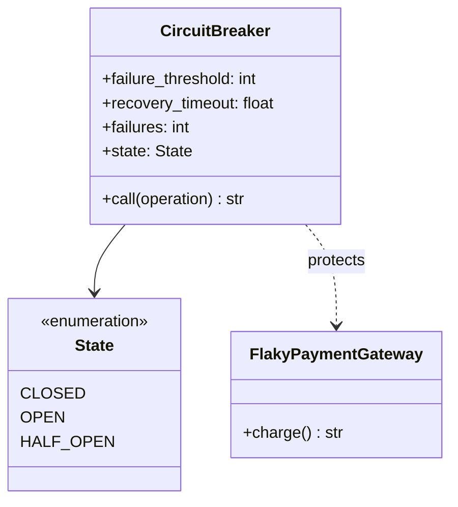
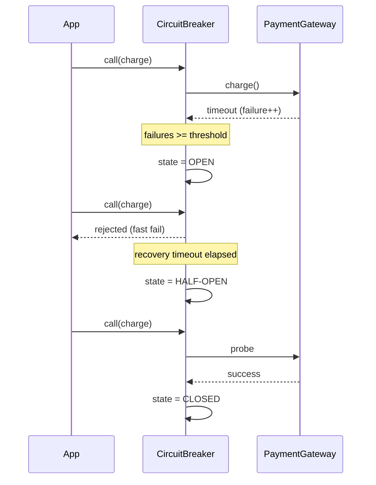
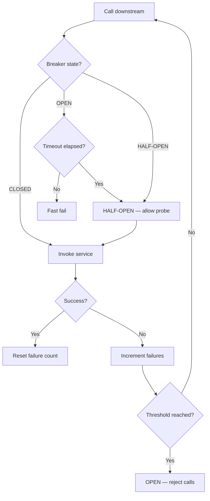

# Circuit Breaker Pattern

## Intent

Prevent cascading failures by **wrapping calls to unreliable dependencies** with a breaker that opens after repeated errors, rejects calls while open, and probes in half-open state before closing again.

This demo wraps a flaky payment gateway; after three failures the breaker opens and fast-fails until recovery timeout.

## Class Diagram



## Sequence Diagram



## Flowchart



## Run Instructions

```bash
cd PyPatterns
python3 architecture/circuit_breaker/demo.py
```

Expected output shows failures incrementing, breaker opening, then half-open probe and close on success.

## Pros / Cons

| Pros | Cons |
| ---- | ---- |
| Stops hammering failing services | Tuning thresholds is workload-specific |
| Fails fast — frees threads and connections | Open breaker may reject valid calls during recovery |
| Gives downstream time to heal | Needs fallback or degraded-mode UX |

## Distributed Environments

Circuit breakers are **mandatory at service mesh boundaries**:

- **Istio / Envoy / resilience4j / Polly**: per-route failure budgets and automatic open/close.
- **Bulkhead pattern (companion)**: isolate thread pools so one dependency cannot exhaust all resources.
- **Health checks + load balancers**: remove unhealthy instances before breakers trip fleet-wide.

Log state transitions, expose breaker metrics to dashboards, and combine with retries only in closed state.

## References

- [Circuit Breaker — Azure Architecture Center](https://learn.microsoft.com/en-us/azure/architecture/patterns/circuit-breaker)
- [List of software architecture styles and patterns — Wikipedia](https://en.wikipedia.org/wiki/List_of_software_architecture_styles_and_patterns)
