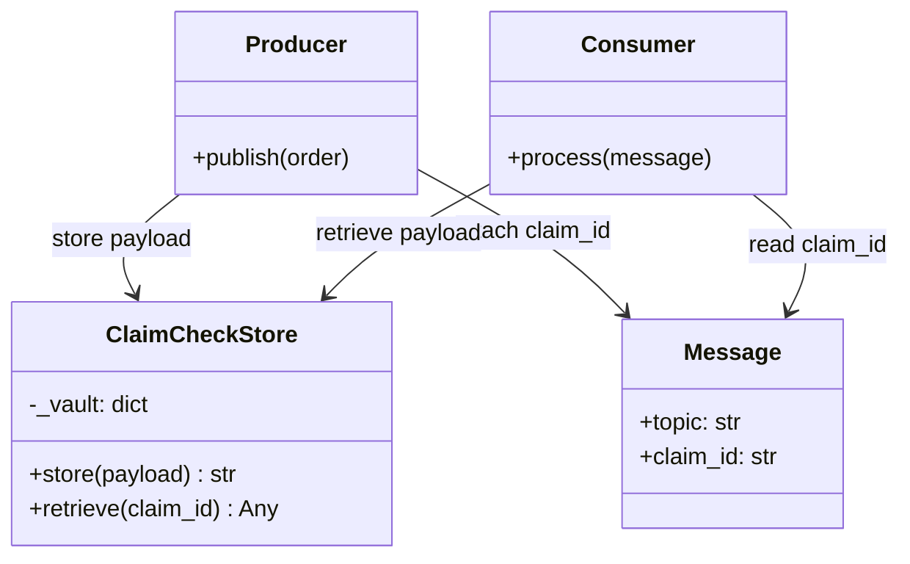
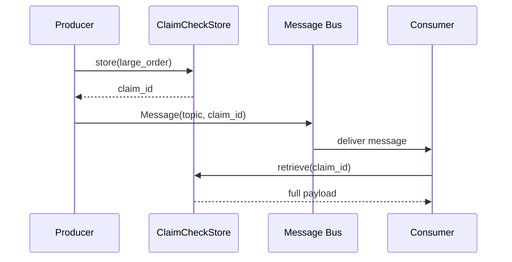
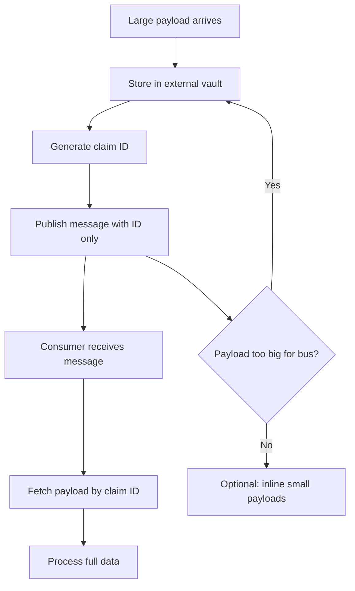

# Claim Check Pattern

## Intent

Store large message payloads in external storage and pass only a **reference (claim check)** through the messaging channel. Keeps brokers lean and avoids size limits on the wire.

This demo stores a bulky order in a `ClaimCheckStore` and sends a lightweight `Message` carrying only the claim ID.

## Class Diagram



## Sequence Diagram



## Flowchart



## Run Instructions

```bash
cd PyPatterns
python3 architecture/claim_check/demo.py
```

Expected output shows a small message on the bus and the consumer restoring five line items from the store.

## Pros / Cons

| Pros | Cons |
| ---- | ---- |
| Keeps message brokers fast and within size quotas | Requires durable, shared storage both sides trust |
| Reduces network bandwidth for bulky attachments | Extra round trip to fetch payload |
| Same pattern works for files, images, and event snapshots | Claim store becomes a critical dependency |
| Enables replay without re-publishing megabyte payloads | Lifecycle/TTL management for orphaned claims |

## Distributed Environments

Claim Check is a standard **enterprise integration pattern**:

- **Amazon SQS + S3**: extended payloads stored in S3; SQS message holds the S3 key.
- **Azure Service Bus** large message support via Azure Blob claim check.
- **Kafka** compact topics for metadata; object storage for attachments.
- **Camel / Spring Integration** `ClaimCheck` component wraps the store-and-forward flow.

Use when payloads exceed broker limits (256 KB SQS, 1 MB Kafka default) or when the same blob must be read by multiple consumers without duplicate transfers.

## References

- [Claim Check — Enterprise Integration Patterns](https://www.enterpriseintegrationpatterns.com/patterns/messaging/StoreInLibrary.html)
- [List of software architecture styles and patterns — Wikipedia](https://en.wikipedia.org/wiki/List_of_software_architecture_styles_and_patterns)
- [Messaging — Wikipedia](https://en.wikipedia.org/wiki/Message_passing)
