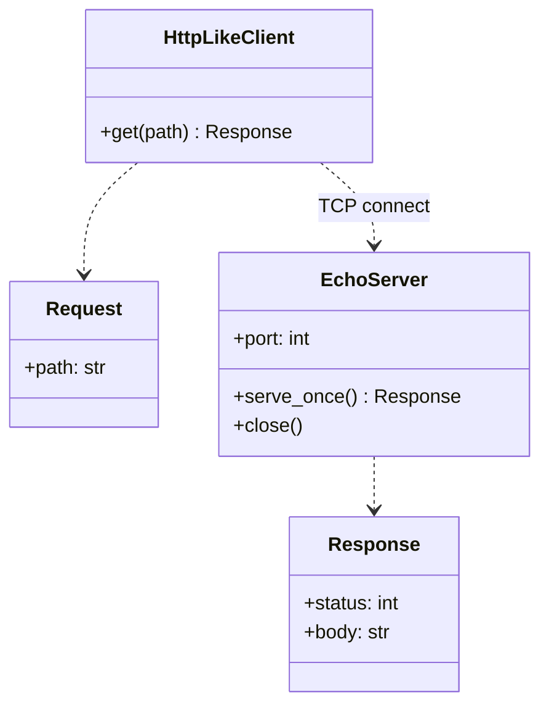
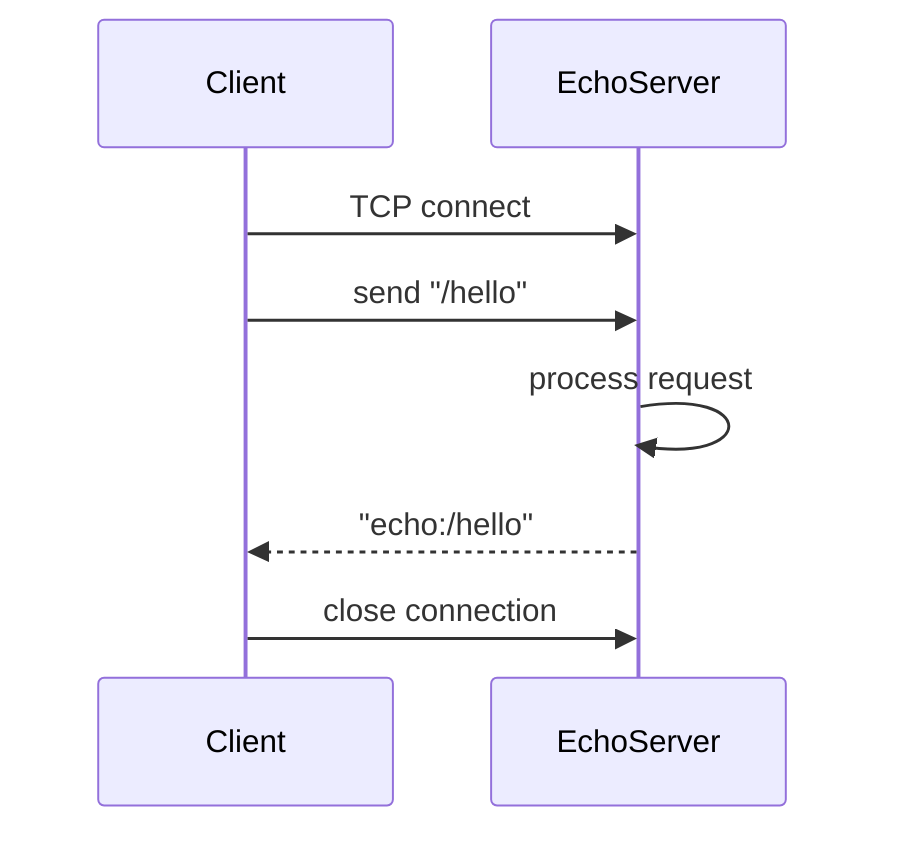
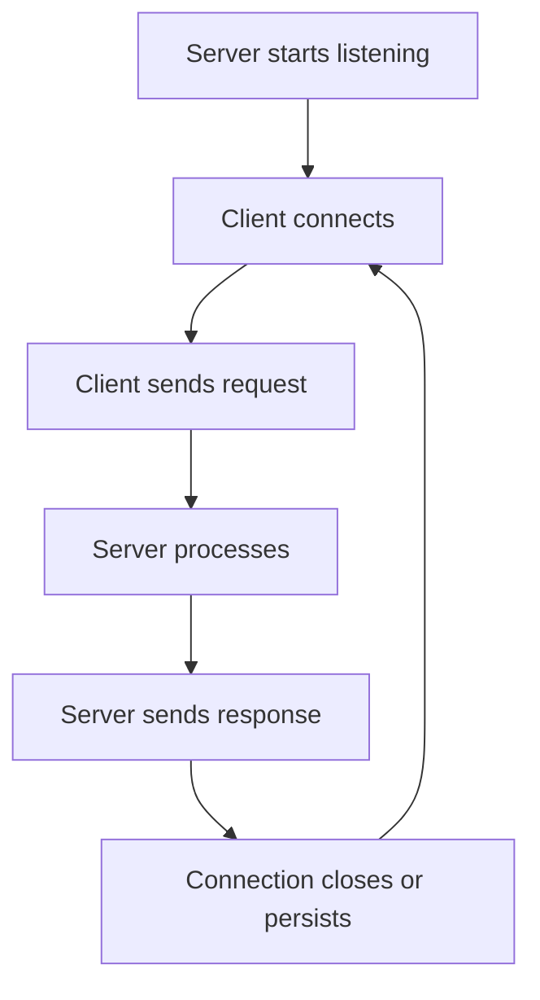

# Client–Server Pattern

## Intent

Split responsibilities between **clients** that initiate requests and **servers** that listen, process, and respond. The client knows the server address; the server does not call the client first.

This demo runs a minimal TCP echo server and a client that sends `/hello` and prints the response.

## Class Diagram



## Sequence Diagram



## Flowchart



## Run Instructions

```bash
cd PyPatterns
python3 architecture/client_server/demo.py
```

Expected output shows the client sending `/hello` and receiving `echo:/hello` from the server.

## Pros / Cons

| Pros | Cons |
| ---- | ---- |
| Simple, well-understood separation | Server can become a bottleneck |
| Centralized data and business logic | Single point of failure without clustering |
| Clients stay thin | Network latency on every interaction |

## Distributed Environments

Client–server is the **foundation of web and enterprise systems**:

- **HTTP/REST and gRPC**: request–response over TCP with standardized framing.
- **Three-tier architecture**: presentation (client) → application (server) → database.
- **Load balancers**: virtual server fronting many backend instances.

Evolve toward **n-tier**, **microservices**, or **peer-to-peer** when centralized servers no longer scale — but the request initiator/responder split remains.

## References

- [Client–server model — Wikipedia](https://en.wikipedia.org/wiki/Client%E2%80%93server_model)
- [List of software architecture styles and patterns — Wikipedia](https://en.wikipedia.org/wiki/List_of_software_architecture_styles_and_patterns)
