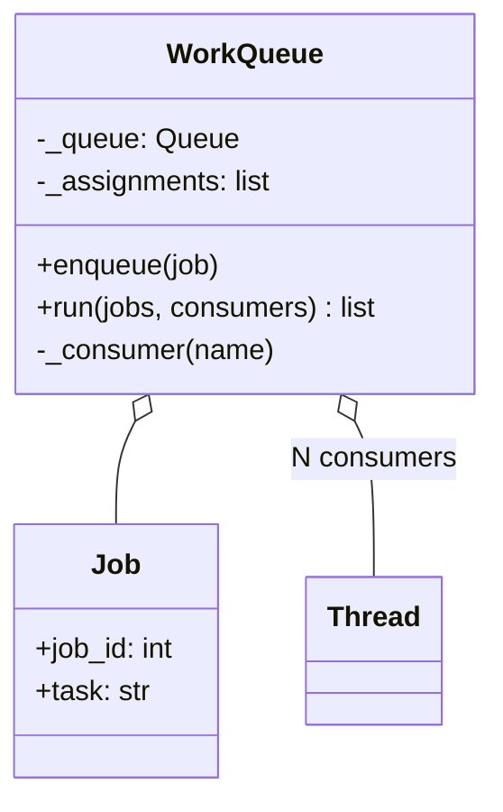
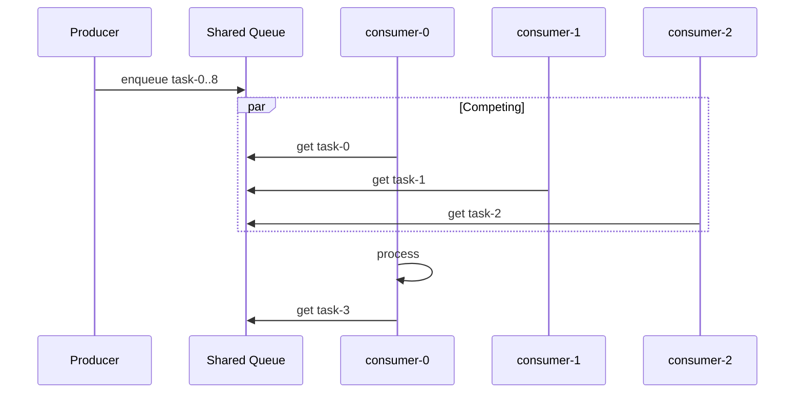
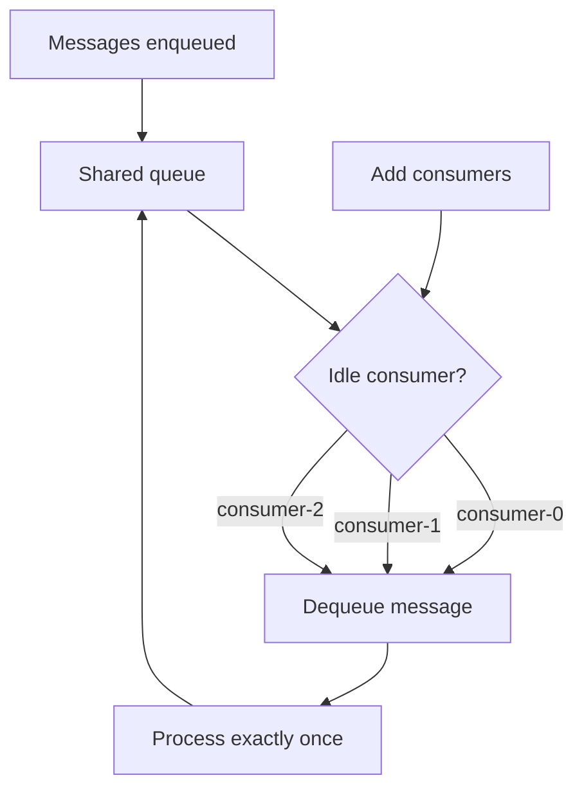

# Competing Consumers Pattern

## Intent

Enable **horizontal scaling** by running multiple consumer instances against **one shared queue**. Each message is processed by exactly one consumer — whichever worker is idle first claims the job.

This demo enqueues nine tasks; three consumers race to drain the queue.

## Class Diagram



## Sequence Diagram



## Flowchart



## Run Instructions

```bash
cd PyPatterns
python3 architecture/competing_consumers/demo.py
```

Expected output shows nine tasks distributed across three consumers (interleaved assignment lines).

## Pros / Cons

| Pros | Cons |
| ---- | ---- |
| Scale throughput by adding workers | Messages not globally ordered across consumers |
| Built-in load balancing via queue | Poison messages can block one consumer |
| Simple deployment model | Duplicate processing if visibility timeout expires |

## Distributed Environments

Competing consumers power **worker fleets everywhere**:

- **Amazon SQS + auto-scaling groups**: CloudWatch queue depth triggers new EC2 instances.
- **Celery workers**: `--concurrency=N` processes pull from Redis/RabbitMQ.
- **Kubernetes HPA**: scale Deployments based on queue lag metrics.

Use FIFO queues only when strict ordering per partition is required; otherwise standard queues maximize parallelism.

## References

- [Competing Consumers — Enterprise Integration Patterns](https://www.enterpriseintegrationpatterns.com/patterns/messaging/CompetingConsumers.html)
- [List of software architecture styles and patterns — Wikipedia](https://en.wikipedia.org/wiki/List_of_software_architecture_styles_and_patterns)
