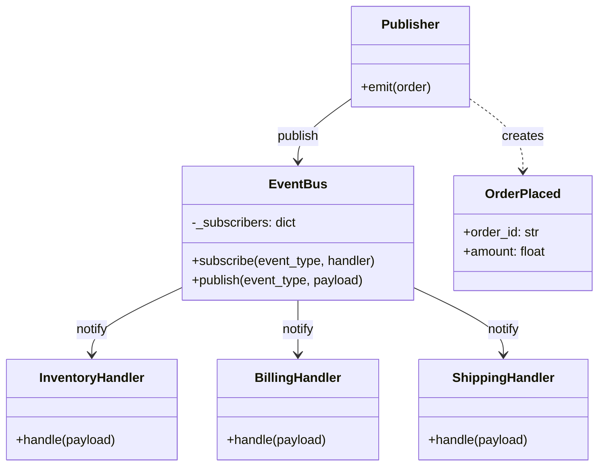
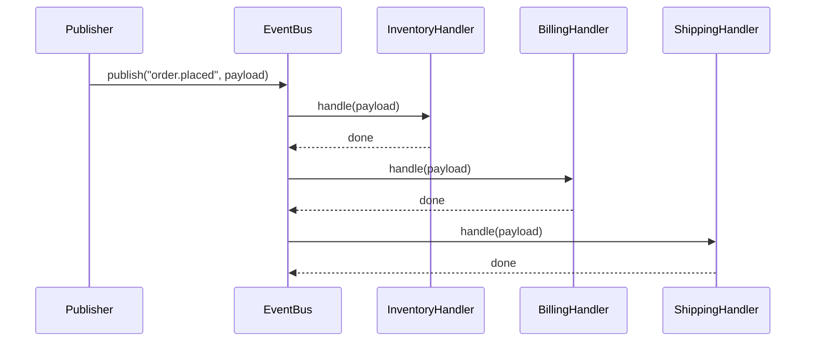
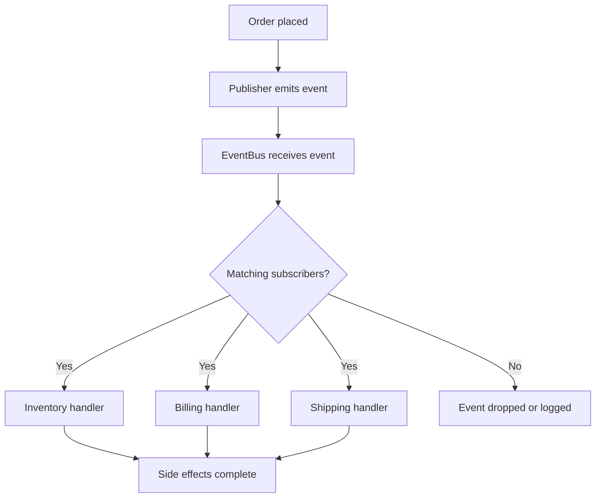

# Event-Driven Architecture

## Intent

Decouple producers from consumers by routing state changes through an **event bus**. Publishers emit events without knowing who listens; subscribers react to event types they care about. This enables scalable, reactive systems where components evolve independently.

This demo places an order and fans out `order.placed` events to inventory, billing, and shipping handlers via a central `EventBus`.

## Class Diagram



## Sequence Diagram



## Flowchart



## Run Instructions

```bash
cd PyPatterns
python3 architecture/event_driven/demo.py
```

Expected output shows one order event fanning out to three independent subscribers.

## Pros / Cons

| Pros | Cons |
| ---- | ---- |
| Loose coupling between producers and consumers | Event ordering and exactly-once delivery are hard |
| Easy to add new subscribers without changing publishers | Debugging distributed event flows can be opaque |
| Natural fit for async, reactive workloads | Eventual consistency requires careful design |

## Distributed Environments

Event-driven architecture is the backbone of modern distributed systems:

- **Apache Kafka**, **RabbitMQ**, and **AWS EventBridge** provide durable, cross-service event routing.
- **CQRS + Event Sourcing** stores state as an append-only log of domain events.
- **Saga patterns** coordinate long-running transactions through compensating events across microservices.

When an e-commerce platform emits `OrderPlaced`, separate fulfillment, analytics, and fraud-detection services subscribe independently — each scaling and deploying on its own schedule without tight coupling to the checkout service.

## References

- [Event-driven architecture — Wikipedia](https://en.wikipedia.org/wiki/Event-driven_architecture)
- [Publish–subscribe pattern — Wikipedia](https://en.wikipedia.org/wiki/Publish%E2%80%93subscribe_pattern)
