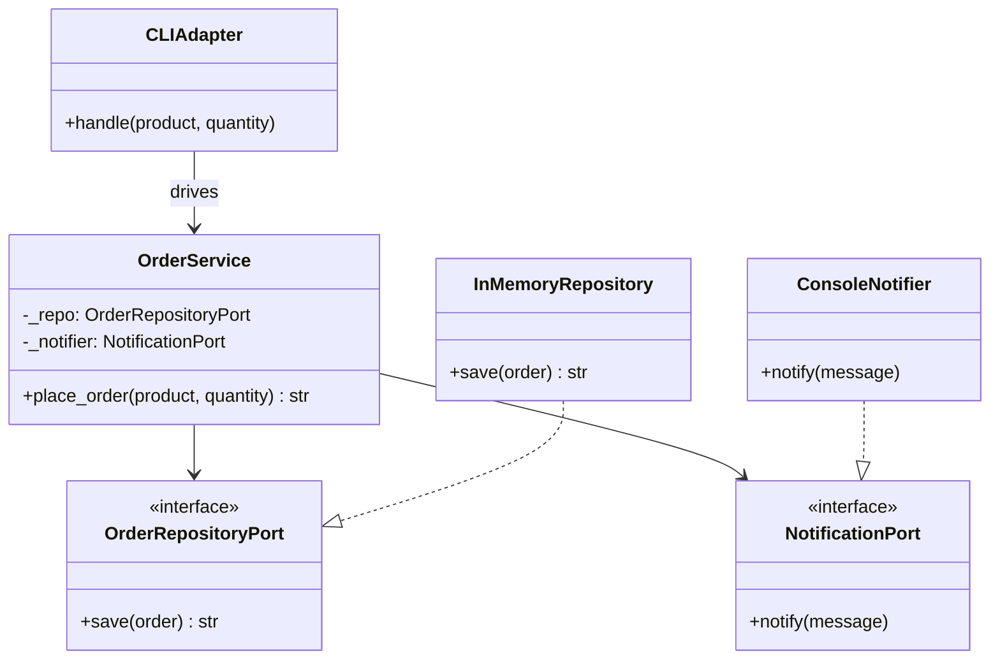
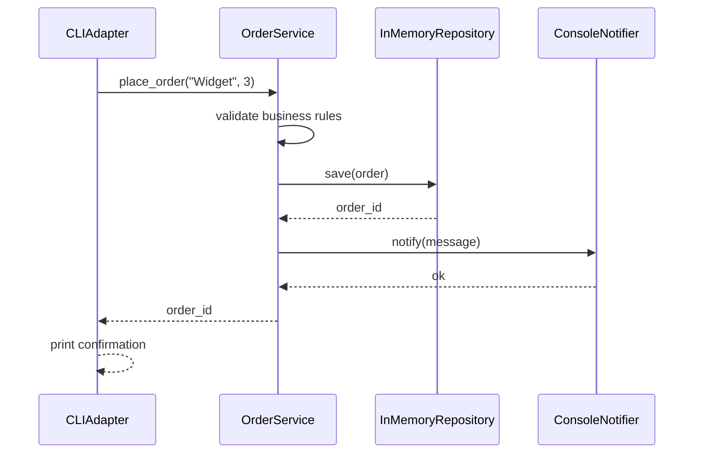
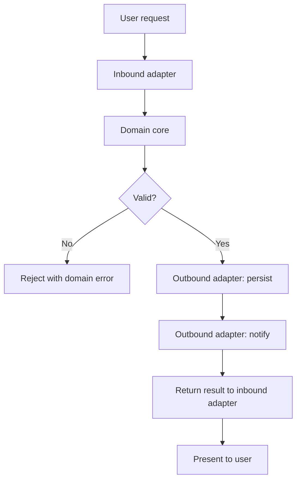

# Hexagonal Architecture

## Intent

Isolate the **domain core** from external concerns using **ports** (interfaces) and **adapters** (implementations). Inbound adapters (CLI, HTTP, messaging) drive the application; outbound adapters (database, email, APIs) satisfy port contracts. The domain never imports infrastructure.

This demo places orders through a CLI adapter, persists via an in-memory repository adapter, and notifies through a console adapter — all wired around a pure `OrderService`.

## Class Diagram



## Sequence Diagram



## Flowchart



## Run Instructions

```bash
cd PyPatterns
python3 architecture/hexagonal/demo.py
```

Expected output shows two orders placed through the CLI, persisted and notified via swappable adapters.

## Pros / Cons

| Pros | Cons |
| ---- | ---- |
| Domain logic is testable without infrastructure | More interfaces and wiring than a simple layered app |
| Swap databases, UIs, or message brokers by changing adapters | Can feel heavyweight for small CRUD applications |
| Clear boundary between business rules and I/O | Team must discipline itself to keep dependencies pointing inward |

## Distributed Environments

Hexagonal (ports-and-adapters) architecture maps cleanly to polyglot microservice boundaries:

- **Inbound adapters** become REST controllers, gRPC handlers, or Kafka consumers at the service edge.
- **Outbound adapters** wrap remote service clients, cloud SDKs, or message publishers behind stable ports.
- **Anti-corruption layers** in DDD are outbound adapters that translate foreign models before they reach the domain.

A payment service keeps `ChargePort` stable while swapping a Stripe adapter for an Adyen adapter in production — or a fake adapter in integration tests — without touching settlement logic.

## References

- [Hexagonal architecture — Wikipedia](https://en.wikipedia.org/wiki/Hexagonal_architecture_(software))
- [Ports and adapters — Alistair Cockburn](https://alistair.cockburn.us/hexagonal-architecture/)
