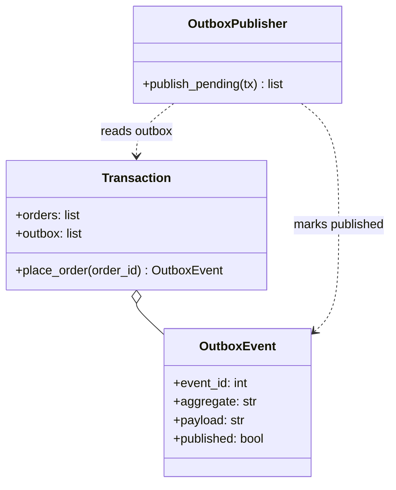
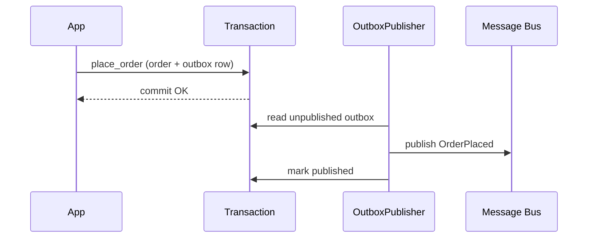
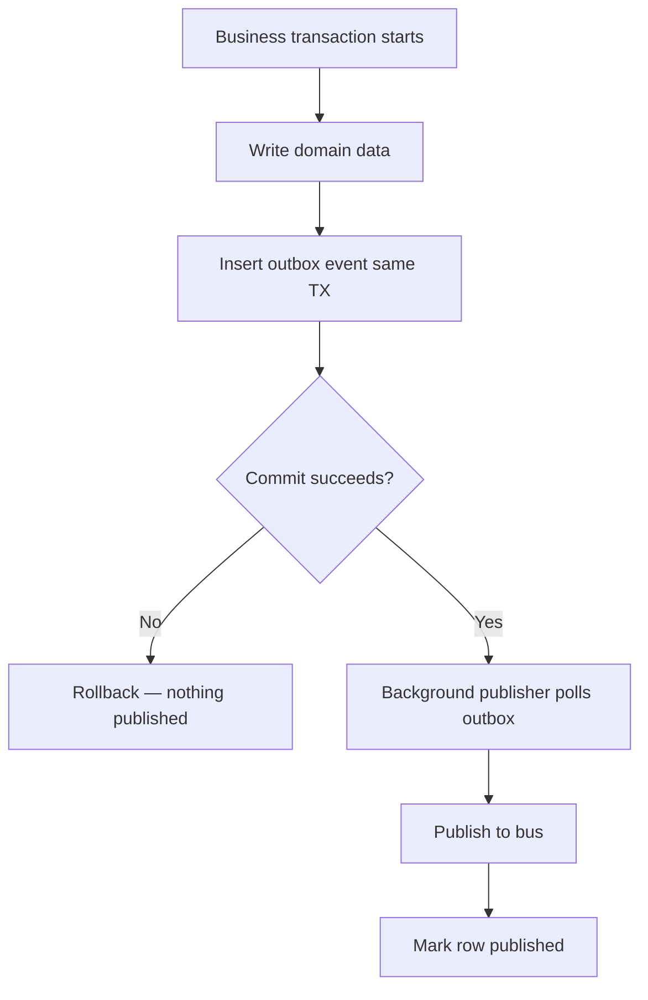

# Transactional Outbox Pattern

## Intent

Guarantee **reliable event publishing** by writing outbound messages to an **outbox table in the same database transaction** as the domain change. A separate process reads the outbox and publishes to the message bus — avoiding dual-write inconsistencies.

This demo places orders and outbox rows atomically, then a publisher drains pending events after commit.

## Class Diagram



## Sequence Diagram



## Flowchart



## Run Instructions

```bash
cd PyPatterns
python3 architecture/inbox_outbox/demo.py
```

Expected output shows two orders committed with matching outbox rows, then both events published with zero pending rows remaining.

## Pros / Cons

| Pros | Cons |
| ---- | ---- |
| Atomic domain write + event record | Requires outbox table and relay process |
| At-least-once delivery without losing events | Duplicate publishes possible — consumers must be idempotent |
| Decouples OLTP from messaging infrastructure | Polling adds latency vs synchronous publish |

## Distributed Environments

The outbox is a **foundational microservices pattern**:

- **Change Data Capture (CDC)**: Debezium reads outbox rows from the DB binlog and streams to Kafka.
- **Sagas / event sourcing**: domain events become the integration contract between bounded contexts.
- **Inbox pattern (companion)**: consumers deduplicate incoming messages with a processed-message table.

Never publish to a broker inside the same request handler without persisting the intent — network failures between DB commit and publish cause silent data loss.

## References

- [Transactional outbox — microservices.io](https://microservices.io/patterns/data/transactional-outbox.html)
- [List of software architecture styles and patterns — Wikipedia](https://en.wikipedia.org/wiki/List_of_software_architecture_styles_and_patterns)
