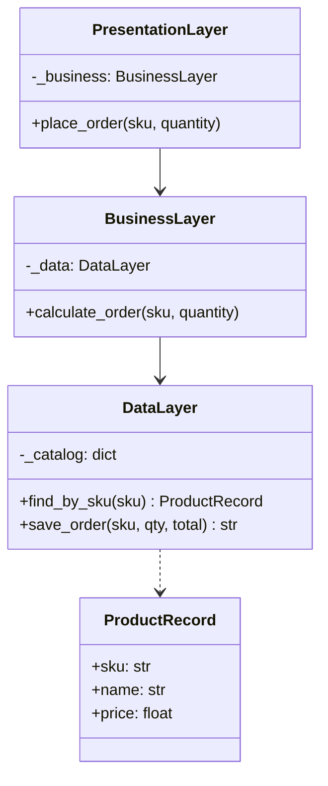
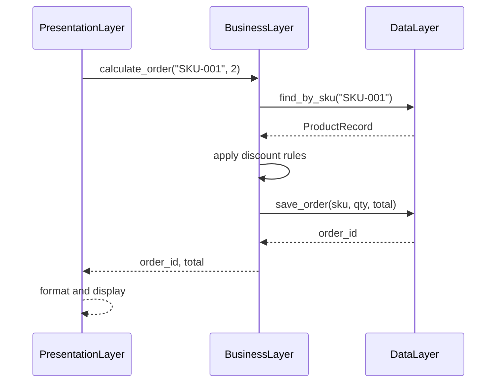
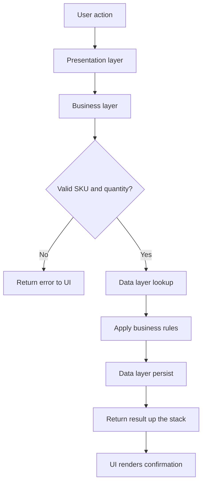

# Layered Architecture

## Intent

Organize an application into horizontal **tiers** with strict top-down dependencies: **presentation** (UI/API), **business** (domain logic), and **data** (persistence). Each layer exposes services to the layer above and calls services in the layer below — never skipping layers or calling upward.

This demo routes order requests from a presentation layer through business pricing rules to a data layer that simulates persistence.

## Class Diagram



## Sequence Diagram



## Flowchart



## Run Instructions

```bash
cd PyPatterns
python3 architecture/layered/demo.py
```

Expected output shows two orders flowing through presentation → business → data layers with a bulk discount applied.

## Pros / Cons

| Pros | Cons |
| ---- | ---- |
| Simple mental model familiar to most developers | Can degrade into a "big ball of mud" if layers leak |
| Clear separation of UI, logic, and persistence | Performance bottlenecks when every call traverses all tiers |
| Easy onboarding for CRUD-centric applications | Hard to split into independent deployable units later |

## Distributed Environments

Classic layered architecture often appears in **n-tier enterprise deployments**:

- **Presentation tier** runs as a web farm (React SPA + API gateway).
- **Business tier** hosts application servers (Java EE, .NET) behind load balancers.
- **Data tier** is a managed RDBMS cluster (PostgreSQL, SQL Server) with read replicas.

In cloud migrations, teams sometimes **extract the data layer first** (database-per-service) while keeping a monolithic business tier — a stepping stone toward microservices without rewriting every layer at once.

## References

- [Multitier architecture — Wikipedia](https://en.wikipedia.org/wiki/Multitier_architecture)
- [Layered architecture pattern — Microsoft Azure](https://learn.microsoft.com/en-us/azure/architecture/guide/architecture-styles/layered)
