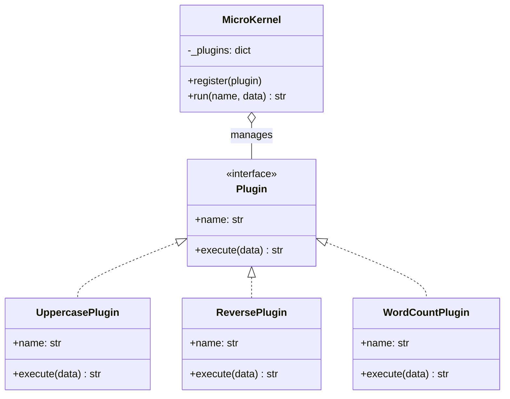
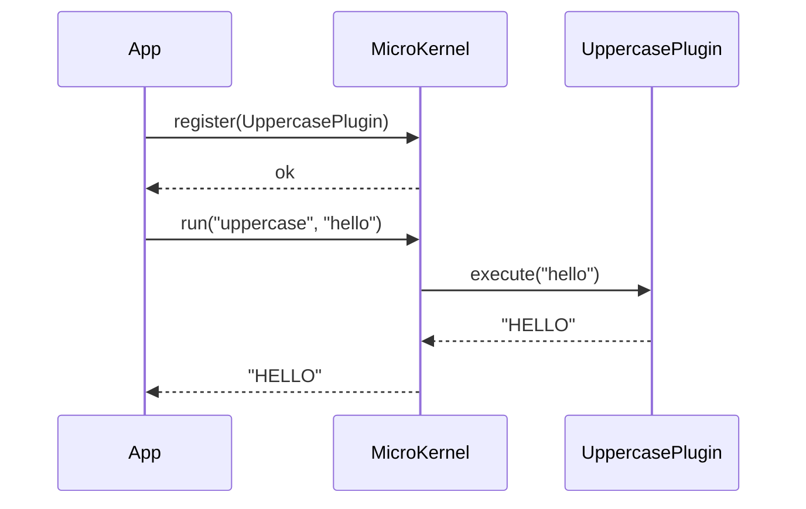
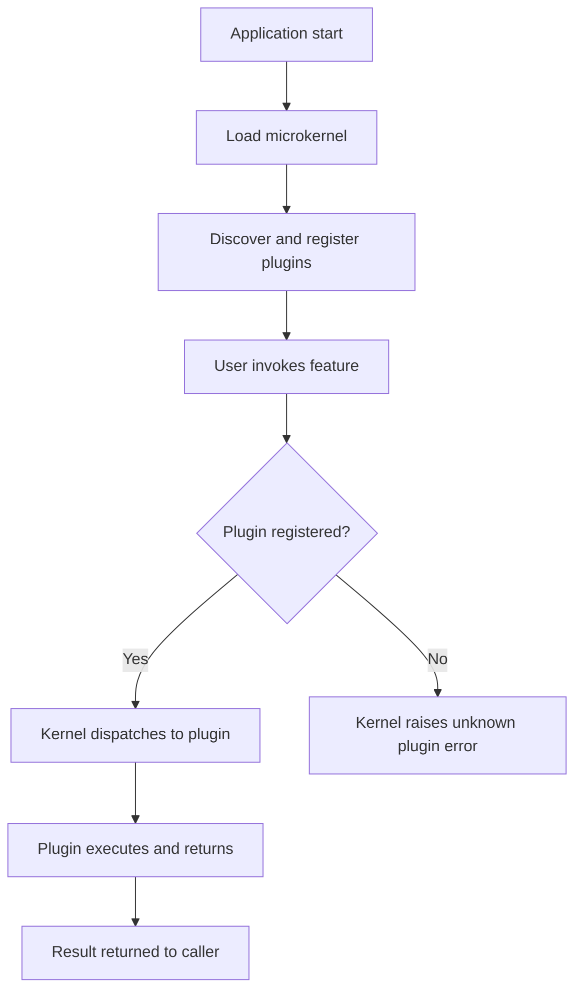

# Microkernel Architecture

## Intent

Keep a minimal **core** (microkernel) responsible for plugin lifecycle and dispatch, while **feature modules** (plugins) provide all product functionality. The core stays stable; new capabilities ship as plugins without modifying kernel code.

This demo registers uppercase, reverse, and word-count plugins into a `MicroKernel` that dispatches text processing to the selected plugin.

## Class Diagram



## Sequence Diagram



## Flowchart



## Run Instructions

```bash
cd PyPatterns
python3 architecture/microkernel/demo.py
```

Expected output shows three plugins registered and each transforming the same input string differently.

## Pros / Cons

| Pros | Cons |
| ---- | ---- |
| Core remains small and stable across releases | Plugin API versioning and compatibility are critical |
| Features ship independently as loadable modules | Debugging across plugin boundaries can be difficult |
| Ideal for extensible platforms (IDEs, browsers, OSes) | Poor fit when features are tightly interdependent |

## Distributed Environments

Microkernel patterns appear in platforms that must support third-party extensions at scale:

- **VS Code** and **Eclipse** load editor features as plugins around a thin workbench core.
- **Kubernetes** uses a CRI/CNI/CSI plugin model so container runtimes and network drivers swap without changing the kubelet.
- **API gateways** (Kong, Envoy) route traffic through filter plugins for auth, rate limiting, and transformation.

A SaaS analytics platform keeps query scheduling in the kernel while customers install custom export plugins — each sandboxed and hot-reloadable without redeploying the core service.

## References

- [Microkernel architecture — Wikipedia](https://en.wikipedia.org/wiki/Microkernel)
- [Microkernel pattern — O'Reilly Software Architecture Patterns](https://www.oreilly.com/library/view/software-architecture-patterns/9781491971437/ch3.html)
