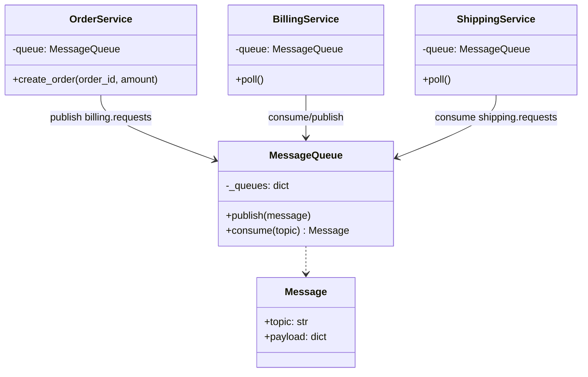
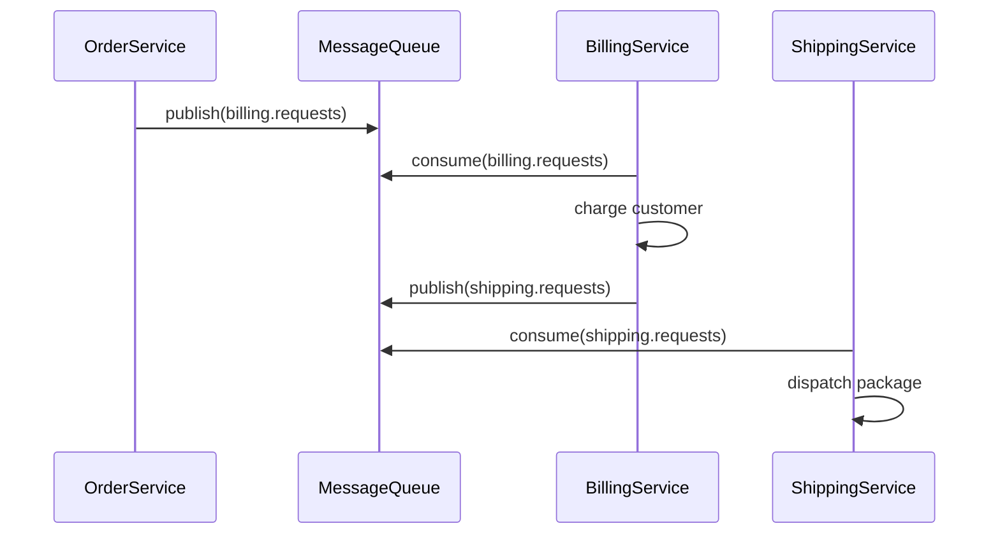
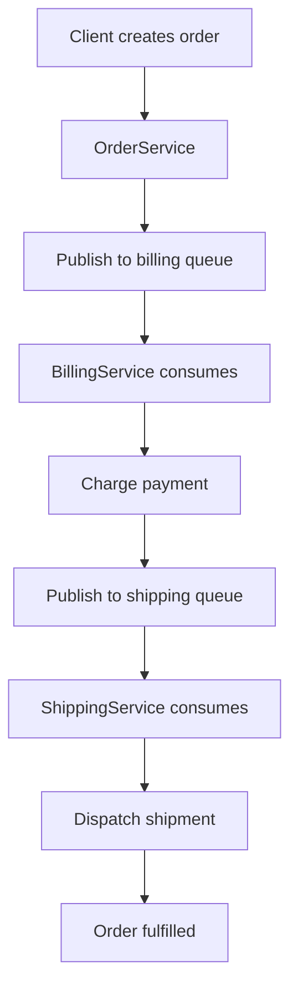

# Microservices Architecture

## Intent

Decompose an application into **small, independently deployable services**, each owning its data and communicating through **lightweight protocols** (HTTP, gRPC, or message queues). Teams can develop, scale, and release services autonomously.

This demo simulates three microservices — Order, Billing, and Shipping — exchanging messages through topic-based queues without shared databases.

## Class Diagram



## Sequence Diagram



## Flowchart



## Run Instructions

```bash
cd PyPatterns
python3 architecture/microservices/demo.py
```

Expected output shows an order flowing through three independent services via message queues.

## Pros / Cons

| Pros | Cons |
| ---- | ---- |
| Independent deployment, scaling, and technology choices per service | Distributed complexity — networking, observability, data consistency |
| Fault isolation — one service failure need not crash the whole system | Operational overhead (service mesh, CI/CD per service, API versioning) |
| Aligns with Conway's Law — teams own bounded contexts | Cross-service transactions require sagas or eventual consistency |

## Distributed Environments

Microservices are the dominant pattern for cloud-native distributed systems:

- **Kubernetes** orchestrates containerized services with service discovery, health checks, and auto-scaling.
- **Service meshes** (Istio, Linkerd) handle mTLS, retries, and circuit breaking between services.
- **Event-driven choreography** (Kafka, SNS/SQS) replaces synchronous call chains for resilience.

A retail platform runs catalog, cart, payment, and notification as separate services — each with its own PostgreSQL instance, deployed on independent CI/CD pipelines, and scaled based on individual load profiles during peak shopping events.

## References

- [Microservices — Wikipedia](https://en.wikipedia.org/wiki/Microservices)
- [Microservices architecture style — Microsoft Azure](https://learn.microsoft.com/en-us/azure/architecture/guide/architecture-styles/microservices)
