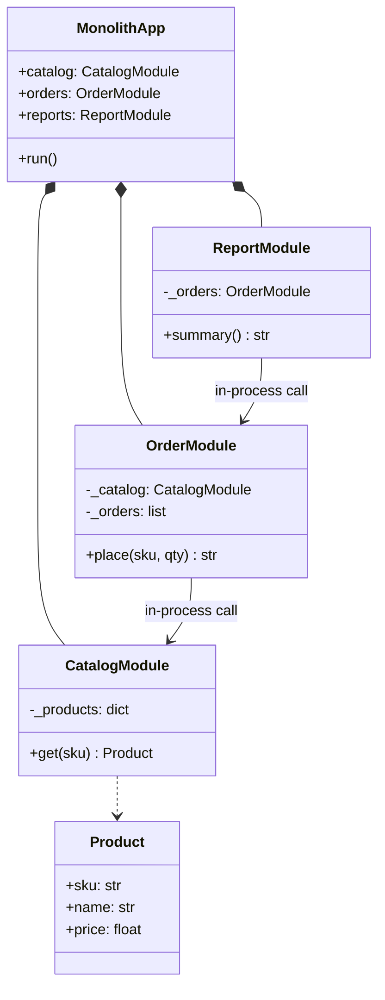
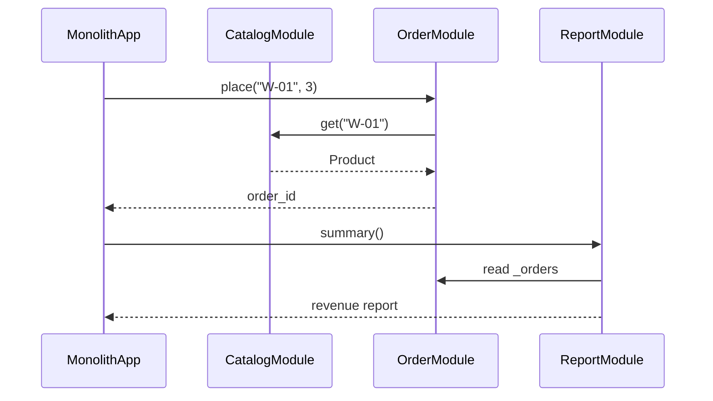
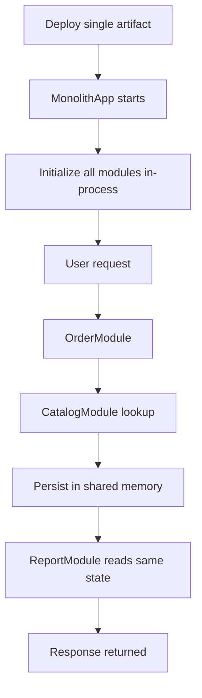

# Monolithic Architecture

## Intent

Build the entire application as a **single deployable unit** with internal modules communicating through **in-process calls**. All features share one codebase, one runtime, and typically one database — maximizing simplicity at the cost of scaling granularity.

This demo wires catalog, order, and reporting modules inside a `MonolithApp` that runs entirely in one Python process.

## Class Diagram



## Sequence Diagram



## Flowchart



## Run Instructions

```bash
cd PyPatterns
python3 architecture/monolithic/demo.py
```

Expected output shows orders placed and a revenue summary — all within one process and deployment.

## Pros / Cons

| Pros | Cons |
| ---- | ---- |
| Simple to develop, test, and deploy initially | Entire app must redeploy for any change |
| No network latency between modules | Scaling requires scaling the whole application |
| Straightforward debugging and transactions | Codebase grows unwieldy as team and features expand |

## Distributed Environments

Monoliths remain common and can coexist with distributed infrastructure:

- **Modular monoliths** enforce module boundaries internally, preparing for later extraction into services.
- **Vertical scaling** (bigger VMs) and **read replicas** extend monolith capacity before splitting.
- **Strangler fig pattern** gradually replaces monolith modules with microservices at the network edge.

Many successful products (Shopify, GitHub early architecture) ran as modular monoliths for years — deploying one artifact to a fleet of identical servers behind a load balancer — before extracting hot paths into separate services only when scaling demands required it.

## References

- [Monolithic application — Wikipedia](https://en.wikipedia.org/wiki/Monolithic_application)
- [Monolithic architecture — AWS Prescriptive Guidance](https://docs.aws.amazon.com/prescriptive-guidance/latest/modernization-decomposing-monoliths/welcome.html)
