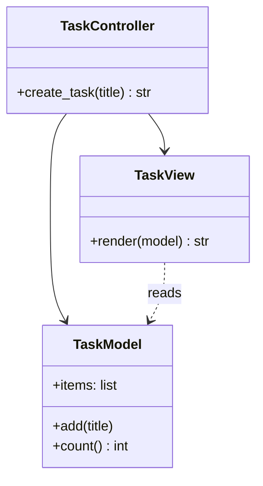
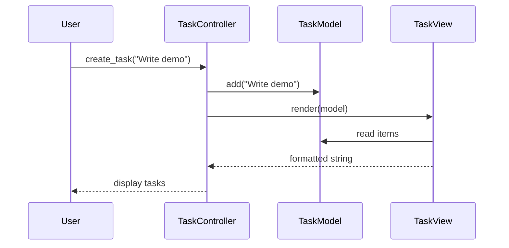
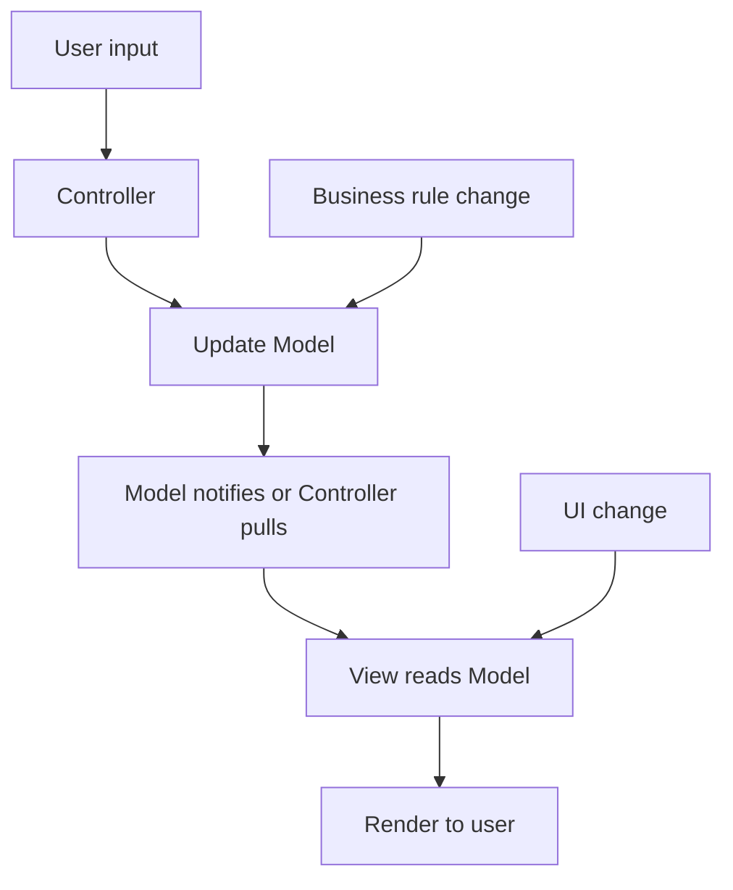

# Model–View–Controller (MVC) Pattern

## Intent

Separate an application into three roles: **Model** (data and rules), **View** (presentation), and **Controller** (input handling). Changes to UI layout do not require changing business logic, and vice versa.

This demo builds a simple task list: the controller handles "create task" actions, the model stores items, and the view renders the list.

## Class Diagram



## Sequence Diagram



## Flowchart



## Run Instructions

```bash
cd PyPatterns
python3 architecture/mvc/demo.py
```

Expected output shows the task list growing after each controller action, rendered by the view.

## Pros / Cons

| Pros | Cons |
| ---- | ---- |
| Clear separation of concerns | Can become ceremony-heavy in small apps |
| Multiple views over same model | Controller bloat if all logic lands there |
| Testable model independent of UI | Framework-specific MVC variants differ |

## Distributed Environments

MVC maps to **tiered and API-backed systems**:

- **Web MVC**: Rails, Django, Spring MVC — server-side rendering with template views.
- **Frontend MVC/MVVM**: React + state stores — component views, reducer/model, event controllers.
- **Backend-for-frontend**: controller layer at the API edge; model in domain microservices.

In microservices, the "model" often spans multiple services — the controller aggregates DTOs while keeping presentation logic out of domain cores.

## References

- [Model–view–controller — Wikipedia](https://en.wikipedia.org/wiki/Model%E2%80%93view%E2%80%93controller)
- [List of software architecture styles and patterns — Wikipedia](https://en.wikipedia.org/wiki/List_of_software_architecture_styles_and_patterns)
