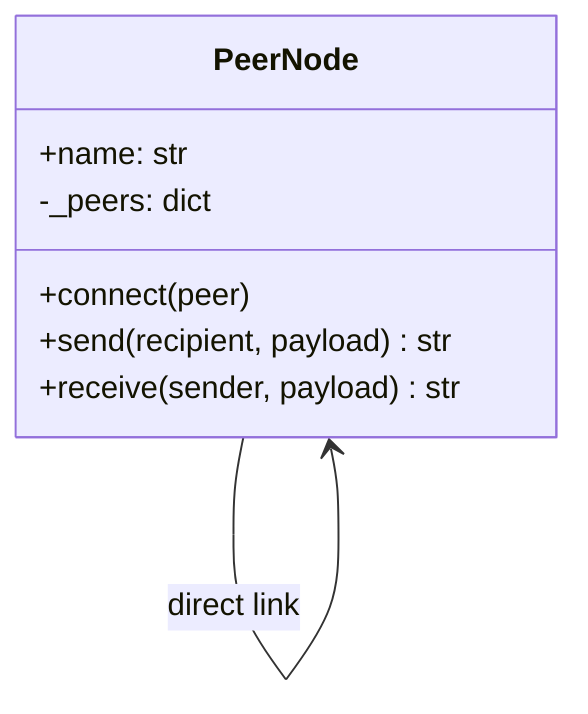
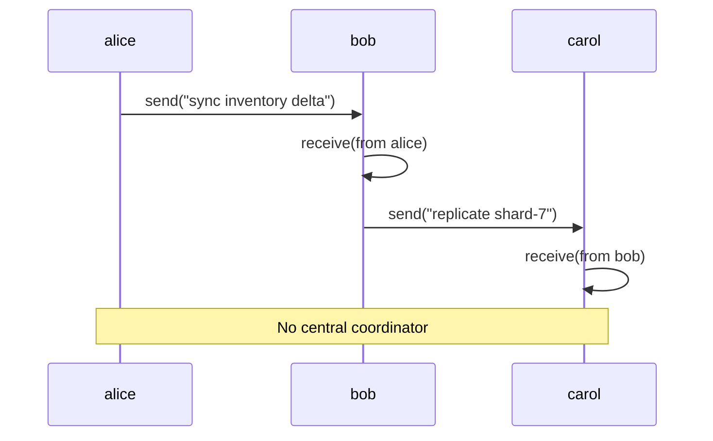
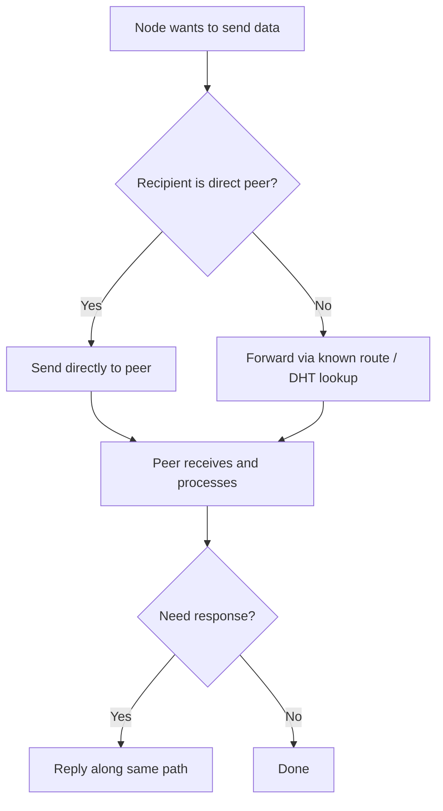

# Peer-to-Peer Pattern

## Intent

Let nodes communicate **directly with one another** without routing every message through a central server. Each peer maintains connections to its neighbors and exchanges data in a decentralized mesh.

This demo connects three `PeerNode` instances; Alice talks to Bob, Bob talks to Carol — no broker in the middle.

## Class Diagram



## Sequence Diagram



## Flowchart



## Run Instructions

```bash
cd PyPatterns
python3 architecture/peer_to_peer/demo.py
```

Expected output shows two direct peer messages and a note that no central server participated.

## Pros / Cons

| Pros | Cons |
| ---- | ---- |
| No single point of failure for routing | Harder to enforce global policies and observability |
| Scales horizontally as peers join | Peer discovery and NAT traversal are non-trivial |
| Low latency for nearby peers | Eventual consistency and partition tolerance trade-offs |
| Resilient to broker outages in hybrid topologies | Security — every peer must authenticate neighbors |

## Distributed Environments

Peer-to-peer appears wherever **decentralization** matters:

- **BitTorrent / IPFS**: content addressed and fetched from peers, not one origin server.
- **Blockchain nodes**: gossip protocols propagate transactions and blocks.
- **WebRTC**: browsers exchange media and data channels directly after signaling.
- **Cassandra / Riak**: replicas talk peer-to-peer for read repair and anti-entropy.
- **Service meshes (partial)**: sidecars may forward to adjacent pods without always hitting a central gateway.

Often combined with a lightweight **signaling or discovery** service (not a message broker) for bootstrap only.

## References

- [Peer-to-peer — Wikipedia](https://en.wikipedia.org/wiki/Peer-to-peer)
- [List of software architecture styles and patterns — Wikipedia](https://en.wikipedia.org/wiki/List_of_software_architecture_styles_and_patterns)
- [Gossip protocol — Wikipedia](https://en.wikipedia.org/wiki/Gossip_protocol)
