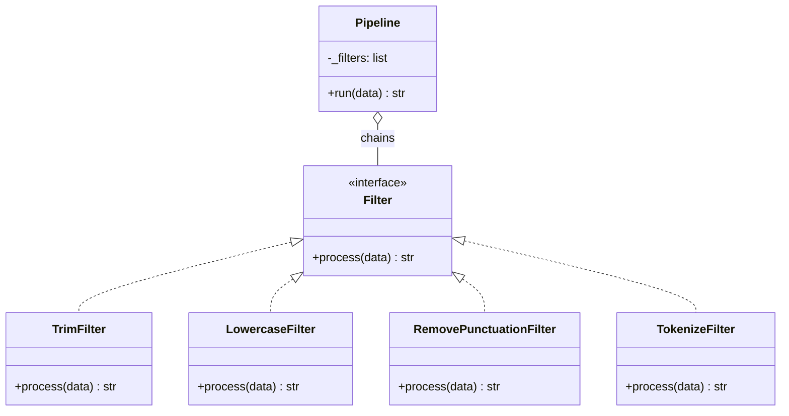
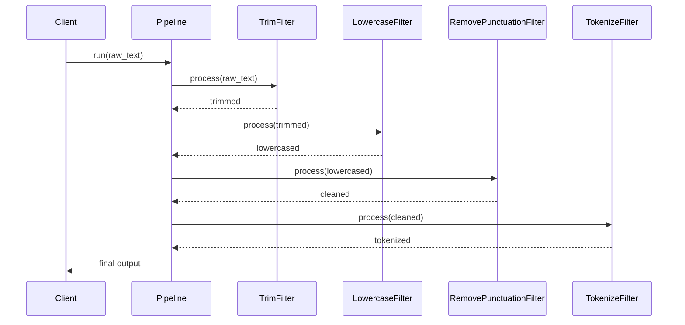
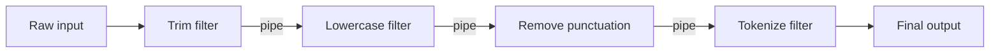

# Pipes and Filters Architecture

## Intent

Process data as a **stream** flowing through a chain of independent **filters**, connected by **pipes** that pass output from one stage to the next. Each filter performs one transformation; filters are reusable and composable into different pipelines.

This demo runs raw text through trim → lowercase → remove punctuation → tokenize stages, printing intermediate results at each pipe connection.

## Class Diagram



## Sequence Diagram



## Flowchart



## Run Instructions

```bash
cd PyPatterns
python3 architecture/pipes_and_filters/demo.py
```

Expected output shows each pipeline stage transforming the input, ending with pipe-delimited tokens.

## Pros / Cons

| Pros | Cons |
| ---- | ---- |
| Filters are independently testable and reusable | Not ideal for complex branching or stateful workflows |
| Easy to add, remove, or reorder processing stages | Error handling across stages requires explicit design |
| Natural parallelism — stages can run concurrently on stream chunks | Latency accumulates across long filter chains |

## Distributed Environments

Pipes and filters underpin many large-scale data and media systems:

- **Unix shell pipelines** (`grep | sort | uniq`) are the original pipes-and-filters model.
- **Apache NiFi**, **AWS Glue ETL**, and **Apache Beam** compose data transformations as directed acyclic graphs of filter stages.
- **Media transcoding** chains decode → resize → encode through filter stages connected by buffered pipes.

A log-ingestion platform streams events through deduplication, enrichment, and aggregation filters — each stage deployed as a separate Kafka Streams processor that scales horizontally with partition count.

## References

- [Pipeline (computing) — Wikipedia](https://en.wikipedia.org/wiki/Pipeline_(computing))
- [Pipes and filters — Enterprise Integration Patterns](https://www.enterpriseintegrationpatterns.com/patterns/messaging/PipesAndFilters.html)
