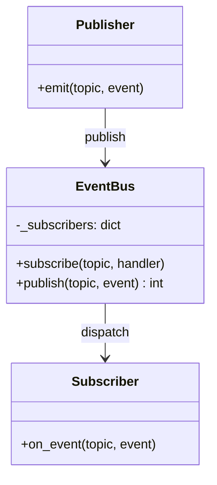
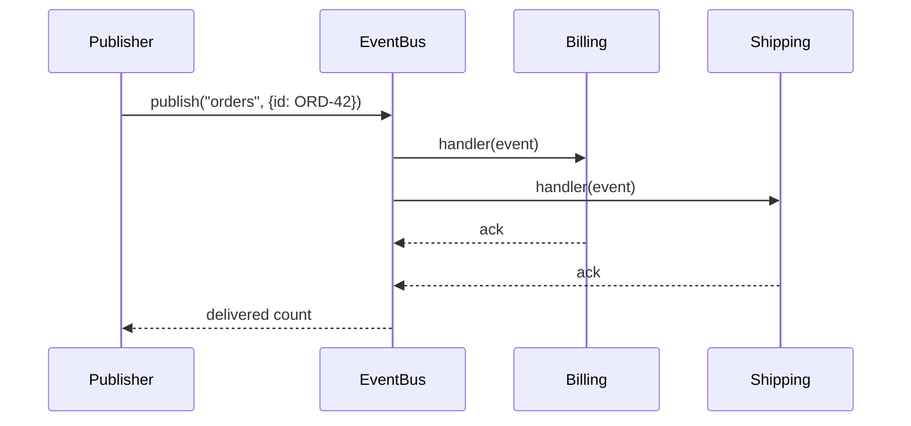
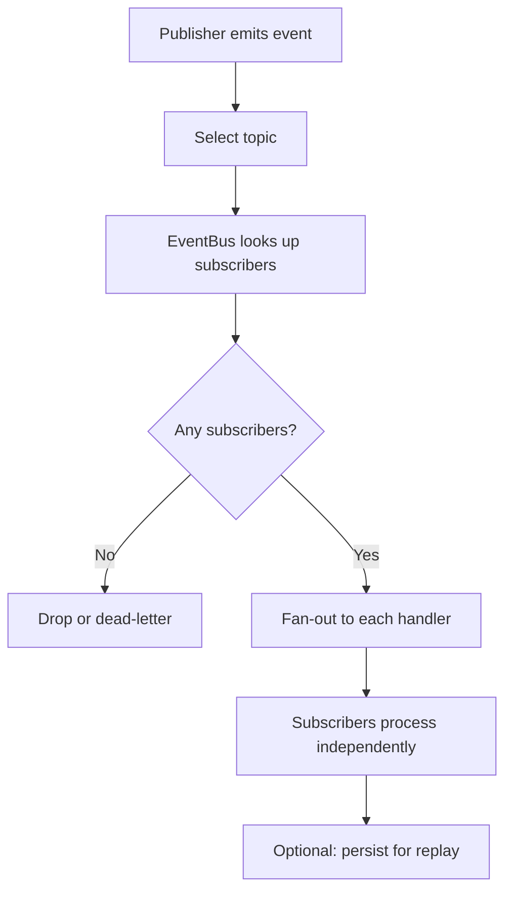

# Publish-Subscribe Pattern

## Intent

Decouple **publishers** from **subscribers** through named **topics**. Publishers emit events to a topic; subscribers register interest and receive matching events without knowing who sent them.

This demo uses an `EventBus` where an order event notifies both billing and shipping, and an inventory event reaches the warehouse alone.

## Class Diagram



## Sequence Diagram



## Flowchart



## Run Instructions

```bash
cd PyPatterns
python3 architecture/publish_subscribe/demo.py
```

Expected output shows two subscribers notified for `orders` and one for `inventory`.

## Pros / Cons

| Pros | Cons |
| ---- | ---- |
| Loose coupling — add subscribers without changing publishers | Ordering guarantees vary by broker |
| Natural fan-out for domain events | Debugging distributed event chains is harder |
| Scales to many consumers per topic | Slow subscribers need backpressure or DLQ |
| Enables event-driven and CQRS architectures | Topic design becomes a governance concern |

## Distributed Environments

Pub/sub is the backbone of **event-driven microservices**:

- **Apache Kafka**, **Google Pub/Sub**, **AWS SNS/SQS**, **NATS**, **RabbitMQ** (topic exchanges).
- **Domain events**: `OrderPlaced` triggers billing, fulfillment, and analytics independently.
- **Change Data Capture (CDC)**: Debezium publishes database row changes to topics.
- **CloudEvents** standardizes envelope metadata across vendors.

Prefer immutable event logs (Kafka) when you need replay; use fire-and-forget SNS when you need simple fan-out.

## References

- [Publish–subscribe pattern — Wikipedia](https://en.wikipedia.org/wiki/Publish%E2%80%93subscribe_pattern)
- [List of software architecture styles and patterns — Wikipedia](https://en.wikipedia.org/wiki/List_of_software_architecture_styles_and_patterns)
- [Event-driven architecture — Wikipedia](https://en.wikipedia.org/wiki/Event-driven_architecture)
