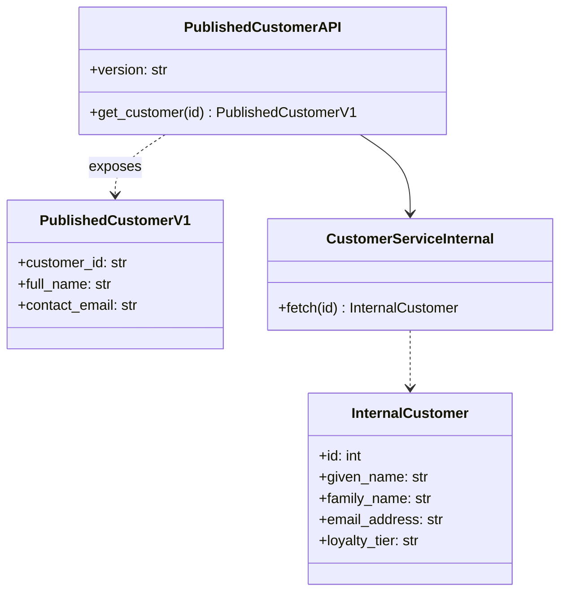
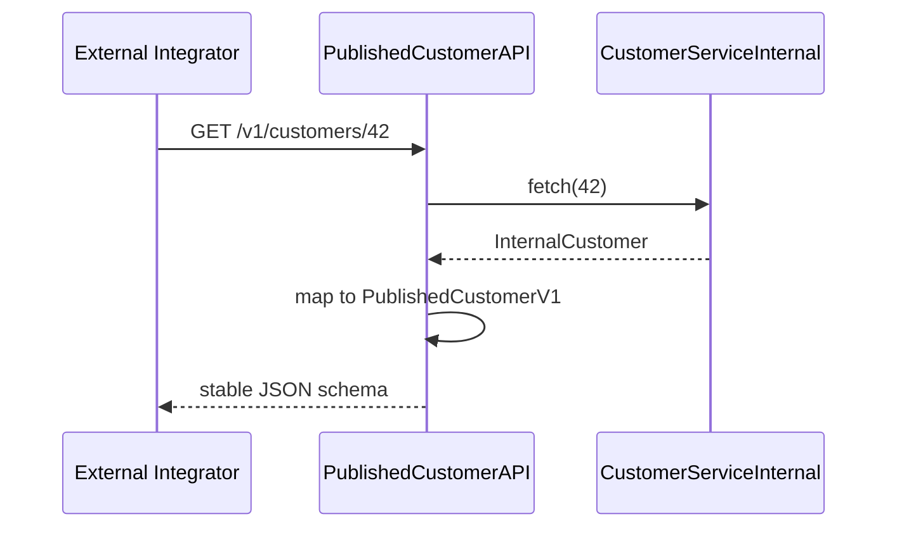
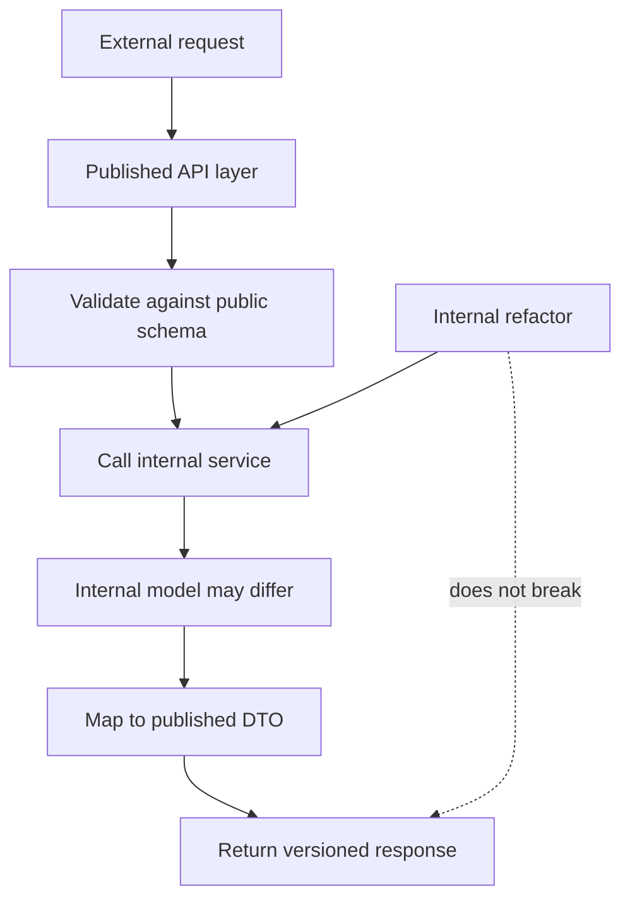

# Published Interface Pattern

## Intent

Expose a **stable, versioned public API** while allowing internal services to evolve freely. External integrators depend only on the published contract; internal field renames and schema changes are mapped at the boundary.

This demo hides internal `loyalty_tier` and maps `given_name`/`family_name` to a semver-guaranteed `PublishedCustomerV1`.

## Class Diagram



## Sequence Diagram



## Flowchart



## Run Instructions

```bash
cd PyPatterns
python3 architecture/published_interfaces/demo.py
```

Expected output shows `PublishedCustomerV1` with `full_name` and `contact_email`, with internal-only fields omitted.

## Pros / Cons

| Pros | Cons |
| ---- | ---- |
| Internal agility without breaking partners | Mapping layer to build and test |
| Clear semver contract for integrators | Multiple published versions may coexist |
| Hides implementation details | Published surface can lag new features |

## Distributed Environments

Published interfaces define **integration boundaries**:

- **OpenAPI / AsyncAPI specs** checked into a registry; breaking changes require major version bumps.
- **API gateways** enforce published routes while routing to internal microservices.
- **Consumer-driven contracts** (Pact): partners test against the published schema, not internal stubs.

Document deprecation timelines; never remove a published field without a migration path.

## References

- [Published Language — Domain-Driven Design](https://www.domainlanguage.com/ddd/reference/)
- [List of software architecture styles and patterns — Wikipedia](https://en.wikipedia.org/wiki/List_of_software_architecture_styles_and_patterns)
