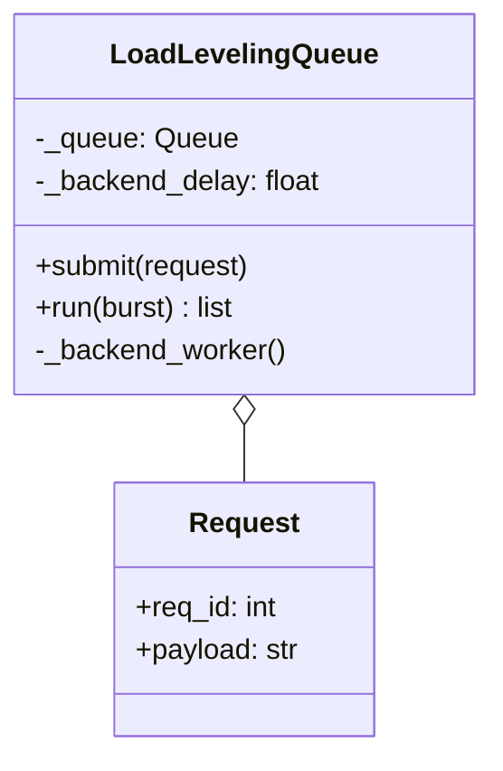
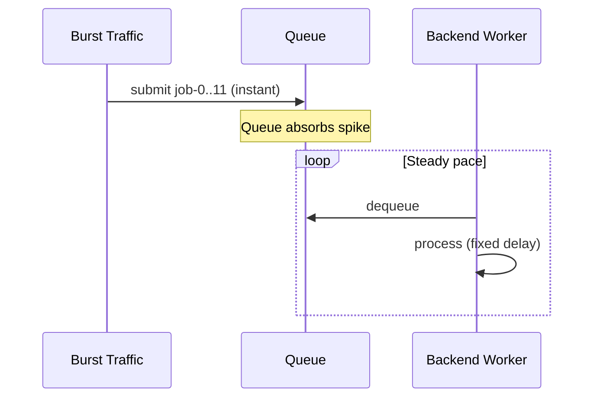
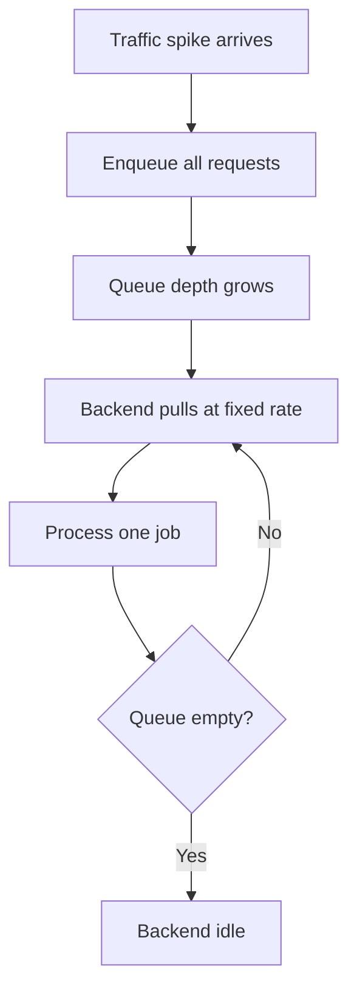

# Queue-Based Load Leveling Pattern

## Intent

Use a **message queue as a buffer** between bursty producers and a capacity-limited backend. Spikes are absorbed in the queue; the backend drains work at a steady, sustainable rate.

This demo submits twelve jobs instantly while a single worker processes them with a fixed delay.

## Class Diagram



## Sequence Diagram



## Flowchart



## Run Instructions

```bash
cd PyPatterns
python3 architecture/queue_load_leveling/demo.py
```

Expected output reports 12 burst requests, steady backend pacing, and total elapsed time greater than instant processing.

## Pros / Cons

| Pros | Cons |
| ---- | ---- |
| Protects fragile backends from overload | Adds latency during spikes |
| Smooth, predictable resource usage | Queue can grow unbounded without limits |
| Simple to scale consumers horizontally | Requires monitoring queue depth |

## Distributed Environments

Load leveling appears wherever **ingress exceeds service capacity**:

- **AWS SQS + Lambda**: queue absorbs API Gateway spikes; Lambda concurrency caps drain rate.
- **API rate limiting + task queues**: accept requests fast, process asynchronously.
- **Autoscaling lag**: queue bridges the gap while new instances boot.

Pair with dead-letter queues and max-receive counts so poison messages do not block the pipe indefinitely.

## References

- [Queue-Based Load Leveling — Azure Architecture Center](https://learn.microsoft.com/en-us/azure/architecture/patterns/queue-based-load-leveling)
- [List of software architecture styles and patterns — Wikipedia](https://en.wikipedia.org/wiki/List_of_software_architecture_styles_and_patterns)
