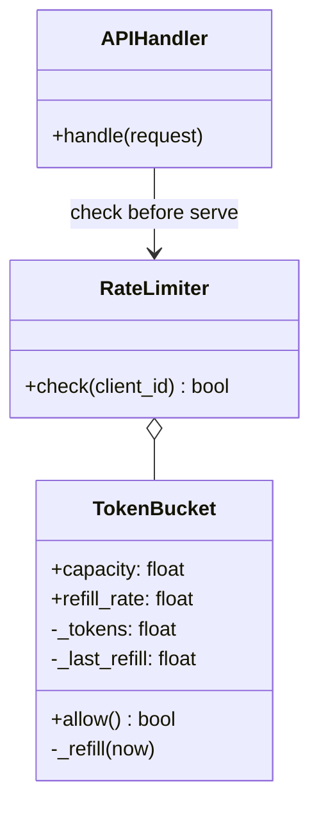
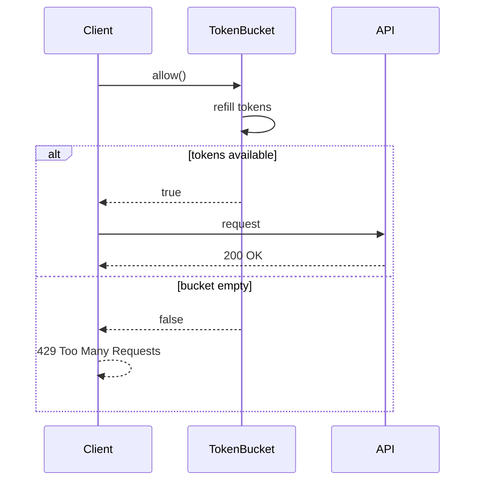
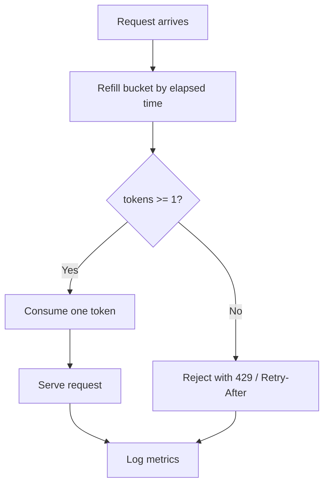

# Rate Limiting Pattern

## Intent

Cap how many requests a client or service may execute in a given time window. Protects shared resources, enforces fair use, and prevents abuse using algorithms such as **token bucket** or **sliding window**.

This demo implements a **token bucket** that allows bursts up to capacity and refills tokens at a steady rate.

## Class Diagram



## Sequence Diagram



## Flowchart



## Run Instructions

```bash
cd PyPatterns
python3 architecture/rate_limiting/demo.py
```

Expected output shows an initial burst of allowed requests followed by rejections until tokens refill.

## Pros / Cons

| Pros | Cons |
| ---- | ---- |
| Protects APIs from overload and abuse | Misconfigured limits frustrate legitimate users |
| Token bucket allows controlled bursts | Distributed counters need Redis or similar |
| Simple to explain in SLAs and docs | Sliding window is more accurate but costlier |
| Standard HTTP 429 semantics | Per-tenant tuning requires observability |

## Distributed Environments

Rate limiting is enforced at **every edge**:

- **API gateways**: Kong, Envoy, AWS API Gateway usage plans.
- **Redis + Lua**: atomic INCR/EXPIRE or token bucket scripts shared across pods.
- **CDN / WAF**: Cloudflare, Akamai rate rules before traffic hits origin.
- **gRPC interceptors** and **middleware** apply per-method quotas.

Distinguish **rate limiting** (requests per second) from **throttling** (concurrency / queue depth) — often used together.

## References

- [Token bucket — Wikipedia](https://en.wikipedia.org/wiki/Token_bucket)
- [Leaky bucket — Wikipedia](https://en.wikipedia.org/wiki/Leaky_bucket)
- [List of software architecture styles and patterns — Wikipedia](https://en.wikipedia.org/wiki/List_of_software_architecture_styles_and_patterns)
