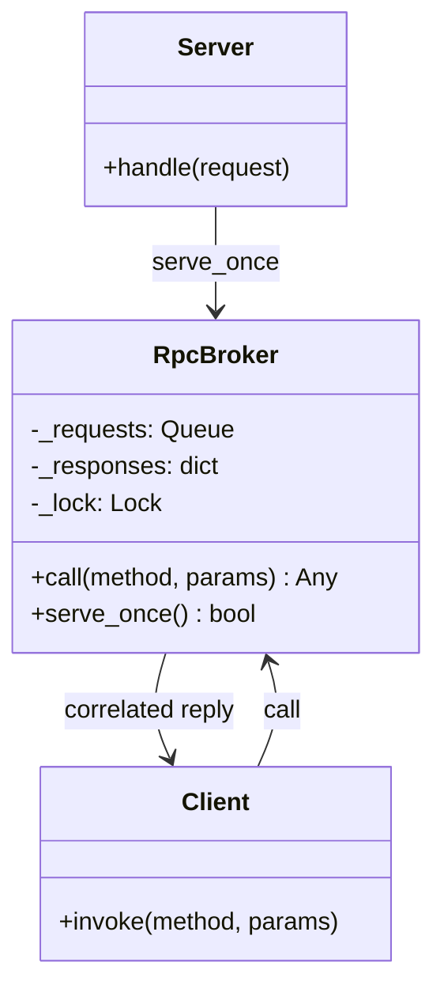
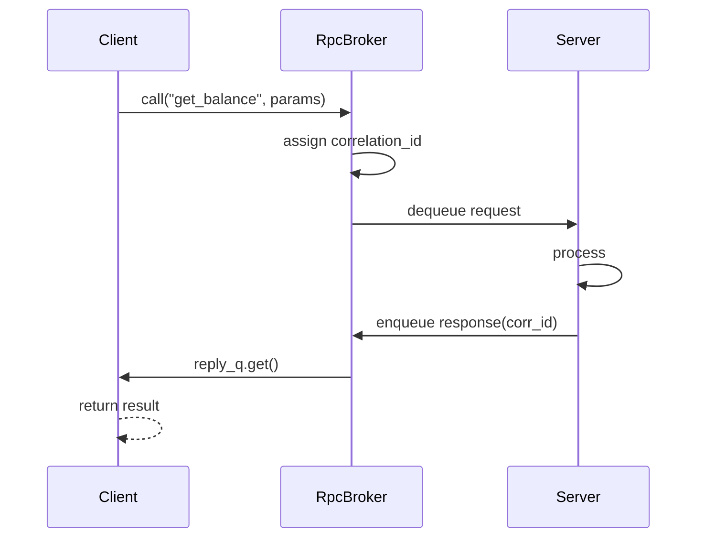
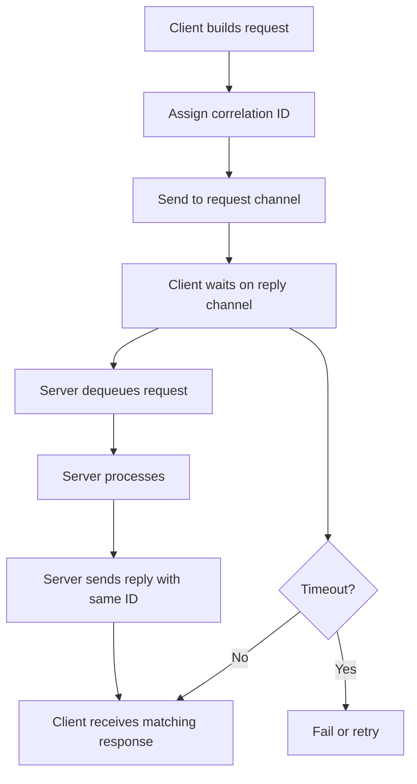

# Request-Response Pattern

## Intent

Model **synchronous interaction** as a paired message exchange: the client sends a request and blocks until a correlated response arrives. This is the messaging analogue of RPC and HTTP call/response semantics.

This demo uses an in-process `RpcBroker` with correlation IDs, a request queue, and per-call reply queues.

## Class Diagram



## Sequence Diagram



## Flowchart



## Run Instructions

```bash
cd PyPatterns
python3 architecture/request_response/demo.py
```

Expected output shows two RPC calls returning formatted results after the background server handles them.

## Pros / Cons

| Pros | Cons |
| ---- | ---- |
| Familiar semantics — maps cleanly to function calls | Couples client and server in time (blocking) |
| Correlation IDs enable many in-flight calls | Timeouts and orphaned replies need handling |
| Works over queues, sockets, or HTTP | Less resilient than fire-and-forget under load |
| Natural fit for query operations | Not ideal for long-running or streaming work |

## Distributed Environments

Request-response underpins most **synchronous service calls**:

- **HTTP/REST** and **gRPC** are request-response at the transport layer.
- **RabbitMQ RPC** (`reply_to` + `correlation_id` headers).
- **JSON-RPC**, **SOAP**, **GraphQL queries** — all request-reply shaped.
- **Service mesh** retries and circuit breakers wrap synchronous hops.

For long operations, combine with **async callback**, **polling**, or **webhooks** instead of holding the connection open.

## References

- [Request–response — Wikipedia](https://en.wikipedia.org/wiki/Request%E2%80%93response)
- [Remote procedure call — Wikipedia](https://en.wikipedia.org/wiki/Remote_procedure_call)
- [List of software architecture styles and patterns — Wikipedia](https://en.wikipedia.org/wiki/List_of_software_architecture_styles_and_patterns)
