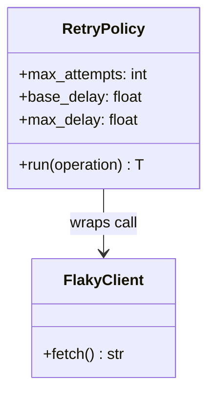
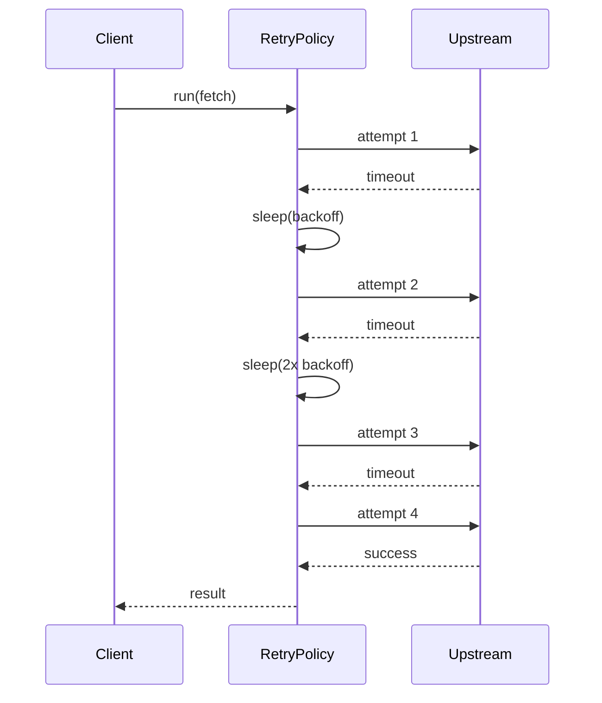
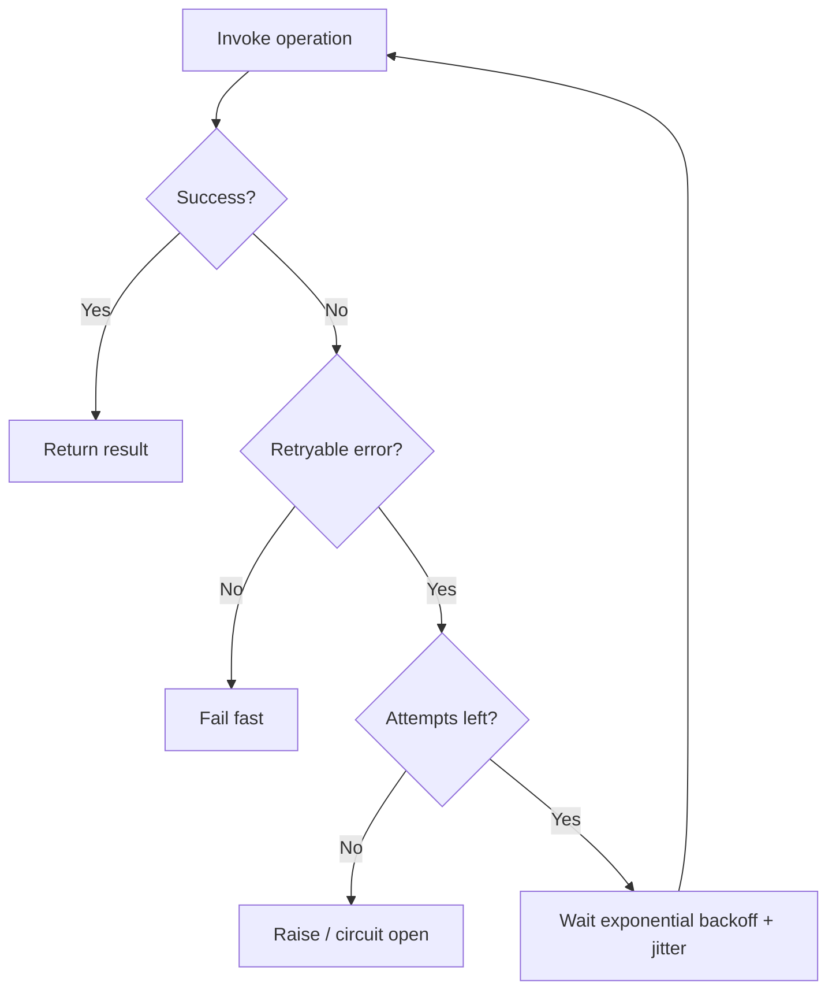

# Retry Pattern

## Intent

Automatically **re-attempt failed operations** when errors are transient (timeouts, 503s, network blips). Combine retries with **exponential backoff** and jitter to avoid overwhelming a recovering dependency.

This demo uses a `RetryPolicy` that succeeds on the fourth attempt after backing off between failures.

## Class Diagram



## Sequence Diagram



## Flowchart



## Run Instructions

```bash
cd PyPatterns
python3 architecture/retry/demo.py
```

Expected output shows three failed attempts, then success on attempt four.

## Pros / Cons

| Pros | Cons |
| ---- | ---- |
| Masks transient failures from callers | Can amplify load during outages (retry storms) |
| Improves perceived reliability | Non-idempotent ops may duplicate side effects |
| Backoff + jitter protects recovering services | Hides systemic problems if retries always succeed eventually |
| Configurable per dependency | Total latency grows with attempt count |

## Distributed Environments

Retries appear at **every network boundary**:

- **HTTP clients**: `urllib3.Retry`, AWS SDK built-in retry modes.
- **gRPC**: retry policy in service config; idempotency keys for POST.
- **Message consumers**: visibility timeout + redelivery (SQS, RabbitMQ).
- **Kubernetes**: `restartPolicy` and probe failure thresholds.
- **Circuit breaker** (Hystrix, resilience4j) often sits beside retry to stop infinite loops.

Always retry **idempotent** reads and writes with deduplication keys; use **dead-letter queues** after max attempts.

## References

- [Exponential backoff — Wikipedia](https://en.wikipedia.org/wiki/Exponential_backoff)
- [Idempotence — Wikipedia](https://en.wikipedia.org/wiki/Idempotence)
- [List of software architecture styles and patterns — Wikipedia](https://en.wikipedia.org/wiki/List_of_software_architecture_styles_and_patterns)
