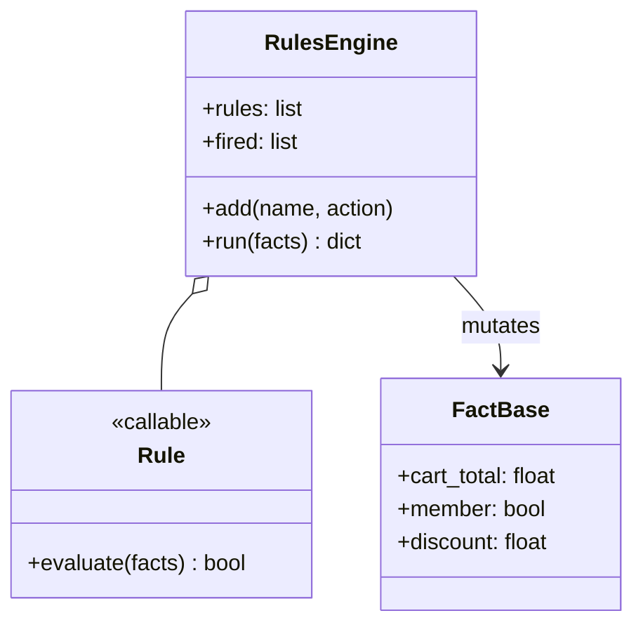
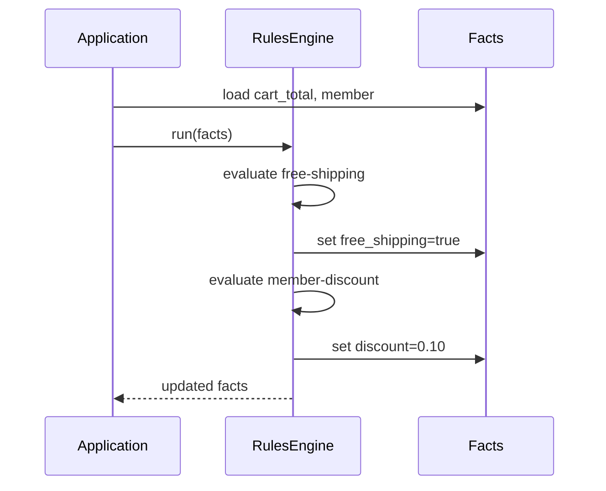
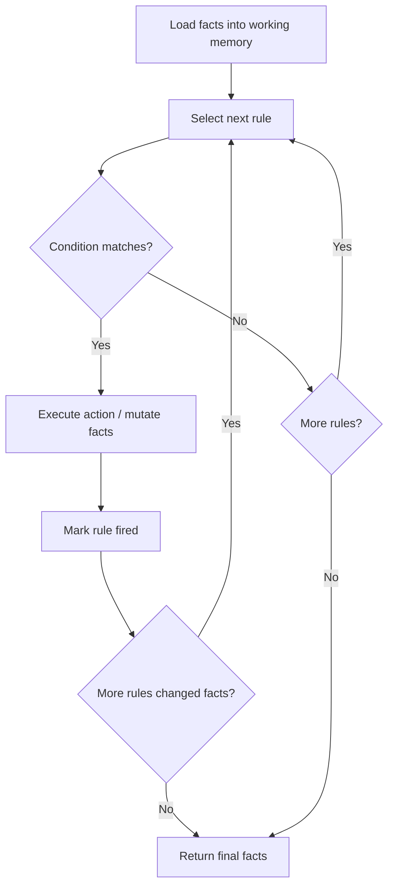

# Rule-Based Pattern

## Intent

Encode business logic as a set of **declarative rules** evaluated against a shared **fact base**. A rules engine matches conditions and fires actions, keeping policy separate from application flow.

This demo applies free-shipping and member-discount rules to a shopping-cart fact dictionary.

## Class Diagram



## Sequence Diagram



## Flowchart



## Run Instructions

```bash
cd PyPatterns
python3 architecture/rule_based/demo.py
```

Expected output shows both rules firing and final facts with discount and free shipping applied.

## Pros / Cons

| Pros | Cons |
| ---- | ---- |
| Business rules change without redeploying code | Rule interaction and ordering can surprise teams |
| Non-developers can author rules (with tooling) | Debugging forward-chaining cycles is hard |
| Centralizes policy — fewer scattered conditionals | Performance tuning needed for large rule sets |
| Fits pricing, eligibility, routing, fraud checks | Overkill for trivial one-off conditions |

## Distributed Environments

Rule engines power **policy-heavy domains**:

- **Drools**, **Easy Rules**, **Open Policy Agent (OPA)** for authorization and admission control.
- **AWS EventBridge** rules route events by pattern matching.
- **Fraud detection** and **credit scoring** pipelines evaluate fact streams.
- **Kubernetes admission webhooks** and **Istio** policies enforce cluster rules.

OPA/Rego is popular for **policy-as-code** in GitOps workflows; Drools suits complex forward/backward chaining in JVM ecosystems.

## References

- [Business rules engine — Wikipedia](https://en.wikipedia.org/wiki/Business_rules_engine)
- [Forward chaining — Wikipedia](https://en.wikipedia.org/wiki/Forward_chaining)
- [List of software architecture styles and patterns — Wikipedia](https://en.wikipedia.org/wiki/List_of_software_architecture_styles_and_patterns)
