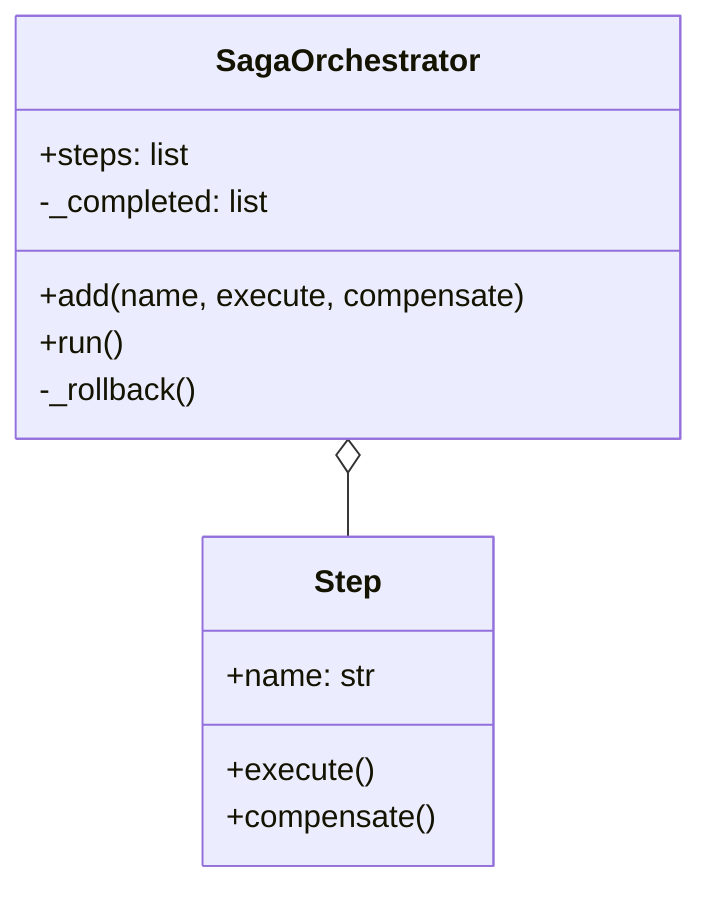
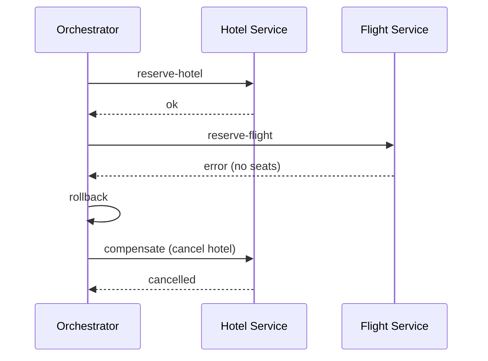
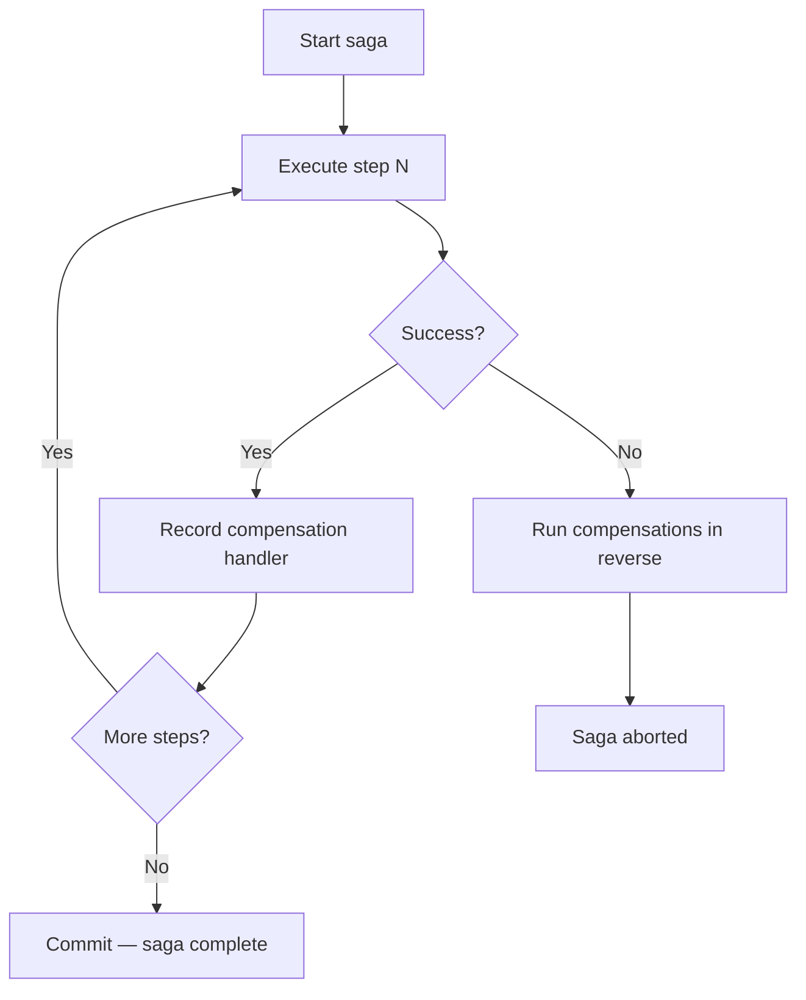

# Saga Pattern

## Intent

Coordinate a **long-running business transaction** across multiple services without a distributed two-phase commit. Each step has a **compensating action**; if a later step fails, prior steps are undone in reverse order.

This demo books a hotel, fails on flight reservation, and compensates by cancelling the hotel.

## Class Diagram



## Sequence Diagram



## Flowchart



## Run Instructions

```bash
cd PyPatterns
python3 architecture/saga/demo.py
```

Expected output shows hotel booked, flight failing, hotel cancelled, and final state with no reservations.

## Pros / Cons

| Pros | Cons |
| ---- | ---- |
| Avoids locking resources across services (no 2PC) | Compensations are hard to design — not true undo |
| Fits microservices and eventual consistency | Orchestrator is a single coordination point (or complex choreography) |
| Each service owns its local transaction | Temporary inconsistent state visible between steps |
| Industry-proven for orders, travel, payments | Idempotent compensate handlers required |

## Distributed Environments

Sagas are essential in **microservice workflows**:

- **Orchestration**: central coordinator (Temporal, Camunda, AWS Step Functions) drives steps.
- **Choreography**: each service listens for events and reacts (`OrderCreated` → `PaymentCaptured` → …).
- **Travel booking**, **e-commerce checkout**, **loan approval** — multi-step flows with rollback.
- **Temporal / Cadence** provide durable saga state and automatic retries.

Prefer **outbox pattern** to publish saga events atomically with local DB commits.

## References

- [Saga pattern — microservices.io](https://microservices.io/patterns/data/saga.html)
- [Saga — Wikipedia (long-running transaction)](https://en.wikipedia.org/wiki/Saga_(software))
- [List of software architecture styles and patterns — Wikipedia](https://en.wikipedia.org/wiki/List_of_software_architecture_styles_and_patterns)
