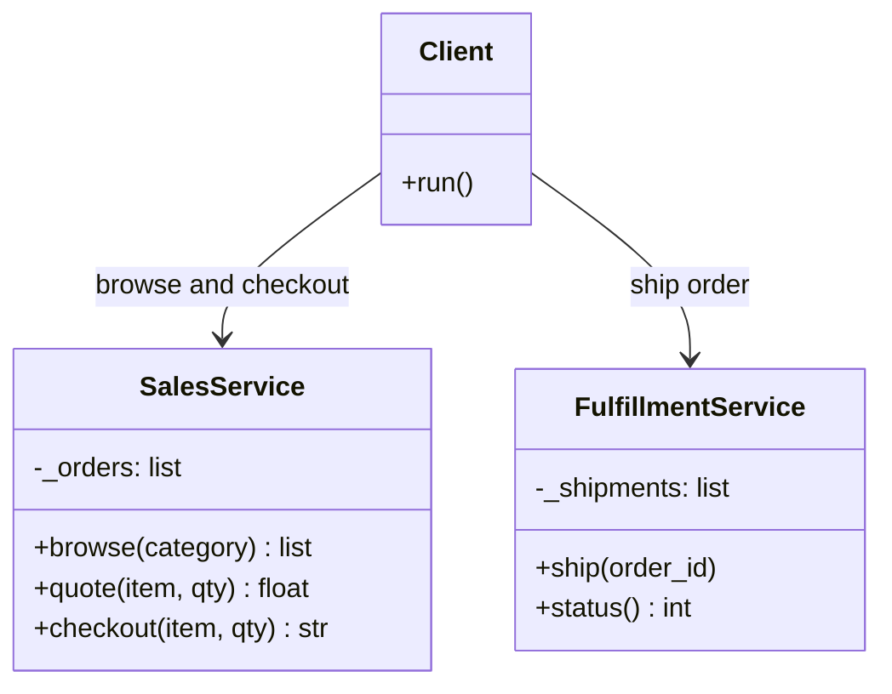
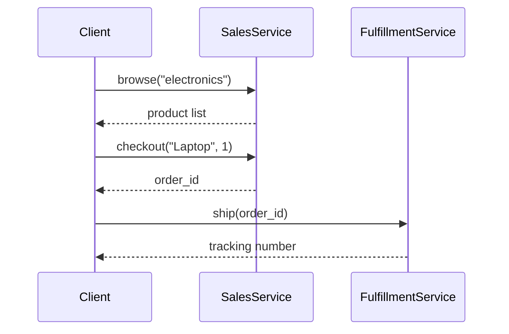
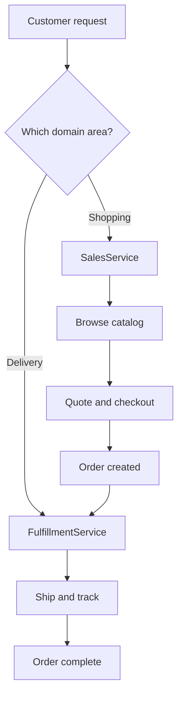

# Service-Based Architecture

## Intent

Organize a system into a **small number of coarse-grained services** — fewer and larger than microservices, but still independently deployable. Each service bundles related capabilities (e.g., all sales functions in one service) to reduce operational overhead while maintaining more modularity than a monolith.

This demo uses two services: **Sales** (browse, quote, checkout) and **Fulfillment** (ship, track) — covering the domain without splitting into dozens of microservices.

## Class Diagram



## Sequence Diagram



## Flowchart



## Run Instructions

```bash
cd PyPatterns
python3 architecture/service_based/demo.py
```

Expected output shows a product browse, checkout, and shipment handled by two coarse-grained services.

## Pros / Cons

| Pros | Cons |
| ---- | ---- |
| Less operational complexity than many microservices | Services can still grow large and become mini-monoliths |
| Clear domain boundaries without excessive fragmentation | Coarser granularity limits independent scaling of hot paths |
| Practical middle ground for teams migrating from monoliths | Requires discipline to resist splitting too early or merging too late |

## Distributed Environments

Service-based architecture suits teams that need modularity without microservice overhead:

- **Two-pizza teams** own one or two coarse services rather than a dozen microservices.
- **Modular deployment** — Sales and Fulfillment deploy independently but each bundles multiple related endpoints.
- **Shared databases** between related capabilities within a service are acceptable; boundaries align with business domains, not individual tables.

An online marketplace runs Catalog+Cart as one service and Payments+Invoicing as another — four bounded contexts collapsed into two deployable units, each with its own database and CI/CD pipeline, avoiding the network-chattiness of fifteen microservices.

## References

- [Service-based architecture — Software Architecture Patterns](https://www.oreilly.com/library/view/software-architecture-patterns/9781491971437/ch4.html)
- [Microservices vs service-based — Martin Fowler](https://martinfowler.com/articles/microservices.html)
