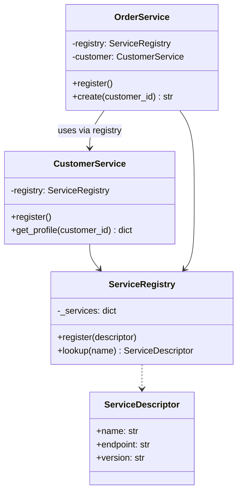
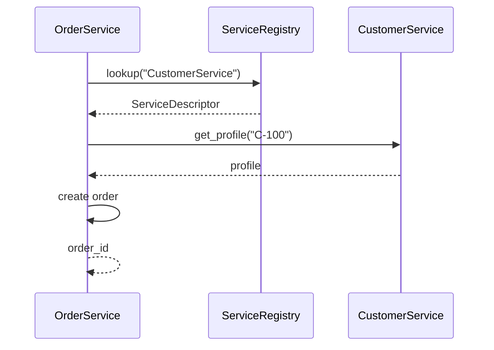
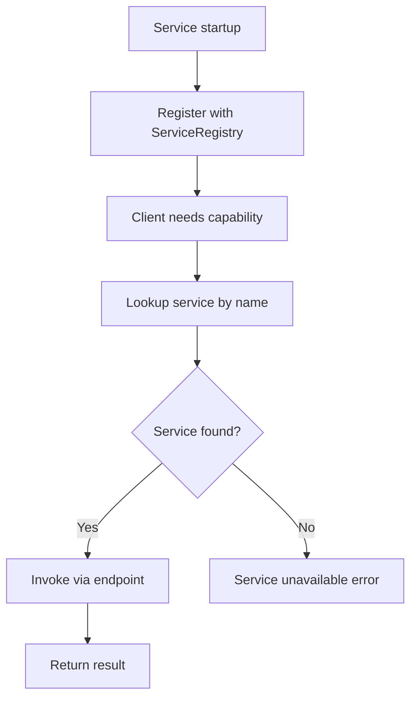

# Service-Oriented Architecture (SOA)

## Intent

Structure an enterprise as a set of **coarse-grained, discoverable services** that communicate through an **enterprise service bus (ESB)** or **service registry**. SOA emphasizes reusable business capabilities, standardized contracts, and centralized governance — a precursor to microservices with larger service boundaries.

This demo registers Customer and Order services in a `ServiceRegistry`, then creates an order by discovering and calling the customer service at runtime.

## Class Diagram



## Sequence Diagram



## Flowchart



## Run Instructions

```bash
cd PyPatterns
python3 architecture/service_oriented/demo.py
```

Expected output shows services registering themselves and an order created via registry-based discovery.

## Pros / Cons

| Pros | Cons |
| ---- | ---- |
| Promotes reusable enterprise business services | ESB can become a bottleneck and single point of failure |
| Centralized governance, contracts, and security policies | Heavyweight XML/SOAP stacks add complexity and latency |
| Services are discoverable and loosely coupled | Large services can still be monoliths in disguise |

## Distributed Environments

SOA shaped enterprise integration before microservices dominated:

- **Enterprise Service Buses** (MuleSoft, IBM Integration Bus) route, transform, and orchestrate SOAP/REST messages between services.
- **UDDI/WSDL registries** (largely superseded) provided formal service discovery; today **Consul**, **Eureka**, and **Kubernetes DNS** fill a similar role.
- **BPM engines** orchestrate long-running business processes across SOA services.

A bank's SOA layer exposes Customer, Account, and Payment as governed services behind an API gateway — each with SLA-backed contracts, centralized authentication, and audit logging enforced by the bus rather than individual teams.

## References

- [Service-oriented architecture — Wikipedia](https://en.wikipedia.org/wiki/Service-oriented_architecture)
- [SOA design pattern — Microsoft Azure](https://learn.microsoft.com/en-us/azure/architecture/guide/architecture-styles/soa)
