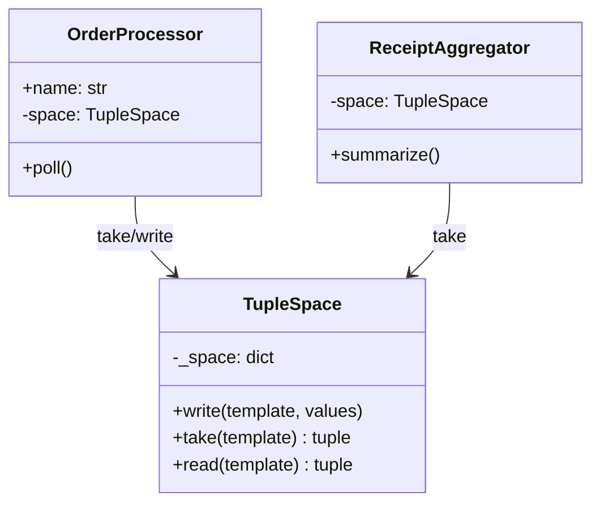
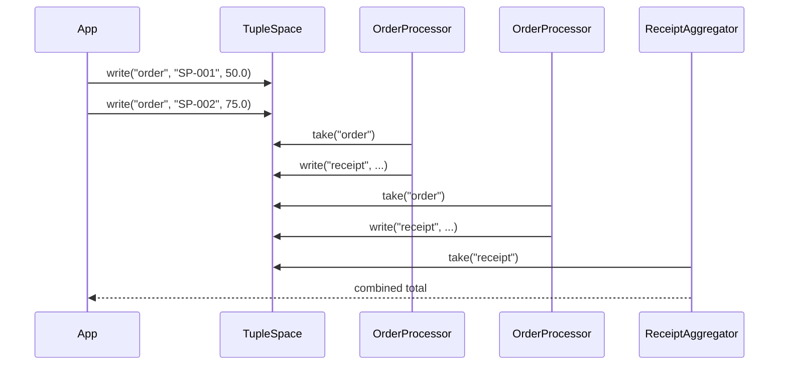
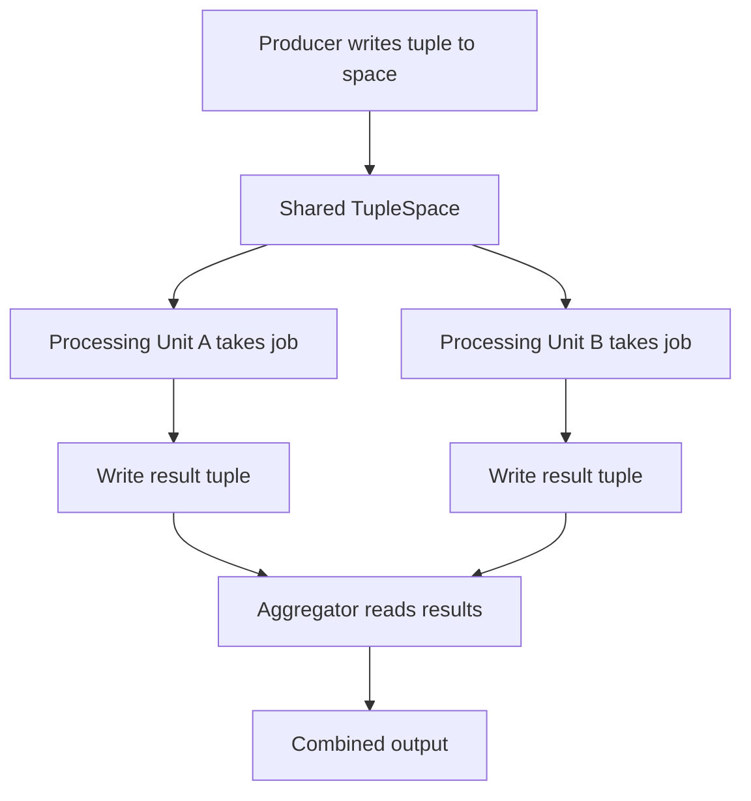

# Space-Based Architecture

## Intent

Eliminate central bottlenecks by routing work through a **shared virtual space** (tuple space, cache, or message grid) while **processing units** scale out independently. Producers write tuples; consumers take or read them — enabling linear scalability for high-throughput, variable-load systems.

This demo uses a `TupleSpace` where order processing units pick jobs, compute totals, and write receipts that an aggregator collects.

## Class Diagram



## Sequence Diagram



## Flowchart



## Run Instructions

```bash
cd PyPatterns
python3 architecture/space_based/demo.py
```

Expected output shows orders written to shared space, processed by two units, and aggregated into a combined total.

## Pros / Cons

| Pros | Cons |
| ---- | ---- |
| Linear scalability by adding processing units | Tuple space consistency and partitioning are complex |
| No central coordinator bottleneck under load | In-memory spaces require replication for fault tolerance |
| Handles extreme traffic spikes gracefully | Less intuitive than request/response for CRUD apps |

## Distributed Environments

Space-based architecture powers high-throughput, elastic systems:

- **JavaSpaces** and **Apache Geode** implement distributed tuple spaces for parallel computation.
- **Hazelcast** and **Redis** serve as shared in-memory data grids where workers pull tasks from partitioned caches.
- **AWS Lambda + SQS/DynamoDB** approximates space-based processing — stateless workers consume from a shared queue/grid.

A financial trading platform writes incoming orders to a partitioned in-memory grid; hundreds of stateless processing units take orders, match them, and write fills back to the space — scaling horizontally during market open without a central order-matching bottleneck.

## References

- [Space-based architecture — Wikipedia](https://en.wikipedia.org/wiki/Space-based_architecture)
- [Tuple space — Wikipedia](https://en.wikipedia.org/wiki/Tuple_space)
