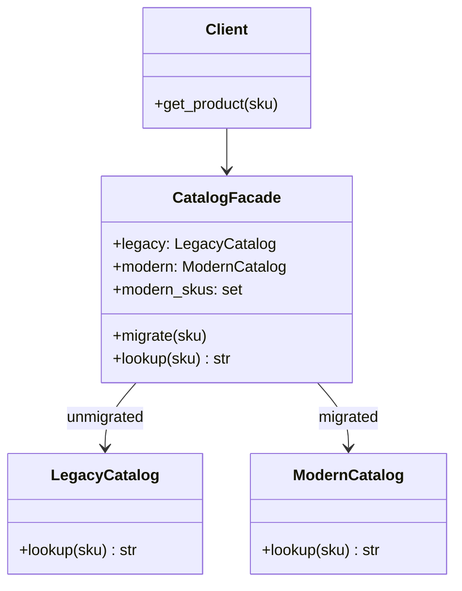
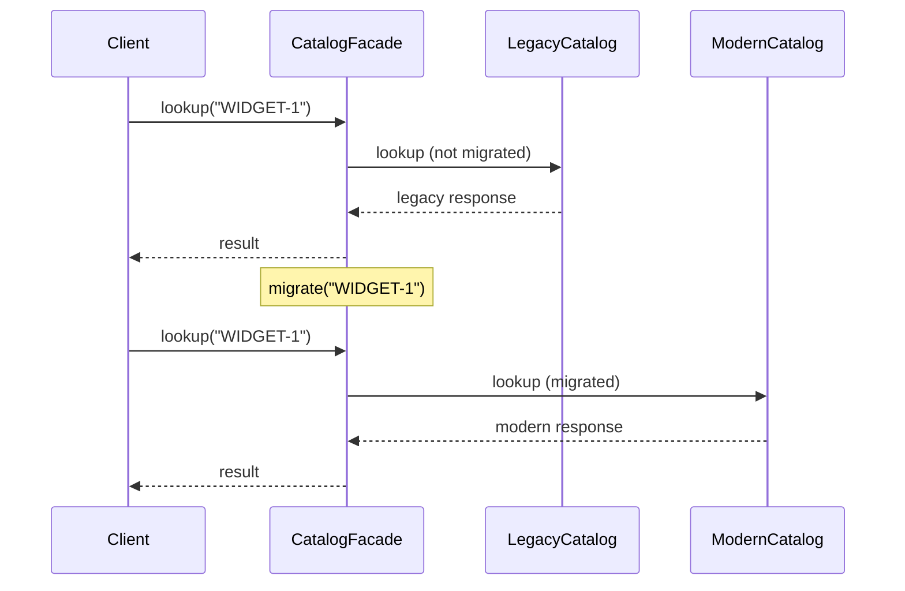
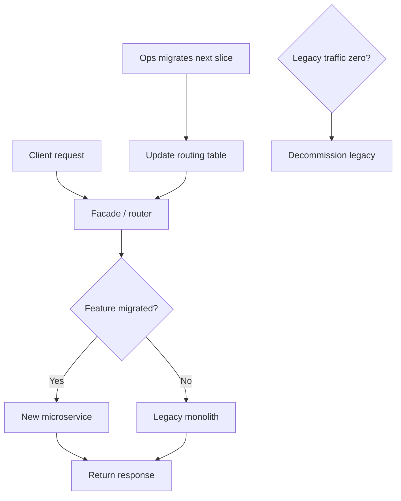

# Strangler Fig Pattern

## Intent

**Incrementally replace** a legacy system by routing traffic through a facade that sends an growing subset of requests to the new implementation. The legacy system is “strangled” over time until it can be retired.

This demo uses a `CatalogFacade` that sends unmigrated SKUs to `LegacyCatalog` and migrated ones to `ModernCatalog`.

## Class Diagram



## Sequence Diagram



## Flowchart



## Run Instructions

```bash
cd PyPatterns
python3 architecture/strangler_fig/demo.py
```

Expected output shows both SKUs on legacy first, then `WIDGET-1` served from modern after migration.

## Pros / Cons

| Pros | Cons |
| ---- | ---- |
| Reduces big-bang rewrite risk | Two systems run in parallel — operational overhead |
| Clients keep a stable API during migration | Routing logic and data sync add complexity |
| Delivers value incrementally | Risk of behavioral drift between old and new |
| Allows rollback per feature slice | Can stall mid-migration without clear milestones |

## Distributed Environments

Strangler fig is the default **legacy modernization** playbook:

- **API gateway** or **BFF** routes `%` of traffic by header, cookie, or path prefix.
- **Feature flags** (LaunchDarkly, Unleash) control which users hit the new stack.
- **Database strangling**: CDC replicates legacy rows into new store; dual-write during transition.
- **AWS Migration Hub**, **Azure App Service** slot swapping for gradual cutover.

Named after strangler fig vines that gradually envelop and replace a host tree.

## References

- [Strangler fig application — Wikipedia](https://en.wikipedia.org/wiki/Strangler_fig_application)
- [Strangler Fig pattern — Martin Fowler](https://martinfowler.com/bliki/StranglerFigApplication.html)
- [List of software architecture styles and patterns — Wikipedia](https://en.wikipedia.org/wiki/List_of_software_architecture_styles_and_patterns)
