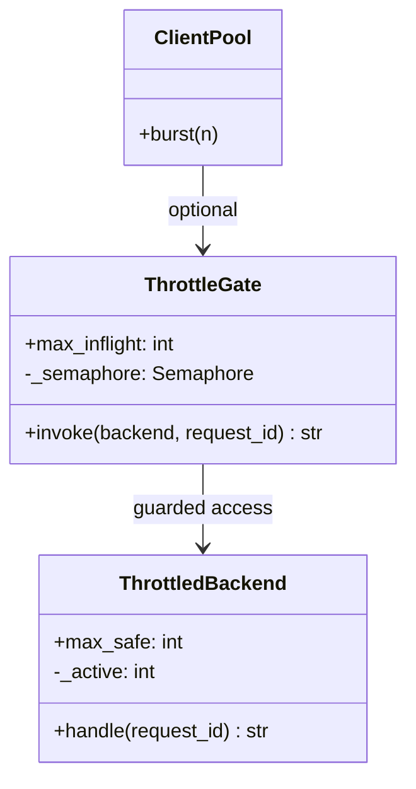
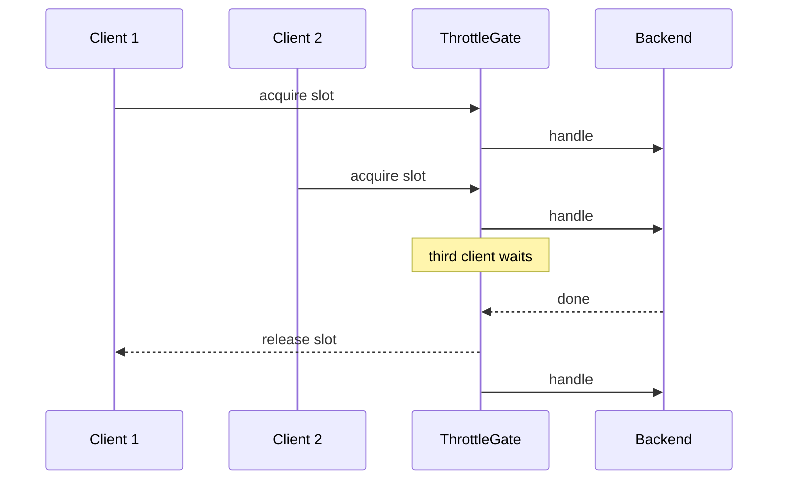
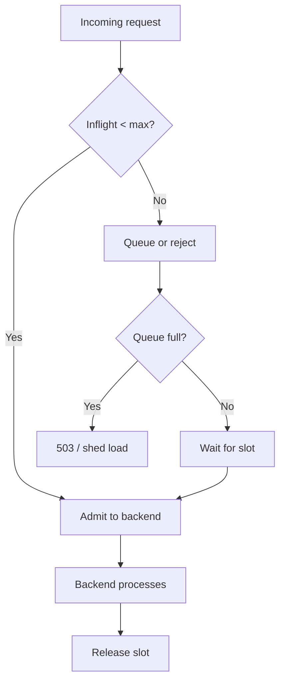

# Throttling Pattern

## Intent

**Protect downstream services** by limiting how much load reaches them — typically via concurrency caps, queue depth limits, or deliberate slowdown. Unlike rate limiting (requests per second), throttling focuses on **resource protection** and graceful degradation under pressure.

This demo compares an unthrottled burst (overloading a fragile backend) with a `ThrottleGate` that caps inflight requests at two.

## Class Diagram



## Sequence Diagram



## Flowchart



## Run Instructions

```bash
cd PyPatterns
python3 architecture/throttling/demo.py
```

Expected output shows failures without throttling and six successful responses with the gate limiting concurrency to two.

## Pros / Cons

| Pros | Cons |
| ---- | ---- |
| Prevents cascade failures and OOM on backends | Queued requests increase tail latency |
| Semaphore / bulkhead patterns isolate tenants | Tuning max inflight requires load testing |
| Works alongside rate limiting at different layers | Aggressive throttling drops revenue-bearing traffic |
| Enables graceful degradation under spike load | Clients may need retry-after signaling |

## Distributed Environments

Throttling protects **capacity-constrained dependencies**:

- **Bulkhead pattern** (Hystrix thread pools per dependency).
- **Envoy / nginx** `max_concurrent_streams` and connection limits.
- **Database connection pools** cap concurrent queries.
- **Serverless concurrency limits** (Lambda reserved concurrency).
- **Adaptive throttling** (Google SRE) reduces accepted RPS as backend latency rises.

Pair with **load shedding** (return 503 early) and **autoscaling** so throttles are a safety net, not the primary capacity plan.

## References

- [Throttling — Wikipedia (computing)](https://en.wikipedia.org/wiki/Throttle)
- [Bulkhead pattern — Azure Architecture Center](https://learn.microsoft.com/en-us/azure/architecture/patterns/bulkhead)
- [List of software architecture styles and patterns — Wikipedia](https://en.wikipedia.org/wiki/List_of_software_architecture_styles_and_patterns)
