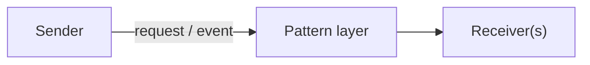

# Behavioral Patterns

Patterns for algorithms, assignment of responsibilities, and communication between objects. Part of the [PyPatterns](../README.md) catalog — **11 of 23** GoF patterns (includes **Interpreter**, which [Refactoring.Guru](https://refactoring.guru/design-patterns) omits).

## Intent

Behavioral patterns answer: *how do objects collaborate?* They encapsulate requests, manage state transitions, notify dependents, and let you swap algorithms at runtime.



## When to use this category

| Situation | Consider |
| --------- | -------- |
| Multiple handlers may process a request | [Chain of Responsibility](chain_of_responsibility/README.md) |
| Undo, queue, or log operations | [Command](command/README.md) |
| Evaluate a small domain-specific language | [Interpreter](interpreter/README.md) |
| Traverse a collection without exposing internals | [Iterator](iterator/README.md) |
| Many objects talk through a central hub | [Mediator](mediator/README.md) |
| Snapshot and restore object state | [Memento](memento/README.md) |
| One-to-many change notification | [Observer](observer/README.md) |
| Behavior changes with internal state | [State](state/README.md) |
| Swap algorithms at runtime | [Strategy](strategy/README.md) |
| Fixed algorithm skeleton, variable steps | [Template Method](template_method/README.md) |
| Add operations without modifying classes | [Visitor](visitor/README.md) |

## Patterns in this folder

| Pattern | Demo | Details |
| ------- | ---- | ------- |
| Chain of Responsibility | `python3 behavioral/chain_of_responsibility/demo.py` | [README](chain_of_responsibility/README.md) |
| Command | `python3 behavioral/command/demo.py` | [README](command/README.md) |
| Interpreter | `python3 behavioral/interpreter/demo.py` | [README](interpreter/README.md) |
| Iterator | `python3 behavioral/iterator/demo.py` | [README](iterator/README.md) |
| Mediator | `python3 behavioral/mediator/demo.py` | [README](mediator/README.md) |
| Memento | `python3 behavioral/memento/demo.py` | [README](memento/README.md) |
| Observer | `python3 behavioral/observer/demo.py` | [README](observer/README.md) |
| State | `python3 behavioral/state/demo.py` | [README](state/README.md) |
| Strategy | `python3 behavioral/strategy/demo.py` | [README](strategy/README.md) |
| Template Method | `python3 behavioral/template_method/demo.py` | [README](template_method/README.md) |
| Visitor | `python3 behavioral/visitor/demo.py` | [README](visitor/README.md) |

Run from **PyPatterns/** with Just:

```bash
just observer
just command
just strategy
just run behavioral/state
```

## Distributed environments

Category-level guidance — each pattern README has specific notes.

- **Observer** → pub/sub (Kafka, SNS/SQS, Redis streams); avoid in-process-only observer lists across services.
- **Command** → message queues, CQRS write models, saga steps with compensating transactions.
- **Strategy** → policy engines and routing rules per tenant/region.
- **State** → workflow engines (Temporal, Step Functions) for long-running distributed state machines.
- **Memento** → event sourcing snapshots; store mementos in durable storage, not local RAM.
- **Chain of Responsibility** → middleware pipelines, auth filter chains, and API gateway plugins.

## See also

- [Creational patterns](../creational/README.md)
- [Structural patterns](../structural/README.md)
- [Concurrency patterns](../concurrency/README.md) — async command dispatch, active objects
- [Architecture patterns](../architecture/README.md) — sagas, pub/sub, event-driven systems

## References

- [GoF — Behavioral patterns (Wikipedia)](https://en.wikipedia.org/wiki/Behavioral_pattern)
- [Refactoring.Guru — Behavioral](https://refactoring.guru/design-patterns/behavioral-patterns)
