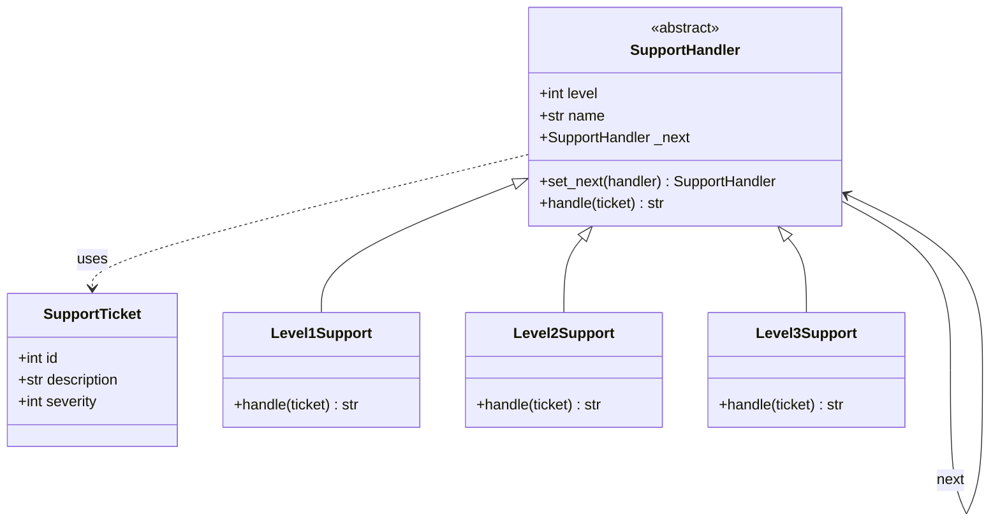
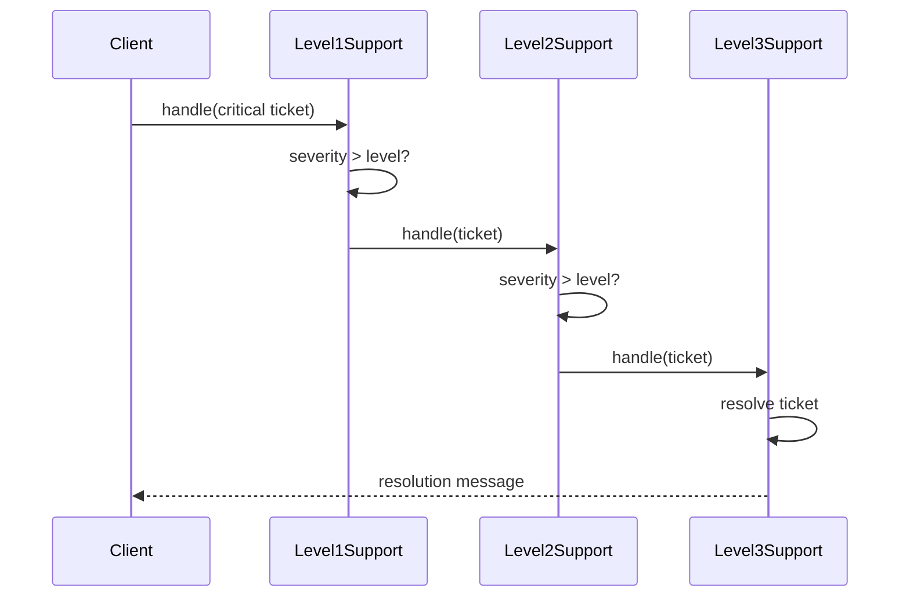
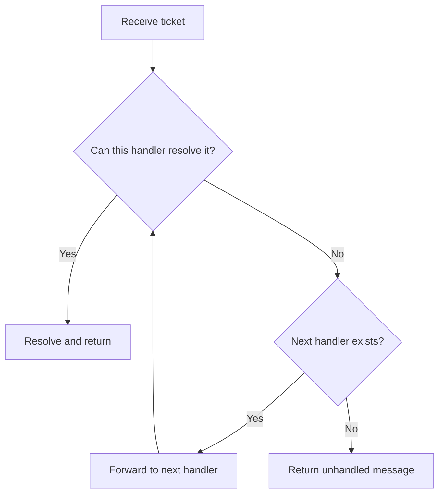

# Chain of Responsibility

## Intent

Avoid coupling the sender of a request to its receiver by giving multiple objects a chance to handle the request. Chain the receiving objects and pass the request along the chain until an object handles it.

This demo models a **support ticket escalation chain**: Level 1 handles low-severity issues, Level 2 handles medium, and Level 3 handles critical outages.

## Run

```bash
python3 behavioral/chain_of_responsibility/demo.py
```

## Class Diagram



## Sequence Diagram



## Flowchart



## Pros and Cons

| Pros | Cons |
| ---- | ---- |
| Reduces coupling between sender and receivers | No guarantee the request will be handled |
| Add or reorder handlers at runtime | Can be hard to debug long chains |
| Single Responsibility — each handler focuses on one level | May introduce latency as requests traverse the chain |

## Distributed Environments

In microservices, a chain of responsibility often maps to **middleware pipelines** or **API gateway filters** (auth → rate limit → routing). Each node decides whether to handle the request or pass it downstream.

- **HTTP middleware** (FastAPI, Starlette, Express) chains handlers in order.
- **Message queues** can route events through topic subscriptions where each consumer either processes or re-publishes.
- **Service meshes** (Istio, Linkerd) apply sidecar filters that mirror chain-of-responsibility semantics at the network layer.

Watch for **lost requests** when no handler claims responsibility — add explicit dead-letter queues or fallback endpoints in distributed setups.

## References

- [Chain of Responsibility — Refactoring.Guru](https://refactoring.guru/design-patterns/chain-of-responsibility)
- [Chain-of-responsibility pattern — Wikipedia](https://en.wikipedia.org/wiki/Chain-of-responsibility_pattern)
