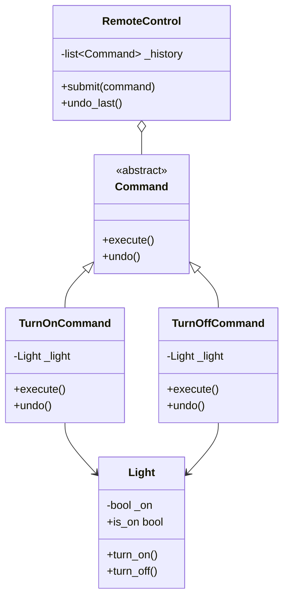
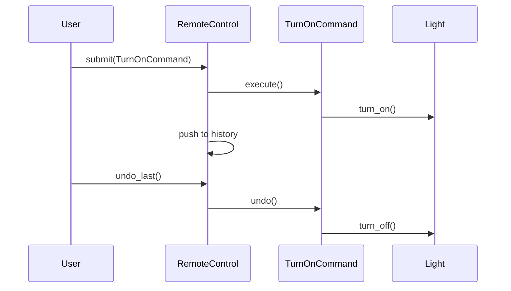
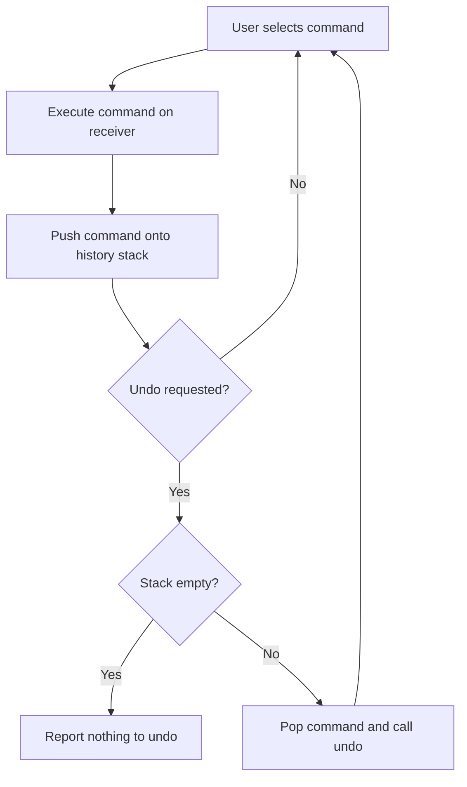

# Command

## Intent

Encapsulate a request as an object, thereby letting you parameterize clients with different requests, queue or log requests, and support undoable operations.

This demo implements a **light switch** controlled by commands with an **undo stack** on a remote control.

## Run

```bash
python3 behavioral/command/demo.py
```

## Class Diagram



## Sequence Diagram



## Flowchart



## Pros and Cons

| Pros | Cons |
| ---- | ---- |
| Decouples invoker from receiver | Many small command classes |
| Supports undo/redo and macro commands | Can over-complicate simple operations |
| Enables queuing, logging, and scheduling | Undo logic must be carefully designed |

## Distributed Environments

Command pattern maps naturally to **job queues** and **event sourcing**:

- **Celery / RQ / Sidekiq** treat each task as a serialized command object executed by workers.
- **CQRS + Event Sourcing** stores commands as immutable events; replay rebuilds state.
- **Kafka / RabbitMQ** messages are commands consumed by downstream services.

In distributed systems, ensure commands are **idempotent** and include correlation IDs for tracing. Undo in distributed contexts often requires compensating transactions (Saga pattern) rather than simple stack pops.

## References

- [Command — Refactoring.Guru](https://refactoring.guru/design-patterns/command)
- [Command pattern — Wikipedia](https://en.wikipedia.org/wiki/Command_pattern)
