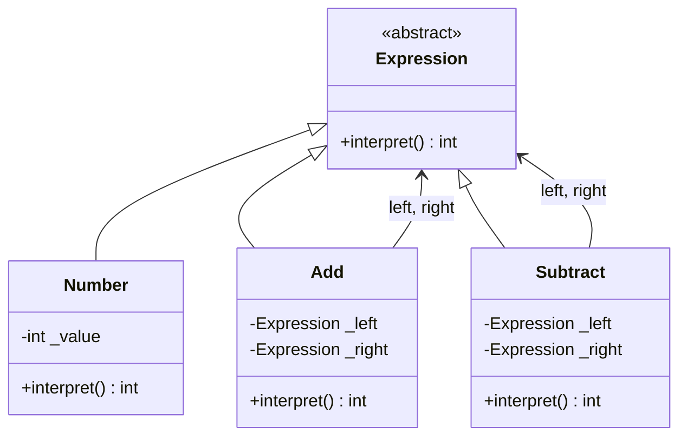
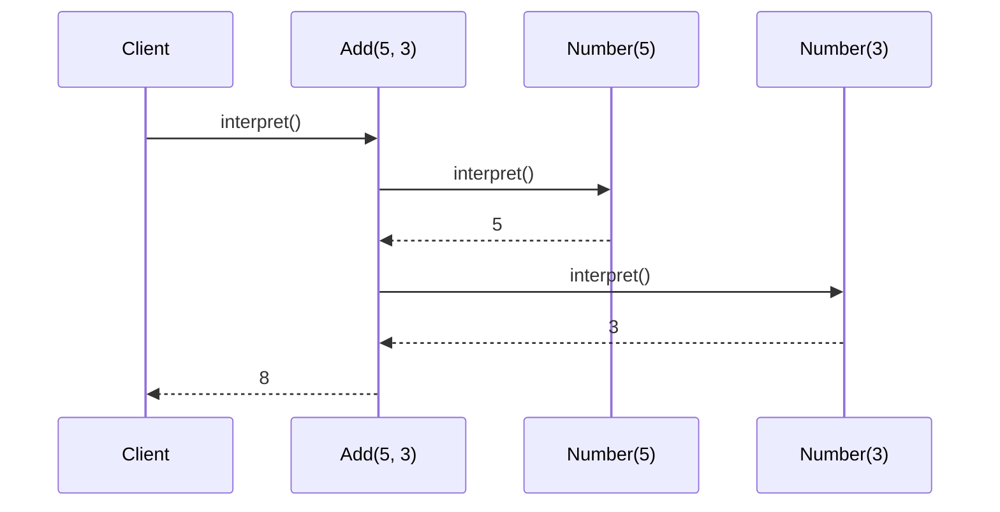
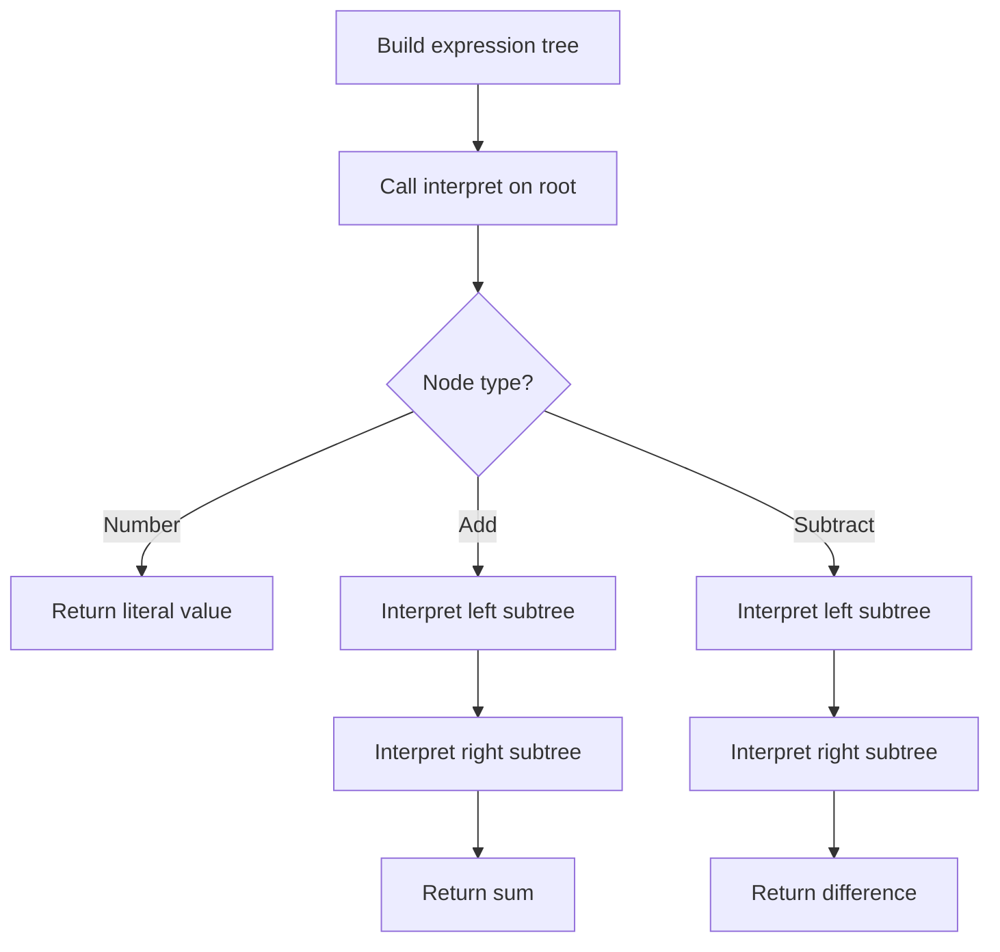

# Interpreter

## Intent

Given a language, define a representation for its grammar along with an interpreter that uses the representation to interpret sentences in the language.

This demo evaluates a simple arithmetic expression tree for **5 + 3**.

## Run

```bash
python3 behavioral/interpreter/demo.py
```

## Class Diagram



## Sequence Diagram



## Flowchart



## Pros and Cons

| Pros | Cons |
| ---- | ---- |
| Easy to implement simple grammars | Complex grammars become hard to maintain |
| Open/Closed — add new expression types easily | Performance can suffer vs compiled parsers |
| Each grammar rule is a class | Debugging nested trees is non-trivial |

## Distributed Environments

Interpreter pattern appears in **rule engines** and **DSL evaluation** across services:

- **Policy engines** (OPA, AWS IAM policies) interpret declarative rules at runtime.
- **Workflow DSLs** (Temporal, Airflow DAG definitions) parse and execute domain-specific instructions.
- **Query languages** (GraphQL resolvers, SQL planners) interpret AST nodes into execution plans.

In distributed setups, prefer compiling hot-path expressions to bytecode or caching parse trees. Ship grammar definitions as versioned schemas so all nodes interpret consistently.

## References

- [Interpreter — Refactoring.Guru](https://refactoring.guru/design-patterns/interpreter)
- [Interpreter pattern — Wikipedia](https://en.wikipedia.org/wiki/Interpreter_pattern)
