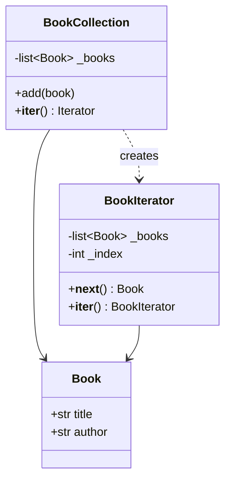
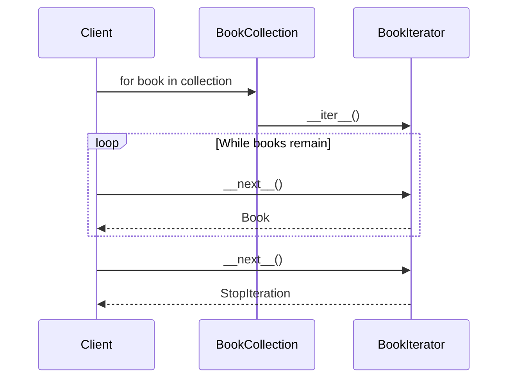
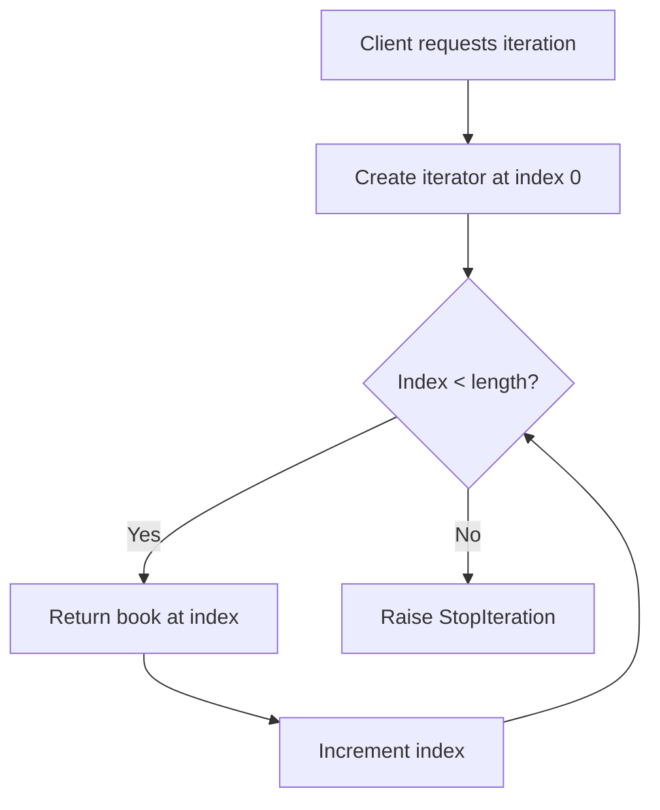

# Iterator

## Intent

Provide a way to access the elements of an aggregate object sequentially without exposing its underlying representation.

This demo implements a custom **BookCollection** with a dedicated **BookIterator**.

## Run

```bash
python3 behavioral/iterator/demo.py
```

## Class Diagram



## Sequence Diagram



## Flowchart



## Pros and Cons

| Pros | Cons |
| ---- | ---- |
| Single Responsibility — traversal logic is isolated | Can be overkill for simple collections |
| Supports multiple simultaneous traversals | Custom iterators must honor protocol correctly |
| Compatible with Python's `for` loops | Lazy iteration state can be surprising |

## Distributed Environments

Iterator semantics extend to **paginated APIs** and **stream consumers**:

- **REST pagination** (`cursor`, `offset/limit`) iterates large datasets without loading everything into memory.
- **Kafka / Kinesis consumers** pull records sequentially from partitions.
- **Database cursors** (server-side) stream rows across network boundaries.

In distributed systems, iterators should be **resumable** (checkpoint cursors) and **fault-tolerant** (idempotent processing). Avoid assuming the entire collection fits on one node.

## References

- [Iterator — Refactoring.Guru](https://refactoring.guru/design-patterns/iterator)
- [Iterator pattern — Wikipedia](https://en.wikipedia.org/wiki/Iterator_pattern)
