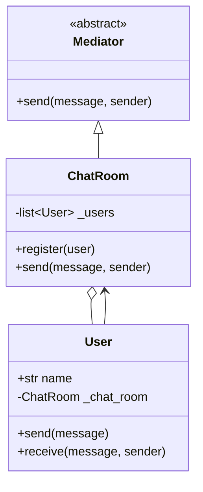
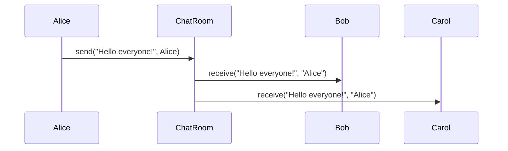
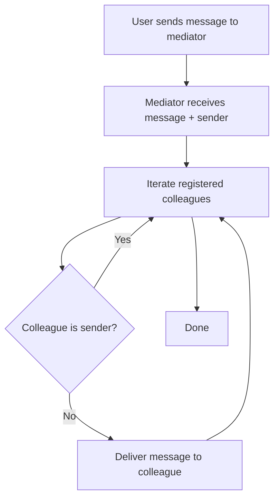

# Mediator

## Intent

Define an object that encapsulates how a set of objects interact. Mediator promotes loose coupling by keeping objects from referring to each other explicitly, and lets you vary their interaction independently.

This demo implements a **chat room** that routes messages between users without direct peer-to-peer references.

## Run

```bash
python3 behavioral/mediator/demo.py
```

## Class Diagram



## Sequence Diagram



## Flowchart



## Pros and Cons

| Pros | Cons |
| ---- | ---- |
| Reduces tangled many-to-many dependencies | Mediator can become a god object |
| Centralizes interaction logic | Single point of failure if poorly designed |
| Easy to change interaction rules in one place | Can hide too much domain logic |

## Distributed Environments

Mediators appear as **brokers**, **orchestrators**, and **hubs**:

- **Message brokers** (RabbitMQ, NATS) mediate between producers and consumers.
- **Chat servers** (Slack, Discord gateways) route messages without clients knowing all peers.
- **Orchestration layers** (Kubernetes controllers, workflow engines) coordinate microservices.

Scale mediators horizontally with **sharding** (room-per-partition) and avoid storing all state in one process. Event-driven architectures often replace centralized mediators with **pub/sub** for better fault tolerance.

## References

- [Mediator — Refactoring.Guru](https://refactoring.guru/design-patterns/mediator)
- [Mediator pattern — Wikipedia](https://en.wikipedia.org/wiki/Mediator_pattern)
