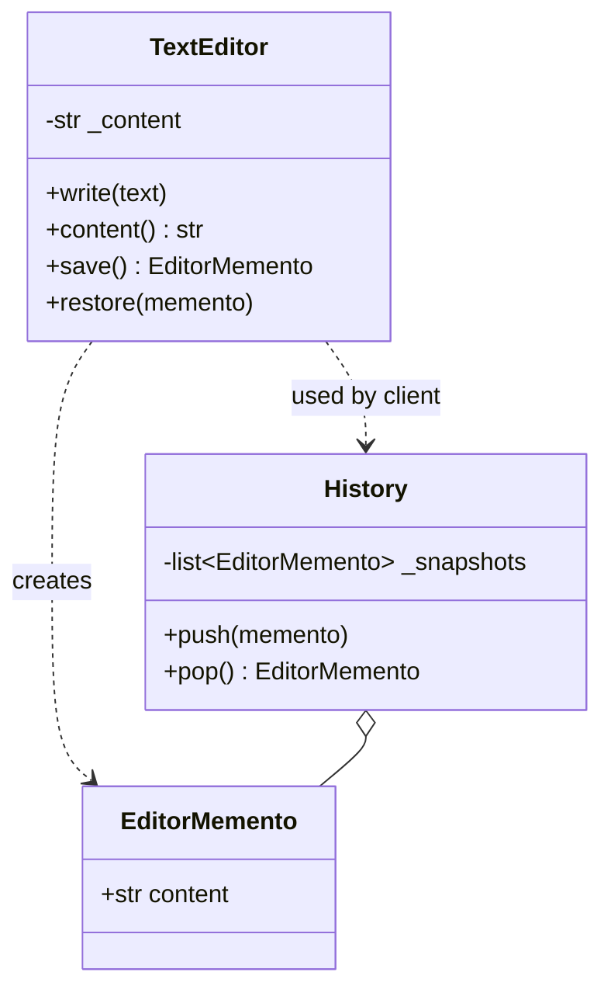
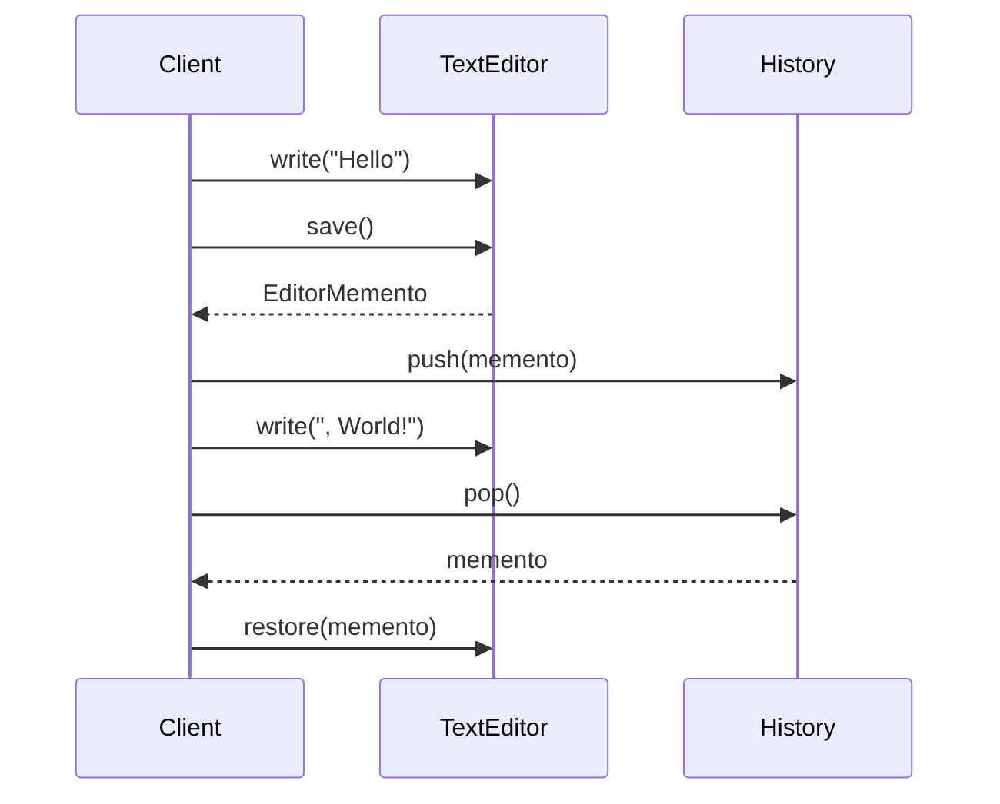
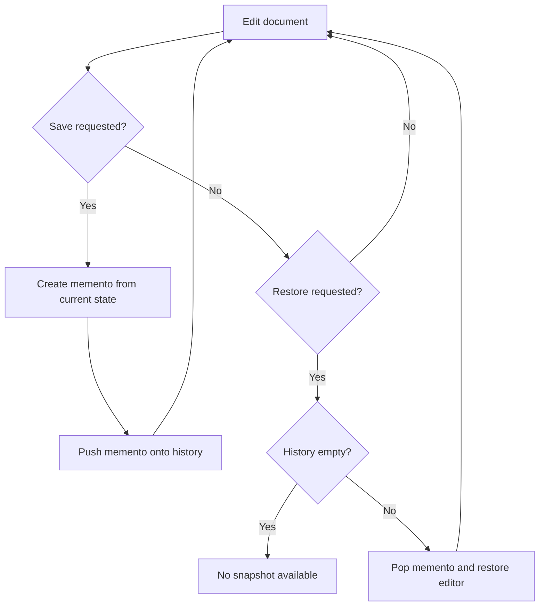

# Memento

## Intent

Without violating encapsulation, capture and externalize an object's internal state so that the object can be restored to this state later.

This demo models a **text editor** that saves snapshots to a history stack and restores previous content.

## Run

```bash
python3 behavioral/memento/demo.py
```

## Class Diagram



## Sequence Diagram



## Flowchart



## Pros and Cons

| Pros | Cons |
| ---- | ---- |
| Preserves encapsulation of originator | Large state snapshots consume memory |
| Simple undo/redo implementation | Caretaker must manage memento lifecycle |
| Originators control what gets saved | Deep copies can be expensive |

## Distributed Environments

Memento concepts underpin **snapshots**, **backups**, and **versioning**:

- **Database snapshots** (PostgreSQL PITR, DynamoDB backups) capture consistent state for restore.
- **Event sourcing** stores state transitions; snapshots accelerate replay.
- **Kubernetes etcd** and **Raft log compaction** use snapshotting to bound storage growth.

In distributed systems, mementos must be **consistent across replicas**. Use vector clocks or CRDTs when merging concurrent edits. Store snapshots in durable object storage (S3, GCS) with retention policies.

## References

- [Memento — Refactoring.Guru](https://refactoring.guru/design-patterns/memento)
- [Memento pattern — Wikipedia](https://en.wikipedia.org/wiki/Memento_pattern)
