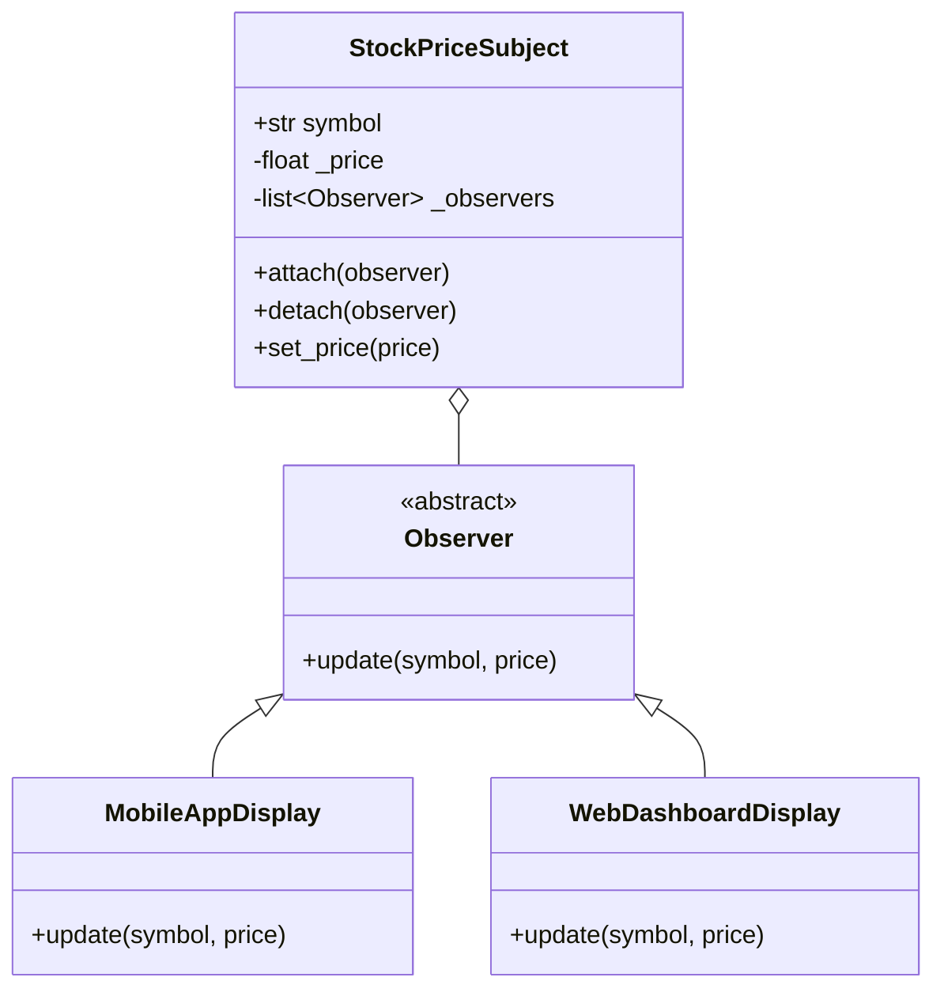
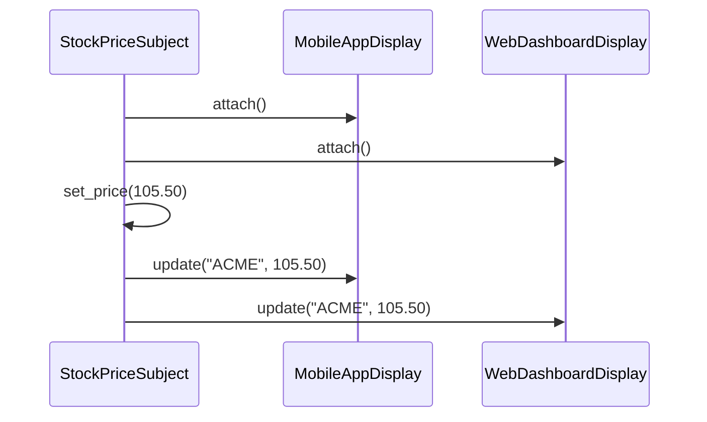
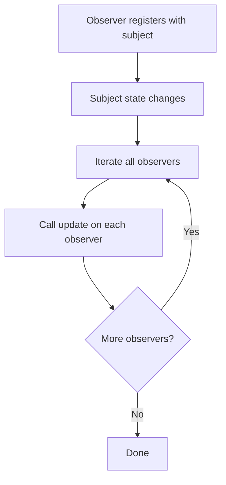

# Observer

## Intent

Define a one-to-many dependency between objects so that when one object changes state, all its dependents are notified and updated automatically.

This demo uses a **stock price subject** that notifies **mobile** and **web dashboard** observers on price changes.

## Run

```bash
python3 behavioral/observer/demo.py
```

## Class Diagram



## Sequence Diagram



## Flowchart



## Pros and Cons

| Pros | Cons |
| ---- | ---- |
| Open/Closed — add observers without changing subject | Unexpected update order |
| Supports broadcast communication | Memory leaks if observers aren't detached |
| Loose coupling between subject and observers | Can cause cascading updates |

## Distributed Environments

Observer is the foundation of **pub/sub** and **event-driven architecture**:

- **Webhooks** notify subscribers when remote state changes.
- **Kafka / Redis Pub/Sub / SNS** broadcast events to many consumers.
- **Reactive streams** (RxPY, ReactiveX) propagate changes across async pipelines.

In distributed systems, replace in-process observer lists with **durable topics**. Use at-least-once delivery, idempotent handlers, and dead-letter queues. Consider **event schemas** (Avro, Protobuf) for contract stability across services.

## References

- [Observer — Refactoring.Guru](https://refactoring.guru/design-patterns/observer)
- [Observer pattern — Wikipedia](https://en.wikipedia.org/wiki/Observer_pattern)
