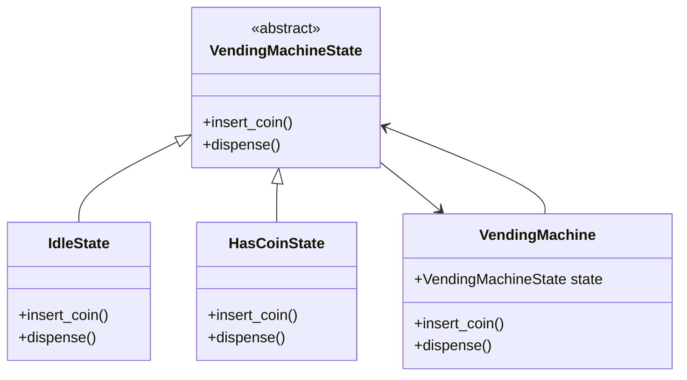
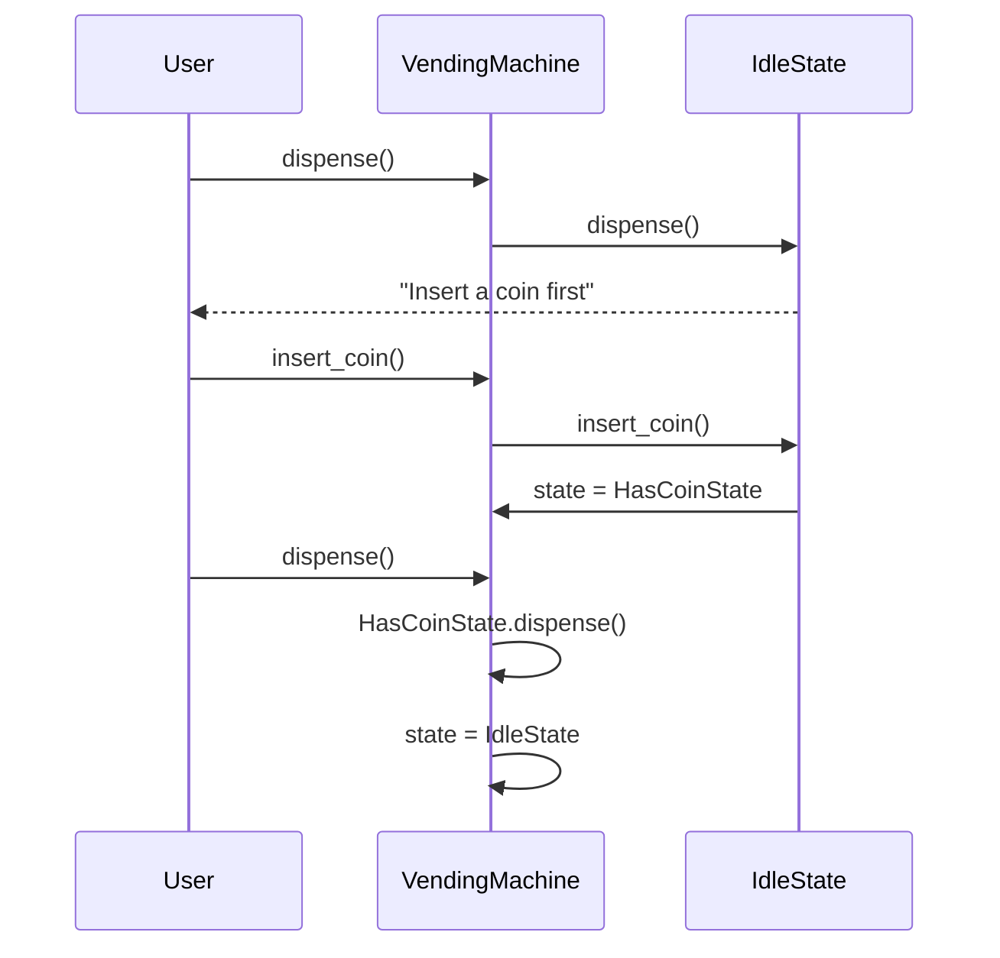
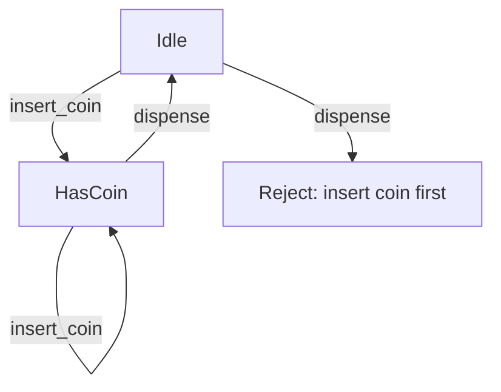

# State

## Intent

Allow an object to alter its behavior when its internal state changes. The object will appear to change its class.

This demo models a **vending machine** transitioning between **Idle** and **HasCoin** states.

## Run

```bash
python3 behavioral/state/demo.py
```

## Class Diagram



## Sequence Diagram



## Flowchart



## Pros and Cons

| Pros | Cons |
| ---- | ---- |
| Eliminates large conditional state machines | Many classes for simple state counts |
| Single Responsibility per state | Context must delegate every state-dependent call |
| Open/Closed — add states without changing context | State transitions can be scattered |

## Distributed Environments

State pattern maps to **workflow engines** and **finite state machines** in distributed systems:

- **Saga orchestrators** track long-running transaction states (pending → committed → compensated).
- **AWS Step Functions / Temporal** encode state machines that survive process restarts.
- **Order fulfillment** pipelines (placed → paid → shipped → delivered) use explicit state objects.

Persist state externally (database, Redis) so machines survive node failures. Use **idempotent transitions** and guard against duplicate events in message-driven state changes.

## References

- [State — Refactoring.Guru](https://refactoring.guru/design-patterns/state)
- [State pattern — Wikipedia](https://en.wikipedia.org/wiki/State_pattern)
