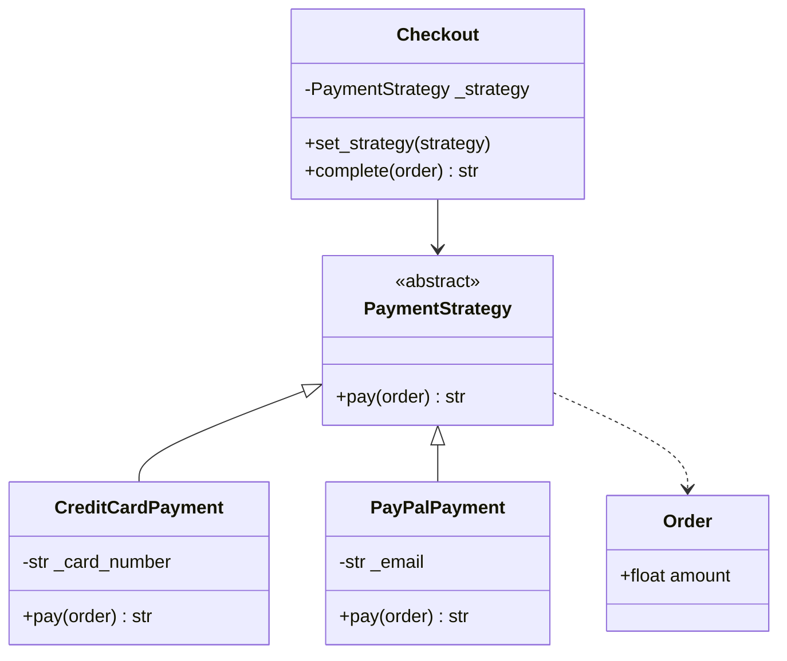
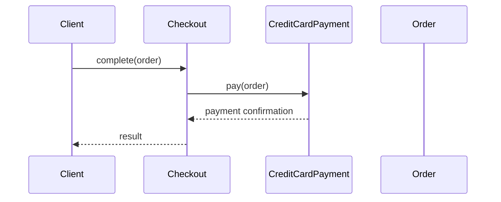
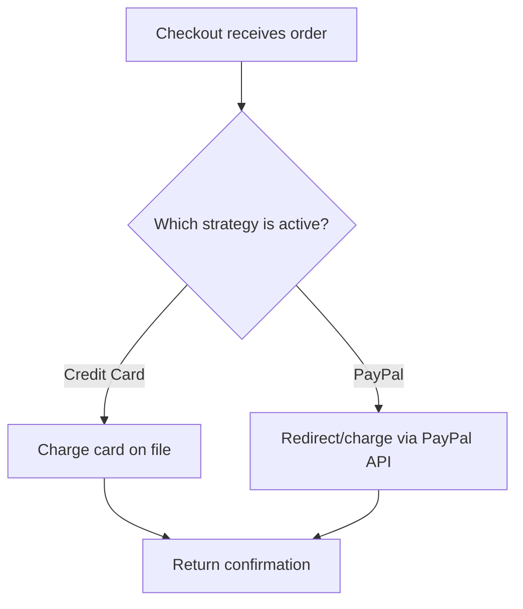

# Strategy

## Intent

Define a family of algorithms, encapsulate each one, and make them interchangeable. Strategy lets the algorithm vary independently from clients that use it.

This demo implements **Credit Card** and **PayPal** payment strategies at checkout.

## Run

```bash
python3 behavioral/strategy/demo.py
```

## Class Diagram



## Sequence Diagram



## Flowchart



## Pros and Cons

| Pros | Cons |
| ---- | ---- |
| Swap algorithms at runtime | Clients must know which strategy to pick |
| Isolates algorithm implementation details | Increased number of classes |
| Replaces conditionals with composition | Over-engineering for single-algorithm cases |

## Distributed Environments

Strategy appears in **pluggable backends** and **multi-provider integrations**:

- **Payment gateways** (Stripe, Adyen, Braintree) selected per region or customer preference.
- **Storage drivers** (S3, GCS, Azure Blob) chosen via configuration.
- **Load balancing algorithms** (round-robin, least-connections) swapped in API gateways.

Register strategies via **dependency injection** or **plugin registries**. In microservices, expose strategy selection through feature flags or tenant configuration without redeploying.

## References

- [Strategy — Refactoring.Guru](https://refactoring.guru/design-patterns/strategy)
- [Strategy pattern — Wikipedia](https://en.wikipedia.org/wiki/Strategy_pattern)
